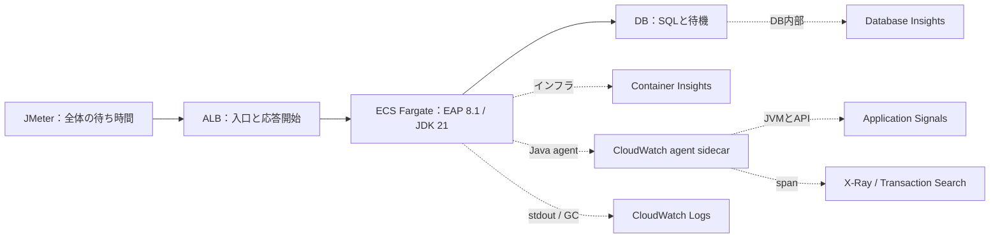
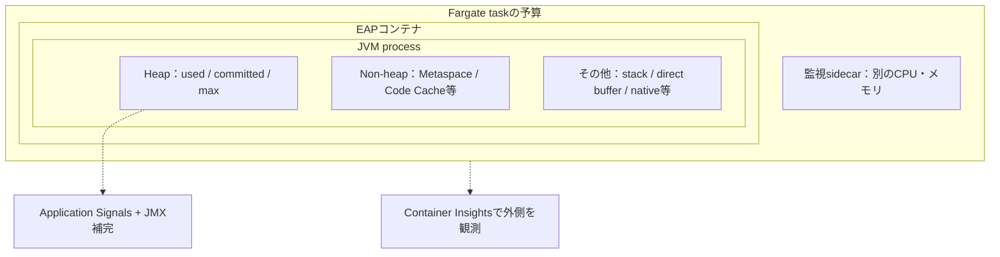
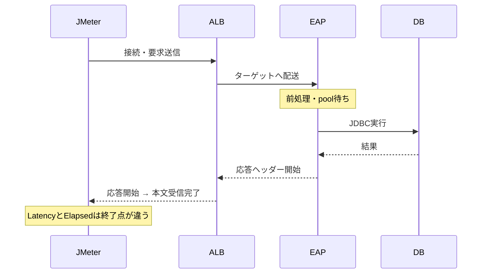

# JMeter × AWS 全体パフォーマンステスト 監視・分析ガイド

**ECS Fargate / JBoss EAP 8.1 / Red Hat build of OpenJDK 21**

公式情報確認日：2026-10-02（日本時間）

Excel版と本文・根拠を共通化しています。Markdownは表示アプリがフォントを決めるため、Meiryo UIの指定はExcel版へ適用しています。

## まず答えと前提

**今回の前提**：ユーザー指定：JBoss EAP 8.1、Red Hat build of OpenJDK 21、ECS Fargate。Linuxコンテナを説明例にする。ALB・DB・キャッシュ等の採用状況は未指定なので、利用時のみ読む項目とする。 [S45 EAP 8のサポート構成](https://access.redhat.com/articles/6961381) / [S46 EAP 8.1の対応構成・コンテナ](https://docs.redhat.com/en/documentation/red_hat_jboss_enterprise_application_platform/8.1/html/release_notes_for_red_hat_jboss_enterprise_application_platform_8.1/supported-configurations-rn_assembly-release-notes)

**最初の答え**：コンテナ全体はCloudWatchのAWS/ECSとECS/ContainerInsights。JVMヒープ・GC・スレッドは、計装を追加したApplication Signals（ApplicationSignals名前空間）が第一候補。Xmx・committed・EAPの接続プールなど不足する指標はJMX等で補う。 [S01 Application Signalsの収集指標](https://docs.aws.amazon.com/AmazonCloudWatch/latest/monitoring/AppSignals-MetricsCollected.html) / [S05 ECS Enhanced Container Insights指標](https://docs.aws.amazon.com/AmazonCloudWatch/latest/monitoring/Container-Insights-enhanced-observability-metrics-ECS.html) / [S06 ECSのCloudWatch監視](https://docs.aws.amazon.com/AmazonECS/latest/developerguide/cloudwatch-metrics.html) / [S53 Java 21 MemoryUsage](https://docs.oracle.com/en/java/javase/21/docs/api/java.management/java/lang/management/MemoryUsage.html)

**大切な区別**：FargateのMemoryUtilizationはJVMヒープ使用率ではない。部屋全体の荷物の量と、その部屋に置かれた机の上の量は違う。JVM外・ヒープ外・監視用コンテナにもメモリが必要。 [S05 ECS Enhanced Container Insights指標](https://docs.aws.amazon.com/AmazonCloudWatch/latest/monitoring/Container-Insights-enhanced-observability-metrics-ECS.html) / [S53 Java 21 MemoryUsage](https://docs.oracle.com/en/java/javase/21/docs/api/java.management/java/lang/management/MemoryUsage.html) / [S54 Java 21 MemoryMXBean](https://docs.oracle.com/en/java/javase/21/docs/api/java.management/java/lang/management/MemoryMXBean.html)

**何を組み合わせるか**：JMeterで利用者の待ち時間、AWS標準指標で入口と土台、Application SignalsでAPIとJVM、X-Ray/Transaction Searchで1件の道のり、Logs Insightsで理由、Database InsightsでDBの待ちを調べる。 [S01 Application Signalsの収集指標](https://docs.aws.amazon.com/AmazonCloudWatch/latest/monitoring/AppSignals-MetricsCollected.html) / [S19 CloudWatch Database Insights](https://docs.aws.amazon.com/AmazonCloudWatch/latest/monitoring/Database-Insights.html) / [S34 CloudWatch Logs Insights](https://docs.aws.amazon.com/AmazonCloudWatch/latest/logs/AnalyzingLogData.html) / [S36 CloudWatch Transaction Search](https://docs.aws.amazon.com/AmazonCloudWatch/latest/monitoring/CloudWatch-Transaction-Search.html) / [S59 JMeter用語集](https://jmeter.apache.org/usermanual/glossary.html)

**資料の性質**：2026-10-02に公式Web資料を確認した設計・学習資料。AWSアカウントへの接続、環境変更、実負荷試験は行っていない。図・数値例・閾値案は学習用であり、実測値やAWSの保証値ではない。

**互換性の境界**：EAPとJDKの対応、Fargateでのコンテナ実行、ADOTのライブラリ計装、Red Hatのサポート契約は別々に確認する。WildFlyの対応表だけでEAP 8.1の個別イメージや業務アプリの完全動作を保証しない。 [S04 Application Signals対応システム](https://docs.aws.amazon.com/AmazonCloudWatch/latest/monitoring/CloudWatch-Application-Signals-supportmatrix.html) / [S40 OpenTelemetry Java対応ライブラリ](https://github.com/open-telemetry/opentelemetry-java-instrumentation/blob/main/docs/supported-libraries.md) / [S45 EAP 8のサポート構成](https://access.redhat.com/articles/6961381) / [S46 EAP 8.1の対応構成・コンテナ](https://docs.redhat.com/en/documentation/red_hat_jboss_enterprise_application_platform/8.1/html/release_notes_for_red_hat_jboss_enterprise_application_platform_8.1/supported-configurations-rn_assembly-release-notes)

**読む順番**：初めての方：図解→基礎→メモリ深掘り。担当者：サービス比較→指標一覧→収集設定→設定例→テスト手順。問題が起きたら障害切分とFAQへ。各行の根拠IDから公式資料へ進める。

## 目次

- [01 動作の図解](#chapter-01)
- [02 数字・記録・道のりを区別する](#chapter-02)
- [03 なぜ監視の道具が増えたのか](#chapter-03)
- [04 どのAWSサービス・機能で何を見るか](#chapter-04)
- [05 JMeterからEAPに入るまでの指標](#chapter-05)
- [06 Fargateの外側とコンテナの指標](#chapter-06)
- [07 DB・キャッシュ・非同期・ストレージの指標](#chapter-07)
- [08 JBoss EAPのJVMはどの指標で見るか](#chapter-08)
- [09 部屋・机・引き出しで理解するJVMメモリ](#chapter-09)
- [10 JVMの中で動くJBoss EAPの待ちを調べる](#chapter-10)
- [11 FargateからJVM情報を届ける仕組み](#chapter-11)
- [12 設定・診断・検索の例](#chapter-12)
- [13 1回のAPIの旅を追う](#chapter-13)
- [14 JMeterの数字を正しくAWSへつなぐ](#chapter-14)
- [15 準備から報告までの具体的な手順](#chapter-15)
- [16 症状から次に見る証拠を選ぶ](#chapter-16)
- [17 試験中に並べるグラフと見る順番](#chapter-17)
- [18 数値例と計算](#chapter-18)
- [19 正しく測り続けるための設定](#chapter-19)
- [20 よくある疑問に明確に答える](#chapter-20)
- [21 実行チェックリスト](#chapter-21)
- [22 公式資料一覧](#chapter-22)

<a id="chapter-01"></a>

## 01 動作の図解

### ① 注文の道と、監視データの道

実線のHTTP経路と監視データの転送は別。図のALB・DBは代表例であり、採用済みという意味ではない。



[S02 Application SignalsをECSで有効化](https://docs.aws.amazon.com/AmazonCloudWatch/latest/monitoring/CloudWatch-Application-Signals-Enable-ECSMain.html) / [S03 Application Signalsのsidecar設定](https://docs.aws.amazon.com/AmazonCloudWatch/latest/monitoring/CloudWatch-Application-Signals-ECS-Sidecar.html) / [S05 ECS Enhanced Container Insights指標](https://docs.aws.amazon.com/AmazonCloudWatch/latest/monitoring/Container-Insights-enhanced-observability-metrics-ECS.html) / [S19 CloudWatch Database Insights](https://docs.aws.amazon.com/AmazonCloudWatch/latest/monitoring/Database-Insights.html) / [S36 CloudWatch Transaction Search](https://docs.aws.amazon.com/AmazonCloudWatch/latest/monitoring/CloudWatch-Transaction-Search.html)

### ② メモリは入れ子。ただし計測の合計は単純ではない

task、container、JVM、heapは異なる境界。committed、RSS、予約量、cacheの扱いが違うので、単純な引き算だけでnative memoryを確定しない。



[S05 ECS Enhanced Container Insights指標](https://docs.aws.amazon.com/AmazonCloudWatch/latest/monitoring/Container-Insights-enhanced-observability-metrics-ECS.html) / [S53 Java 21 MemoryUsage](https://docs.oracle.com/en/java/javase/21/docs/api/java.management/java/lang/management/MemoryUsage.html) / [S54 Java 21 MemoryMXBean](https://docs.oracle.com/en/java/javase/21/docs/api/java.management/java/lang/management/MemoryMXBean.html) / [S57 Java 21 Native Memory Tracking](https://docs.oracle.com/en/java/javase/21/vm/native-memory-tracking.html)

### ③ 同じ要求でも時計の区間が違う

架空例：client接続等30ms＋入口/配送20ms＋EAP540ms＋本文受信10ms＝Elapsed600ms。EAP540msの内訳は自処理80ms＋pool待ち100ms＋JDBC360ms。実際には区間の重なりや並行処理を考慮する。



[S10 ALBのCloudWatch指標](https://docs.aws.amazon.com/elasticloadbalancing/latest/application/load-balancer-cloudwatch-metrics.html) / [S11 ALBアクセスログ](https://docs.aws.amazon.com/elasticloadbalancing/latest/application/load-balancer-access-logs.html) / [S36 CloudWatch Transaction Search](https://docs.aws.amazon.com/AmazonCloudWatch/latest/monitoring/CloudWatch-Transaction-Search.html) / [S59 JMeter用語集](https://jmeter.apache.org/usermanual/glossary.html)

Mermaid非対応の閲覧環境ではコードとして表示されます。Excel版では同じ概念を図として表示しています。

<a id="chapter-02"></a>

## 02 数字・記録・道のりを区別する

学校の給食をAPIにたとえる。JMeterは注文を出す人、ALBは受付、EAPは調理場、DBは食材倉庫。たとえの後で正式な用語を説明する。

### API

**やさしく理解**：『カレーを1つください』という決められた注文口。

**動作原理・正確な意味**：HTTPリクエストを受けて処理し、ステータスと本文を返す入口。1回のAPI内でDBや別サービスを何度も呼ぶ場合がある。

**テストでの使い方・注意**：同じURLでも検索条件・件数・本文サイズで負荷は変わる。API名とシナリオを対応付ける。

### メトリクス

**やさしく理解**：1分ごとの注文数や、調理場の混み具合を数字にした記録。

**動作原理・正確な意味**：時間に沿って蓄積する数値。どの範囲の何を何秒ごとに測ったかが必須。数字だけでは個別の注文の事情を特定できない。

**テストでの使い方・注意**：CPU高騰とAPI遅延が同時に起きたら手掛かり。ただし同時発生だけで因果関係は決まらない。

[S33 CloudWatchのメトリクス概念](https://docs.aws.amazon.com/AmazonCloudWatch/latest/monitoring/cloudwatch_concepts.html)

### ログ

**やさしく理解**：『10時3分、食材が届かず注文17が失敗』という日記。

**動作原理・正確な意味**：アプリやサービスが出した出来事の記録。記録していない情報は検索しても出ない。GCログとアクセスログは目的が違う。

**テストでの使い方・注意**：時刻、API、task ID、trace ID、例外の種類を結び付ける。機密の本文・認証情報は出力しない。

[S34 CloudWatch Logs Insights](https://docs.aws.amazon.com/AmazonCloudWatch/latest/logs/AnalyzingLogData.html) / [S62 ECSのawslogs](https://docs.aws.amazon.com/AmazonECS/latest/developerguide/using_awslogs.html)

### トレース / span

**やさしく理解**：1枚の注文票に、受付・調理・倉庫でかかった時間を書く。

**動作原理・正確な意味**：traceは1つの処理のつながり、spanはその一部分。親子関係とIDでHTTPやJDBCの呼出しを関連付ける。

**テストでの使い方・注意**：遅い1件を選び、DB・外部API・アプリ内部のどこが長いかを見る。計装していない区間は空白になる。

[S36 CloudWatch Transaction Search](https://docs.aws.amazon.com/AmazonCloudWatch/latest/monitoring/CloudWatch-Transaction-Search.html) / [S40 OpenTelemetry Java対応ライブラリ](https://github.com/open-telemetry/opentelemetry-java-instrumentation/blob/main/docs/supported-libraries.md)

### プロファイル

**やさしく理解**：料理人がどの作業に手を動かしていたかを、細かく観察する。

**動作原理・正確な意味**：コードの実行・割当・ロック等を調べる。トレースが示す『このspanが遅い』を、JFR等でメソッドや待機へ絞る。

**テストでの使い方・注意**：遅延を見つけた後の深掘り。すべての負荷試験で重いダンプを取る必要はない。

[S56 Java 21 jcmd](https://docs.oracle.com/en/java/javase/21/docs/specs/man/jcmd.html) / [S58 Red Hat build of OpenJDK 21の配布](https://docs.redhat.com/en/documentation/red_hat_build_of_openjdk/21/html/getting_started_with_red_hat_build_of_openjdk_21/openjdk-distribution-selection)

### レイテンシと完了時間

**やさしく理解**：最初の返事までと、お皿を全部受け取るまでの時間は違う。

**動作原理・正確な意味**：JMeter Latencyは最初の応答まで、Elapsedはサンプル完了まで。ALBのTargetResponseTimeは応答ヘッダー開始までの別区間。

**テストでの使い方・注意**：同じ『Latency』という名前でも区間が違う。単位をmsへ揃えてから比べる。差分はあくまで調査の入口。

[S10 ALBのCloudWatch指標](https://docs.aws.amazon.com/elasticloadbalancing/latest/application/load-balancer-cloudwatch-metrics.html) / [S59 JMeter用語集](https://jmeter.apache.org/usermanual/glossary.html)

### RPS / スループット

**やさしく理解**：1秒に何人へ給食を渡せたか。

**動作原理・正確な意味**：処理量を時間で割った値。要求の開始件数、完了件数、成功件数は別。再試行や非同期受付によって件数も違う。

**テストでの使い方・注意**：成功RPS・全RPS・失敗率を同時に見る。早いエラーが増えると平均時間だけは改善することがある。

[S59 JMeter用語集](https://jmeter.apache.org/usermanual/glossary.html)

### p50・p95・p99

**やさしく理解**：100人を待ち時間順に並べ、真ん中・95番目・99番目を見る。

**動作原理・正確な意味**：分位点。平均に隠れる少数の遅い処理を見るために使う。厳密な補間方法はツールに依存する。

**テストでの使い方・注意**：標本数も保存する。各分のp95を平均しても全期間のp95にはならない。API別・負荷段階別に元データから集計。

[S33 CloudWatchのメトリクス概念](https://docs.aws.amazon.com/AmazonCloudWatch/latest/monitoring/cloudwatch_concepts.html)

### 飽和と待ち行列

**やさしく理解**：料理人が全員働いていると、新しい注文は列に並ぶ。

**動作原理・正確な意味**：使用率が上限に近付くと待ち時間が急増し得る。CPUだけでなく接続プール・worker・外部サービスにも上限がある。

**テストでの使い方・注意**：低CPUでもプール待ちやロック待ちなら遅い。CPU使用率だけを合否条件にしない。

[S49 EAP 8.1の接続プール](https://docs.redhat.com/en/documentation/red_hat_jboss_enterprise_application_platform/8.1/html/performance_tuning_for_red_hat_jboss_enterprise_application_platform/assembly-datasource-resource-adapter-tuning_performance-tuning-guide) / [S50 EAP 8.1の管理属性リファレンス](https://docs.redhat.com/en/documentation/red_hat_jboss_enterprise_application_platform/8.1/html/configuration_guide/reference_material)

### 名前空間

**やさしく理解**：数字のノートに付いた『受付』『調理場』という分類名。

**動作原理・正確な意味**：CloudWatchのNamespace。同名のCPUUtilizationでもAWS/ECSとAWS/RDSでは測る対象が違う。

**テストでの使い方・注意**：資料の正式名を名前空間とセットで使う。カスタム指標は例としてPerfTest/JBossEAPを使う。

[S17 RDSのCloudWatch指標](https://docs.aws.amazon.com/AmazonRDS/latest/UserGuide/rds-metrics.html) / [S33 CloudWatchのメトリクス概念](https://docs.aws.amazon.com/AmazonCloudWatch/latest/monitoring/cloudwatch_concepts.html)

### ディメンション

**やさしく理解**：同じ注文数でも『1組』『2組』の札で分ける。

**動作原理・正確な意味**：ClusterName、ServiceName、TaskId等の組合せが時系列を識別する。フィルター対象を変えると別の集計になる。

**テストでの使い方・注意**：サービス平均で正常でも1タスクだけ異常な場合がある。タスク交代前後を分けて比較する。

[S05 ECS Enhanced Container Insights指標](https://docs.aws.amazon.com/AmazonCloudWatch/latest/monitoring/Container-Insights-enhanced-observability-metrics-ECS.html) / [S33 CloudWatchのメトリクス概念](https://docs.aws.amazon.com/AmazonCloudWatch/latest/monitoring/cloudwatch_concepts.html)

### Sum / Average / Maximum

**やさしく理解**：今日の注文数は足し算、机の混み具合は平均や最大で見る。

**動作原理・正確な意味**：イベント件数はSum、使用量の瞬間値はAverage/Maximumが基本。既に秒当たりの指標をSumすると意味が変わる。

**テストでの使い方・注意**：指標固有の例外を優先。ALB RequestCountPerTargetはSumが有効だが、その値はターゲット当たり平均。

[S10 ALBのCloudWatch指標](https://docs.aws.amazon.com/elasticloadbalancing/latest/application/load-balancer-cloudwatch-metrics.html) / [S33 CloudWatchのメトリクス概念](https://docs.aws.amazon.com/AmazonCloudWatch/latest/monitoring/cloudwatch_concepts.html)

### ゲージとカウンター

**やさしく理解**：体温計と、スタートしてからの歩数計の違い。

**動作原理・正確な意味**：使用メモリはゲージ。JMXのGC回数は累積カウンター。累積値は差分を期間で割り、再起動によるゼロ復帰を考慮する。

**テストでの使い方・注意**：GC累積時間の生値をSumしない。Application SignalsとJMXで送信形式・単位が同じとは限らない。

[S01 Application Signalsの収集指標](https://docs.aws.amazon.com/AmazonCloudWatch/latest/monitoring/AppSignals-MetricsCollected.html) / [S41 CloudWatch agentのJMX収集](https://docs.aws.amazon.com/AmazonCloudWatch/latest/monitoring/CloudWatch-Agent-JMX-metrics.html)

### 収集間隔 / 表示期間

**やさしく理解**：1分に1回写真を撮っても、間に起きた1秒の出来事は写らない。

**動作原理・正確な意味**：測定頻度とグラフの集約幅は別。送信遅延もある。Maximumでも未観測のピークは復元できない。

**テストでの使い方・注意**：1分指標で短いGC停止を否定しない。GCログ・トレースと、必要時の細かなカスタム計測で補う。

[S07 ECSサービス使用率と高解像度指標](https://docs.aws.amazon.com/AmazonECS/latest/developerguide/service_utilization.html) / [S33 CloudWatchのメトリクス概念](https://docs.aws.amazon.com/AmazonCloudWatch/latest/monitoring/cloudwatch_concepts.html)

### 欠測

**やさしく理解**：記録用紙が空欄なら、注文ゼロなのか、記録係が不在なのかを調べる。

**動作原理・正確な意味**：No dataは0ではない。停止タスク、送信障害、次元違い、権限不足、有効化前等で指標がなくなる。

**テストでの使い方・注意**：低負荷時の疎なエラー件数と監視停止を区別する。アラームの欠測扱いも指標ごとに決める。

[S06 ECSのCloudWatch監視](https://docs.aws.amazon.com/AmazonECS/latest/developerguide/cloudwatch-metrics.html) / [S33 CloudWatchのメトリクス概念](https://docs.aws.amazon.com/AmazonCloudWatch/latest/monitoring/cloudwatch_concepts.html)

### SLOと合否

**やさしく理解**：『ほとんどの人へ5分以内に配る』という約束。

**動作原理・正確な意味**：要求から決めるサービス目標。例：成功RPS、API別p95/p99、エラー率、継続時間、回復時間。

**テストでの使い方・注意**：CPU80%やヒープ70%は万人共通の合格基準ではない。業務の締切と容量余裕から決める。

[S78 Application Signals一般提供](https://aws.amazon.com/about-aws/whats-new/2024/06/amazon-cloudwatch-application-signals-application-monitoring/)

<a id="chapter-03"></a>

## 03 なぜ監視の道具が増えたのか

登場年月は公式発表で確認。『必要になった理由』は発表内容とシステム構造を基にした解説。昔の発表ページにある当時の制限・料金を現在仕様として扱わない。

### 2009年5月

**登場・変化**：Amazon CloudWatch

**その前に困っていたこと**：借りた仮想サーバーが忙しいかを共通の仕組みで測り、自動増減へ結び付けたかった。

**今回へのつながり**：CPU等の数字を集める土台。ただしアプリ内部の事情は追加計装が必要。

[S65 CloudWatch登場の公式発表](https://aws.amazon.com/blogs/aws/new-aws-load-balancing-automatic-scaling-and-cloud-monitoring-services/)

### 2014-07-10

**登場・変化**：CloudWatch Logs

**その前に困っていたこと**：サーバーごとに日記が散らばり、交換・停止後に原因の記録を追いにくかった。

**今回へのつながり**：EAPとGCログをタスク外へ残す。ログを持ち出して初めて停止後も分析できる。

[S66 CloudWatch Logsの登場](https://aws.amazon.com/about-aws/whats-new/2014/07/10/introducing-amazon-cloudwatch-logs/)

### 2017-04-19

**登場・変化**：AWS X-Ray一般提供

**その前に困っていたこと**：1つの要求が複数サービスを通り、別々のログだけではどこが遅いかつなぎにくかった。

**今回へのつながり**：HTTP・JDBC等の道のりをtraceとして見る。メモリの中身を見る機能とは役割が違う。

[S67 X-Ray一般提供](https://aws.amazon.com/about-aws/whats-new/2017/04/aws-x-ray-now-generally-available/)

### 2017-11-29

**登場・変化**：AWS Fargate

**その前に困っていたこと**：コンテナを動かす前に、土台のサーバー確保・保守・容量調整が必要だった。

**今回へのつながり**：ホスト管理はAWSに任せる。その結果、利用者の観察対象はサービス・タスク・コンテナ・アプリになる。

[S68 Fargateの登場](https://aws.amazon.com/about-aws/whats-new/2017/11/introducing-aws-fargate-a-technology-to-run-containers-without-managing-infrastructure/)

### 2017-12-14

**登場・変化**：統合CloudWatch agent

**その前に困っていたこと**：OS内部の数値とログを集める道具が分かれ、運用が複雑だった。

**今回へのつながり**：収集係の統合。現在のFargate向けAPMではsidecarとして使う構成がある。

[S69 統合CloudWatch agentの登場](https://aws.amazon.com/about-aws/whats-new/2017/12/amazon-cloudwatch-introduces-a-new-cloudwatch-agent-with-aws-systems-manager-integration-for-unified-metrics-and-logs-collection/) / [S03 Application Signalsのsidecar設定](https://docs.aws.amazon.com/AmazonCloudWatch/latest/monitoring/CloudWatch-Application-Signals-ECS-Sidecar.html)

### 2018-11-27

**登場・変化**：Logs Insights一般提供

**その前に困っていたこと**：大量の日記を目で読むだけでは、失敗数や遅いAPIの傾向をすぐに探せなかった。

**今回へのつながり**：時刻と条件で検索し、その場で集計する。

[S70 Logs Insights一般提供](https://aws.amazon.com/about-aws/whats-new/2018/11/announcing-amazon-cloudwatch-logs-insights-fast-interactive-log-analytics/)

### 2019年

**登場・変化**：OpenTelemetry誕生

**その前に困っていたこと**：製品ごとに計装方式が分かれ、送信先を変えるたびにアプリの変更が増えた。

**今回へのつながり**：OpenTracingとOpenCensusを統合。計測・伝送の共通言語を作り、収集先を選びやすくした。

[S72 OpenTelemetryの誕生](https://www.cncf.io/blog/2019/05/21/a-brief-history-of-opentelemetry-so-far/)

### 2019-08-30

**登場・変化**：Container Insights一般提供

**その前に困っていたこと**：短命なコンテナが増え、個々のCPUやメモリを名前と結び付けるのが大変だった。

**今回へのつながり**：ECSの構造に沿った画面・集計を用意。標準機能だけではJVM内部まではわからない。

[S71 Container Insights一般提供](https://aws.amazon.com/about-aws/whats-new/2019/08/container-monitoring-for-amazon-ecs-eks-and-kubernetes-is-now-available-in-amazon-cloudwatch/)

### 2020-04-23

**登場・変化**：CloudWatch Synthetics一般提供

**その前に困っていたこと**：利用者がいない時間も、注文口が本当に使えるか確かめたかった。

**今回へのつながり**：少量の定期的な試し注文。JMeterの大量負荷と組み合わせる補助役。

[S73 Synthetics一般提供](https://aws.amazon.com/about-aws/whats-new/2020/04/amazon-cloudwatch-synthetics-generally-available/)

### 2020-10-21

**登場・変化**：ADOTプレビュー

**その前に困っていたこと**：OpenTelemetryをAWS環境で収集・送信しやすくし、AWSリソースと関連付けたかった。

**今回へのつながり**：Java agentとCollectorの役割を分けて理解する。ADOT自体はデータを見るWebサービスではない。

[S74 ADOTプレビュー](https://aws.amazon.com/about-aws/whats-new/2020/10/announcing-aws-distro-for-opentelemetry-in-preview/)

### 2021年8・9月

**登場・変化**：Managed Grafana / AMP一般提供

**その前に困っていたこと**：見やすい画面やPrometheus保存基盤のために、別途サーバーを保守していた。

**今回へのつながり**：Grafanaは画面、AMPはPrometheus互換保存基盤。JVMの詳細指標を扱う選択肢が広がった。

[S75 Managed Grafana一般提供](https://aws.amazon.com/blogs/aws/amazon-managed-grafana-is-now-generally-available-with-many-new-features/) / [S76 AMP一般提供](https://press.aboutamazon.com/2021/9/aws-announces-general-availability-of-amazon-managed-service-for-prometheus)

### 2021-11-29

**登場・変化**：CloudWatch RUM

**その前に困っていたこと**：サーバーが速くても、利用者のブラウザーでは遅いことがあった。

**今回へのつながり**：実利用者の画面側を観察。通常のJMeter HTTP SamplerはブラウザーのJavaScriptを実行しない。

[S77 CloudWatch RUMの登場](https://aws.amazon.com/blogs/aws/cloudwatch-rum/) / [S60 JMeter Best Practices](https://jmeter.apache.org/usermanual/best-practices.html)

### 2024-06-10

**登場・変化**：Application Signals一般提供

**その前に困っていたこと**：CPUとログとtraceを人がつなぐだけでは、API単位の健康状態とSLOを管理しにくかった。

**今回へのつながり**：API・依存先・ランタイムの数字を同じ文脈で見るAPMへ。

[S78 Application Signals一般提供](https://aws.amazon.com/about-aws/whats-new/2024/06/amazon-cloudwatch-application-signals-application-monitoring/)

### 2024-11-21

**登場・変化**：Transaction Search一般提供

**その前に困っていたこと**：少数の遅い処理や業務属性を、柔軟に検索する必要が増えた。

**今回へのつながり**：spanを検索可能な構造化ログとして扱う。未送信のspanを後から取り戻す機能ではない。

[S79 Transaction Search一般提供](https://aws.amazon.com/about-aws/whats-new/2024/11/amazon-cloudwatch-visibility-application-transactions/) / [S36 CloudWatch Transaction Search](https://docs.aws.amazon.com/AmazonCloudWatch/latest/monitoring/CloudWatch-Transaction-Search.html)

### 2024-12-01

**登場・変化**：Database Insights一般提供

**その前に困っていたこと**：DBごとの画面だけでは、アプリ全体とDB群の問題を関連付けにくかった。

**今回へのつながり**：DB Load・SQL・待機・ログをまとめ、アプリ依存先から掘り下げる。

[S80 Database Insights一般提供](https://aws.amazon.com/about-aws/whats-new/2024/12/amazon-cloudwatch-database-insights/)

### 2024-12-02

**登場・変化**：ECS向けContainer Insights拡張

**その前に困っていたこと**：平均だけでは、特定タスク・特定コンテナの異常を見落としやすかった。

**今回へのつながり**：enhancedでTaskIdやContainerNameを使って調べる。

[S09 Container InsightsのECS概要](https://docs.aws.amazon.com/AmazonECS/latest/developerguide/cloudwatch-container-insights.html)

### 2026-02-25

**登場・変化**：X-Ray SDK/daemonがメンテナンスモード

**その前に困っていたこと**：新規の計装をOpenTelemetryへ集約する方向へ変化。

**今回へのつながり**：新規構成ではOTel/ADOTを優先。X-Rayサービスの終了ではない。現行の公式日程の終了欄はN/Aであり、古い記事の2027年終了を確定事項にしない。

[S38 X-Ray SDK/daemonのサポート日程](https://docs.aws.amazon.com/xray/latest/devguide/xray-sdk-daemon-timeline.html) / [S39 X-RayからOpenTelemetryへの移行](https://docs.aws.amazon.com/xray/latest/devguide/xray-sdk-migration.html)

### 2026-05-21

**登場・変化**：OpenTelemetryがCNCF Graduatedへ

**その前に困っていたこと**：共通計装が多数の利用者・提供者に使われ、プロジェクトの成熟が評価された。

**今回へのつながり**：個別agentの動作保証とは別だが、標準化を選ぶ背景になる。

[S83 OpenTelemetryのCNCF Graduation](https://www.cncf.io/announcements/2026/05/21/cloud-native-computing-foundation-announces-opentelemetrys-graduation-solidifying-status-as-the-de-facto-observability-standard/)

### 2026-06-18

**登場・変化**：ECSサービスの20秒指標

**その前に困っていたこと**：急な増加に対し、従来の1分指標ではスケール判断が遅れやすかった。

**今回へのつながり**：CPU/メモリの高解像度を選択可能。自動で全指標が20秒になるわけではない。

[S81 ECSの20秒指標の発表](https://aws.amazon.com/about-aws/whats-new/2026/06/amazon-ecs-faster-autoscaling/) / [S07 ECSサービス使用率と高解像度指標](https://docs.aws.amazon.com/AmazonECS/latest/developerguide/service_utilization.html)

### 2026-07-23

**登場・変化**：ALBログのCloudWatch Logs配信

**その前に困っていたこと**：入口のログを他のCloudWatchログと同じ場所で検索したかった。

**今回へのつながり**：S3経由だけでなく、ALBのIntegrationsからCloudWatch Logs等への配信を選べる。

[S82 ALBログのCloudWatch連携の発表](https://aws.amazon.com/about-aws/whats-new/2026/07/amazon-cloudwatch-logs/) / [S13 ALBのCloudWatch Logs連携](https://docs.aws.amazon.com/elasticloadbalancing/latest/application/load-balancer-cloudwatch-logs.html)

### 2026-07-31

**登場・変化**：RDS Performance Insightsの移行日

**その前に困っていたこと**：DB監視をDatabase Insightsにまとめる変更。

**今回へのつながり**：現行ガイドは移行済みと案内。PI API文書は継続。Standardは7日無料＋有償1～24か月、Advancedは1～24か月をモード料金に含む。古い保持期間表を流用しない。

[S19 CloudWatch Database Insights](https://docs.aws.amazon.com/AmazonCloudWatch/latest/monitoring/Database-Insights.html) / [S22 Database Insightsと従来API](https://docs.aws.amazon.com/AmazonRDS/latest/UserGuide/USER_PerfInsights.html)

<a id="chapter-04"></a>

## 04 どのAWSサービス・機能で何を見るか

CloudWatchはサービス名、Container InsightsやApplication Signalsはその機能名。収集するソフト、保存する場所、見る画面を混同しない。優先度は本資料の提案。

### 最優先：CloudWatch Metrics / Dashboard / Alarm

**やさしく理解**：全体の温度計と掲示板とベル。

**動作原理・正確な意味**：AWS各サービスの指標とカスタム指標を時系列で保存し、比較・数式・通知に使う。AWS標準指標と追加有効化が必要な指標がある。

**テストでの使い方・注意**：JMeter、ALB、ECS、JVM、DBを同じ時間範囲で並べる。アラームは合否判定のすべてを代行しない。

[S33 CloudWatchのメトリクス概念](https://docs.aws.amazon.com/AmazonCloudWatch/latest/monitoring/cloudwatch_concepts.html)

### 最優先：Container Insights（enhanced）

**やさしく理解**：建物→教室→机という順で、どこが混んでいるか見る。

**動作原理・正確な意味**：ECSのサービス・タスク・コンテナ別にCPU、メモリ、ネットワーク、状態を扱う。通常はECS/ContainerInsightsを参照。

**テストでの使い方・注意**：クラスターのenhancedを事前有効化。タスク単位の偏りを発見する。標準のインフラ収集だけではヒープ/GCは出ない。

[S05 ECS Enhanced Container Insights指標](https://docs.aws.amazon.com/AmazonCloudWatch/latest/monitoring/Container-Insights-enhanced-observability-metrics-ECS.html) / [S08 Container Insightsの設定](https://docs.aws.amazon.com/AmazonCloudWatch/latest/monitoring/deploy-container-insights-ECS-cluster.html)

### 最優先：Application Signals

**やさしく理解**：注文口ごとの混み具合と調理場の状態を一緒に見る。

**動作原理・正確な意味**：計装したアプリのAPI・依存先のAPM指標を扱い、Javaランタイム情報も同じサービス文脈で見られる。

**テストでの使い方・注意**：EAPへADOT Java agent、同一タスクへCloudWatch agentを設定するのが基本候補。JVMの全属性を自動収集するわけではない。

[S01 Application Signalsの収集指標](https://docs.aws.amazon.com/AmazonCloudWatch/latest/monitoring/AppSignals-MetricsCollected.html) / [S02 Application SignalsをECSで有効化](https://docs.aws.amazon.com/AmazonCloudWatch/latest/monitoring/CloudWatch-Application-Signals-Enable-ECSMain.html) / [S03 Application Signalsのsidecar設定](https://docs.aws.amazon.com/AmazonCloudWatch/latest/monitoring/CloudWatch-Application-Signals-ECS-Sidecar.html)

### 最優先：AWS X-Ray

**やさしく理解**：遅かった1枚の注文票の経路図。

**動作原理・正確な意味**：計装済みspan/segmentを集め、親子関係・時間・エラーを分析。サンプリングされる場合がある。

**テストでの使い方・注意**：Servlet/JAX-RS、JDBC、HTTP client等が採用agentで計装されるか確認。SQLのDB内部待機はDatabase Insightsで補う。

[S36 CloudWatch Transaction Search](https://docs.aws.amazon.com/AmazonCloudWatch/latest/monitoring/CloudWatch-Transaction-Search.html) / [S39 X-RayからOpenTelemetryへの移行](https://docs.aws.amazon.com/xray/latest/devguide/xray-sdk-migration.html) / [S40 OpenTelemetry Java対応ライブラリ](https://github.com/open-telemetry/opentelemetry-java-instrumentation/blob/main/docs/supported-libraries.md)

### 深掘り：Transaction Search

**やさしく理解**：たくさんの注文票を、時間や条件で検索する索引。

**動作原理・正確な意味**：CloudWatchへ受信したspanをaws/spansに保存して検索。X-Rayのtrace summaryの索引割合と、アプリでspanを作る割合は別。

**テストでの使い方・注意**：短期診断で詳細なspanを送る場合に有用。100%の取り込み能力と、実際に100%送信・計装できていることは区別する。

[S36 CloudWatch Transaction Search](https://docs.aws.amazon.com/AmazonCloudWatch/latest/monitoring/CloudWatch-Transaction-Search.html) / [S37 Transaction Searchの有効化](https://docs.aws.amazon.com/AmazonCloudWatch/latest/monitoring/Enable-TransactionSearch.html)

### 最優先：CloudWatch Logs / Logs Insights

**やさしく理解**：エラーや出来事の日記をまとめて読み、数える。

**動作原理・正確な意味**：EAPログ、GCログ、アクセスログ、Collectorログを蓄積・検索。メトリクスへ変換するにはEMF/metric filter等が必要。

**テストでの使い方・注意**：awslogsはstdout/stderr用。コンテナ内のserver.logを置くだけでは転送されない。GCログの時刻をAPIと揃える。

[S34 CloudWatch Logs Insights](https://docs.aws.amazon.com/AmazonCloudWatch/latest/logs/AnalyzingLogData.html) / [S62 ECSのawslogs](https://docs.aws.amazon.com/AmazonECS/latest/developerguide/using_awslogs.html) / [S63 CloudWatch Embedded Metric Format](https://docs.aws.amazon.com/AmazonCloudWatch/latest/monitoring/CloudWatch_Embedded_Metric_Format.html)

### DB使用時：Database Insights

**やさしく理解**：倉庫係が実際に働いているのか、鍵待ちなのかを調べる。

**動作原理・正確な意味**：DB LoadをCPU・I/O・ロック等の待機とSQLへ分解する。機能はエンジン・リージョン・モードに依存。

**テストでの使い方・注意**：アプリのJDBC spanが長い時に使用。EAPのJavaヒープはここでは見られない。

[S19 CloudWatch Database Insights](https://docs.aws.amazon.com/AmazonCloudWatch/latest/monitoring/Database-Insights.html) / [S20 Database Insightsインスタンス画面](https://docs.aws.amazon.com/AmazonCloudWatch/latest/monitoring/Database-Insights-Database-Instance-Dashboard.html)

### 補助：RDS Enhanced Monitoring

**やさしく理解**：倉庫の建物の中にあるOSの計器。

**動作原理・正確な意味**：RDS側のOS・プロセスを細かく確認。CloudWatch Logsへ送る仕組みで、通常のAWS/RDS指標とは由来が違う。

**テストでの使い方・注意**：DBのCPUやメモリを深掘り。ECSタスクのJVM監視と取り違えない。

[S21 RDS Enhanced Monitoring](https://docs.aws.amazon.com/AmazonRDS/latest/UserGuide/USER_Monitoring.OS.html)

### 詳細指標の保存：AMP

**やさしく理解**：細かな数字を札付きでしまう、大きなノート。

**動作原理・正確な意味**：Amazon Managed Service for Prometheus。Prometheus互換の時系列保存・PromQL。JMX ExporterからCollectorがscrapeしremote_writeする。

**テストでの使い方・注意**：task ID、pool名、GC名などを用いた独自分析に向く。AMPの数字は自動でCloudWatch名前空間へ現れるわけではない。

[S43 ECSからAMPへのアプリ指標送信](https://docs.aws.amazon.com/AmazonECS/latest/developerguide/application-metrics-prometheus.html)

### 統合表示：Amazon Managed Grafana

**やさしく理解**：複数のノートを1枚の掲示板に並べる。

**動作原理・正確な意味**：AMPやCloudWatch等のデータソースを可視化する。GrafanaそのものがEAP内部を計測するわけではない。

**テストでの使い方・注意**：既存のGrafana運用がある場合の選択肢。データソース、IAM、ワークスペース利用料を確認する。

[S75 Managed Grafana一般提供](https://aws.amazon.com/blogs/aws/amazon-managed-grafana-is-now-generally-available-with-many-new-features/)

### 収集係：ADOT Java agent

**やさしく理解**：調理場の作業に小さな時計を付ける係。

**動作原理・正確な意味**：-javaagentでJVM起動時にロードし、対応ライブラリを計装する。AWS向けOpenTelemetry配布物の1つ。

**テストでの使い方・注意**：既存agentと二重計装しない。クラスローダー、JDBC driver、log contextの組合せを少量負荷で確認。

[S03 Application Signalsのsidecar設定](https://docs.aws.amazon.com/AmazonCloudWatch/latest/monitoring/CloudWatch-Application-Signals-ECS-Sidecar.html) / [S40 OpenTelemetry Java対応ライブラリ](https://github.com/open-telemetry/opentelemetry-java-instrumentation/blob/main/docs/supported-libraries.md) / [S74 ADOTプレビュー](https://aws.amazon.com/about-aws/whats-new/2020/10/announcing-aws-distro-for-opentelemetry-in-preview/)

### 収集係：CloudWatch agent / ADOT Collector

**やさしく理解**：時計から記録を受け取り、ノートへ運ぶ係。

**動作原理・正確な意味**：受信・加工・バッチ化・送信を行う。選んだ構成に応じてCloudWatch/AMP/X-Rayへ流す。Java agentとは別プロセスになることが多い。

**テストでの使い方・注意**：FargateではsidecarのCPU・メモリもタスク予算へ入れる。標準APM経路と独自Prometheus経路を設計せず混在させない。

[S02 Application SignalsをECSで有効化](https://docs.aws.amazon.com/AmazonCloudWatch/latest/monitoring/CloudWatch-Application-Signals-Enable-ECSMain.html) / [S03 Application Signalsのsidecar設定](https://docs.aws.amazon.com/AmazonCloudWatch/latest/monitoring/CloudWatch-Application-Signals-ECS-Sidecar.html) / [S42 ECSのPrometheus収集](https://docs.aws.amazon.com/AmazonCloudWatch/latest/monitoring/ContainerInsights-Prometheus-Setup-ECS.html) / [S43 ECSからAMPへのアプリ指標送信](https://docs.aws.amazon.com/AmazonECS/latest/developerguide/application-metrics-prometheus.html)

### 補助：CloudWatch Synthetics

**やさしく理解**：人が少ない時間も、定期的に小さな試し注文をする。

**動作原理・正確な意味**：CanaryがAPIや画面の成功率・所要時間を確認。合成監視の機能。

**テストでの使い方・注意**：負荷試験中も通常利用の代表経路を少量観察できる。大規模な負荷生成はJMeter側で設計する。

[S73 Synthetics一般提供](https://aws.amazon.com/about-aws/whats-new/2020/04/amazon-cloudwatch-synthetics-generally-available/)

### 画面も対象なら：CloudWatch RUM

**やさしく理解**：本当に使っている人の端末で待ち時間を記録。

**動作原理・正確な意味**：WebクライアントのJavaScriptによって実利用者の性能・エラーを送信する。

**テストでの使い方・注意**：APIだけのJMeter試験ではRUMイベントが自動発生しない。ブラウザー試験を別に定義する。

[S77 CloudWatch RUMの登場](https://aws.amazon.com/blogs/aws/cloudwatch-rum/) / [S60 JMeter Best Practices](https://jmeter.apache.org/usermanual/best-practices.html)

### 補助：イベント / 操作記録

**やさしく理解**：教室の入替えや設定変更を記録した日程表。

**動作原理・正確な意味**：ECSの停止理由・デプロイ・スケーリングイベントを保存。構成変更の監査記録も時系列に重ねる。

**テストでの使い方・注意**：Task stoppedとcontainer restartは違う。CloudTrailの操作記録を業務APIの性能traceと混同しない。

[S09 Container InsightsのECS概要](https://docs.aws.amazon.com/AmazonECS/latest/developerguide/cloudwatch-container-insights.html) / [S61 ECS Exec](https://docs.aws.amazon.com/AmazonECS/latest/developerguide/ecs-exec.html)

<a id="chapter-05"></a>

## 05 JMeterからEAPに入るまでの指標

該当サービスを使う場合に確認する。統計の選択は分析目的に応じた提案であり、公式に指定された例外を優先する。ALBはLoadBalancer/TargetGroup、API GatewayはAPI/Stage等の正しい次元を選ぶ。

### ALB / 必須

**名前空間 / 正式指標名**：AWS/ApplicationELB / RequestCount

**単位・統計の選び方**：Count / Sum / RPS=件数÷期間秒

**何がわかるか**：ターゲットを選べた要求の量。

**読み方・収集条件**：入口で先に拒否された要求は含まれない場合がある。JMeterの件数と一致しないときはWAF、再試行、redirect等を確認。

[S10 ALBのCloudWatch指標](https://docs.aws.amazon.com/elasticloadbalancing/latest/application/load-balancer-cloudwatch-metrics.html)

### ALB / 必須

**名前空間 / 正式指標名**：AWS/ApplicationELB / TargetResponseTime

**単位・統計の選び方**：Seconds / p95・p99・Average

**何がわかるか**：ALBから送り、ターゲットが応答ヘッダーを返し始めるまで。

**読み方・収集条件**：JMeter Elapsedと同一ではない。EAPやDBの遅延を探す入口。比較時は×1000してmsへ。

[S10 ALBのCloudWatch指標](https://docs.aws.amazon.com/elasticloadbalancing/latest/application/load-balancer-cloudwatch-metrics.html)

### ALB / 必須

**名前空間 / 正式指標名**：AWS/ApplicationELB / HTTPCode_Target_5XX_Count

**単位・統計の選び方**：Count / Sum

**何がわかるか**：ターゲットが返したサーバーエラー件数。

**読み方・収集条件**：同時刻のEAP例外・依存先失敗を見る。HTTP200でも業務的失敗なら、この値には出ない。

[S10 ALBのCloudWatch指標](https://docs.aws.amazon.com/elasticloadbalancing/latest/application/load-balancer-cloudwatch-metrics.html)

### ALB / 必須

**名前空間 / 正式指標名**：AWS/ApplicationELB / HTTPCode_ELB_5XX_Count

**単位・統計の選び方**：Count / Sum

**何がわかるか**：ALB自身が返す5XX件数。

**読み方・収集条件**：ターゲット接続失敗、応答待ち、healthy数等を確認。Target側5XXと分ける。個別コードの内訳も使う。

[S10 ALBのCloudWatch指標](https://docs.aws.amazon.com/elasticloadbalancing/latest/application/load-balancer-cloudwatch-metrics.html)

### ALB / 必須

**名前空間 / 正式指標名**：AWS/ApplicationELB / HealthyHostCount / UnHealthyHostCount

**単位・統計の選び方**：Count / Minimum・Maximum

**何がわかるか**：正常に配送できるターゲット数。

**読み方・収集条件**：最小healthyと最大unhealthyを見る。停止や登録解除で減ったこととヘルスチェック失敗を区別する。

[S10 ALBのCloudWatch指標](https://docs.aws.amazon.com/elasticloadbalancing/latest/application/load-balancer-cloudwatch-metrics.html)

### ALB / 推奨

**名前空間 / 正式指標名**：AWS/ApplicationELB / TargetConnectionErrorCount / RejectedConnectionCount

**単位・統計の選び方**：Count / Sum

**何がわかるか**：接続が成立しない・受付側で接続を拒否する兆候。

**読み方・収集条件**：接続数、EAPのworker状態、セキュリティグループ、スケール時刻と照合する。

[S10 ALBのCloudWatch指標](https://docs.aws.amazon.com/elasticloadbalancing/latest/application/load-balancer-cloudwatch-metrics.html)

### ALB / 推奨

**名前空間 / 正式指標名**：AWS/ApplicationELB / RequestCountPerTarget

**単位・統計の選び方**：Count / Sum（値は平均）

**何がわかるか**：ターゲット1台当たりの要求量。

**読み方・収集条件**：Sumという統計名でも意味はターゲット当たり平均。タスク別の真の偏りはログ等で確認する。

[S10 ALBのCloudWatch指標](https://docs.aws.amazon.com/elasticloadbalancing/latest/application/load-balancer-cloudwatch-metrics.html)

### ALB / 補助

**名前空間 / 正式指標名**：AWS/ApplicationELB / ActiveConnectionCount / NewConnectionCount / ProcessedBytes

**単位・統計の選び方**：接続数・Bytes / Sumを確認

**何がわかるか**：接続再利用と転送量の変化。

**読み方・収集条件**：Keep-Aliveの条件を本番に合わせる。接続数とAPI件数は1対1ではない。

[S10 ALBのCloudWatch指標](https://docs.aws.amazon.com/elasticloadbalancing/latest/application/load-balancer-cloudwatch-metrics.html)

### ALB / ログ

**名前空間 / 正式指標名**：request_processing_time / target_processing_time / response_processing_time

**単位・統計の選び方**：Seconds / 要求ごとのログ値

**何がわかるか**：ALBの前処理・ターゲット応答開始・返送開始までを分ける。

**読み方・収集条件**：ログ項目であって標準メトリクス名ではない。POST本文の時間の配分はWAF有無等に依存。3項目を足してもJMeter全時間とは一致しない。

[S11 ALBアクセスログ](https://docs.aws.amazon.com/elasticloadbalancing/latest/application/load-balancer-access-logs.html)

### REST API Gateway / 必須

**名前空間 / 正式指標名**：AWS/ApiGateway / Latency / IntegrationLatency

**単位・統計の選び方**：Milliseconds / p95・p99・Average

**何がわかるか**：入口全体とバックエンド往復の違い。

**読み方・収集条件**：同じAPI/Stageで比較。p95同士の差は入口のp95追加時間にはならない。個別ログで裏付ける。

[S14 REST API Gateway指標](https://docs.aws.amazon.com/apigateway/latest/developerguide/api-gateway-metrics-and-dimensions.html)

### REST API Gateway / 必須

**名前空間 / 正式指標名**：AWS/ApiGateway / Count / 4XXError / 5XXError

**単位・統計の選び方**：Count: SampleCount / エラー: Sum、率はAverage

**何がわかるか**：受信量と入口が認識したエラー。

**読み方・収集条件**：Method/Resourceまでの詳細指標は追加設定・料金。401/403/429等はアクセスログで分ける。

[S14 REST API Gateway指標](https://docs.aws.amazon.com/apigateway/latest/developerguide/api-gateway-metrics-and-dimensions.html)

### HTTP API Gateway / 必須

**名前空間 / 正式指標名**：AWS/ApiGateway / Latency / IntegrationLatency / 4xx / 5xx / Count

**単位・統計の選び方**：遅延: ms / 分位点 / エラー件数: Sum

**何がわかるか**：HTTP APIの遅延と件数。

**読み方・収集条件**：RESTの4XXError/5XXErrorという名前を使わない。Route単位は詳細指標を有効化。X-Ray active tracingのREST向け手順を流用しない。

[S15 HTTP API Gateway指標](https://docs.aws.amazon.com/apigateway/latest/developerguide/http-api-metrics.html) / [S16 API Gateway REST APIのX-Ray](https://docs.aws.amazon.com/apigateway/latest/developerguide/apigateway-xray.html)

### WAF / 利用時

**名前空間 / 正式指標名**：AWS/WAFV2 / AllowedRequests / BlockedRequests / CountedRequests

**単位・統計の選び方**：Count / Sum / 通常1分

**何がわかるか**：負荷がアプリへ届く前に止められていないか。

**読み方・収集条件**：WebACL/Rule等で確認。負荷を1IPに集中するとrate-based ruleへ影響し得る。試験の目的に合わせ、実設定を記録する。

[S26 WAFの指標](https://docs.aws.amazon.com/waf/latest/developerguide/waf-metrics.html)

### CloudFront / 利用時

**名前空間 / 正式指標名**：AWS/CloudFront / Requests / 5xxErrorRate / CacheHitRate

**単位・統計の選び方**：Requests: Sum / 率: Average (%)

**何がわかるか**：エッジで処理した数とキャッシュの効き方。

**読み方・収集条件**：us-east-1で確認、Region次元はGlobal。CacheHitRateは追加指標。ヒットが多いとEAPへ到達する負荷は小さくなる。

[S25 CloudFrontの指標](https://docs.aws.amazon.com/AmazonCloudFront/latest/DeveloperGuide/programming-cloudwatch-metrics.html)

### CloudFront / 利用時

**名前空間 / 正式指標名**：AWS/CloudFront / OriginLatency

**単位・統計の選び方**：Milliseconds / Percentile

**何がわかるか**：オリジン取得が必要だった処理の初期応答まで。

**読み方・収集条件**：追加指標。キャッシュヒットを含む全利用者の待ち時間とは違う。冷えた/温まったcacheを別シナリオにする。

[S25 CloudFrontの指標](https://docs.aws.amazon.com/AmazonCloudFront/latest/DeveloperGuide/programming-cloudwatch-metrics.html)

### NAT Gateway / 通過時

**名前空間 / 正式指標名**：AWS/NATGateway / ErrorPortAllocation / PacketsDropCount / ActiveConnectionCount

**単位・統計の選び方**：失敗/破棄: Sum / 接続: Maximum等

**何がわかるか**：外部API呼出し等で接続や通信が詰まる手掛かり。

**読み方・収集条件**：その通信がNATを本当に通るかを経路で確認。ALB→Fargateや同一VPCのDB通信を無条件でNAT原因にしない。

[S27 NAT Gatewayの指標](https://docs.aws.amazon.com/vpc/latest/userguide/metrics-dimensions-nat-gateway.html)

<a id="chapter-06"></a>

## 06 Fargateの外側とコンテナの指標

標準サービス指標と追加のContainer Insightsを分ける。Fargateの土台のEC2へ自分でホストagentを入れる設計にはしない。詳細の画面ではClusterName・ServiceName・TaskId・ContainerNameを揃える。

### サービス / 必須

**名前空間 / 正式指標名**：AWS/ECS / CPUUtilization

**単位・統計の選び方**：% / Average・Maximum

**何がわかるか**：サービスが割り当てられたCPUに対して使った割合。

**読み方・収集条件**：Fargateサービスで標準提供。平均でCPUの偏りが隠れるのでtask単位も併用。分母はEC2ホスト全体ではない。

[S06 ECSのCloudWatch監視](https://docs.aws.amazon.com/AmazonECS/latest/developerguide/cloudwatch-metrics.html) / [S07 ECSサービス使用率と高解像度指標](https://docs.aws.amazon.com/AmazonECS/latest/developerguide/service_utilization.html)

### サービス / 必須

**名前空間 / 正式指標名**：AWS/ECS / MemoryUtilization

**単位・統計の選び方**：% / Average・Maximum

**何がわかるか**：サービスのメモリ使用割合。

**読み方・収集条件**：予約値/制限の設定と分母を確認。soft limitを分母にすると100%超もあり得るため、hard limitによる終了条件とは別に解釈。ヒープ率ではない。

[S07 ECSサービス使用率と高解像度指標](https://docs.aws.amazon.com/AmazonECS/latest/developerguide/service_utilization.html)

### 標準 / 2026年追加

**名前空間 / 正式指標名**：AWS/ECS / CPUUtilization / MemoryUtilization / resolutionSeconds=20

**単位・統計の選び方**：既定60秒、選択時20秒

**何がわかるか**：急な利用率変化を細かく観測する選択肢。

**読み方・収集条件**：サービス側のmonitoring設定が必要。Container InsightsやJVM指標まで自動的に20秒化されない。課金も確認。

[S07 ECSサービス使用率と高解像度指標](https://docs.aws.amazon.com/AmazonECS/latest/developerguide/service_utilization.html) / [S81 ECSの20秒指標の発表](https://aws.amazon.com/about-aws/whats-new/2026/06/amazon-ecs-faster-autoscaling/)

### タスク / 必須

**名前空間 / 正式指標名**：ECS/ContainerInsights / CpuUtilized / CpuReserved

**単位・統計の選び方**：CPU units / Average・Maximum

**何がわかるか**：タスクごとの使用量と割当量。

**読み方・収集条件**：enhancedのTaskId次元で外れ値を探す。1024 CPU unitsが1 vCPUの目安。再配置によるID変化を記録。

[S05 ECS Enhanced Container Insights指標](https://docs.aws.amazon.com/AmazonCloudWatch/latest/monitoring/Container-Insights-enhanced-observability-metrics-ECS.html)

### コンテナ / 必須

**名前空間 / 正式指標名**：ECS/ContainerInsights / ContainerCpuUtilization / ContainerCpuUtilized

**単位・統計の選び方**：% / CPU units / Average・Maximum

**何がわかるか**：EAPと監視sidecarのCPUを区別。

**読み方・収集条件**：EAP CPU高騰とCollector CPU高騰では対処が違う。メトリクスの集計範囲を確認する。

[S05 ECS Enhanced Container Insights指標](https://docs.aws.amazon.com/AmazonCloudWatch/latest/monitoring/Container-Insights-enhanced-observability-metrics-ECS.html)

### タスク / 必須

**名前空間 / 正式指標名**：ECS/ContainerInsights / MemoryUtilized / MemoryReserved

**単位・統計の選び方**：公式単位: Megabytes / Average・Maximum

**何がわかるか**：タスク全体のメモリ余裕。

**読み方・収集条件**：独自のBytes計測と比べる時は単位・算出方法を揃える。task合計とEAPのみを混ぜない。

[S05 ECS Enhanced Container Insights指標](https://docs.aws.amazon.com/AmazonCloudWatch/latest/monitoring/Container-Insights-enhanced-observability-metrics-ECS.html)

### コンテナ / 必須

**名前空間 / 正式指標名**：ECS/ContainerInsights / ContainerMemoryUtilized / ContainerMemoryUtilization

**単位・統計の選び方**：Megabytes / % / Average・Maximum

**何がわかるか**：EAPコンテナとsidecarの使用メモリ。

**読み方・収集条件**：JVMヒープ、native領域、計測方式によるcache等を含む外側の観測。JMXのHeapMemoryUsageとは境界が違う。

[S05 ECS Enhanced Container Insights指標](https://docs.aws.amazon.com/AmazonCloudWatch/latest/monitoring/Container-Insights-enhanced-observability-metrics-ECS.html) / [S54 Java 21 MemoryMXBean](https://docs.oracle.com/en/java/javase/21/docs/api/java.management/java/lang/management/MemoryMXBean.html)

### 容量 / 必須

**名前空間 / 正式指標名**：ECS/ContainerInsights / DesiredTaskCount / RunningTaskCount / PendingTaskCount

**単位・統計の選び方**：Count / 時系列を比較

**何がわかるか**：欲しい台数、稼働台数、起動待ち。

**読み方・収集条件**：台数が増えてもEAP起動・JIT・接続プール準備が終わるまで処理能力が十分でない場合がある。ALB healthy数も重ねる。

[S05 ECS Enhanced Container Insights指標](https://docs.aws.amazon.com/AmazonCloudWatch/latest/monitoring/Container-Insights-enhanced-observability-metrics-ECS.html)

### 状態 / 必須

**名前空間 / 正式指標名**：ECS/ContainerInsights / RestartCount

**単位・統計の選び方**：Count / 発行方式を確認して増加を見る

**何がわかるか**：restart policyによるコンテナ再起動。

**読み方・収集条件**：restart policy有効のコンテナのみ。タスク入替えの総数ではない。Task STOPPED理由とイベントを別保存する。

[S05 ECS Enhanced Container Insights指標](https://docs.aws.amazon.com/AmazonCloudWatch/latest/monitoring/Container-Insights-enhanced-observability-metrics-ECS.html) / [S09 Container InsightsのECS概要](https://docs.aws.amazon.com/AmazonECS/latest/developerguide/cloudwatch-container-insights.html)

### 状態 / 推奨

**名前空間 / 正式指標名**：ECS/ContainerInsights / UnHealthyContainerHealthStatus

**単位・統計の選び方**：Count / Maximum等

**何がわかるか**：コンテナのhealth check異常。

**読み方・収集条件**：ALB health checkとは別。CPU高負荷、GC停止、起動途中、チェック先の依存障害を切り分ける。

[S05 ECS Enhanced Container Insights指標](https://docs.aws.amazon.com/AmazonCloudWatch/latest/monitoring/Container-Insights-enhanced-observability-metrics-ECS.html)

### 通信 / 推奨

**名前空間 / 正式指標名**：ECS/ContainerInsights / NetworkRxBytes / NetworkTxBytes / ContainerNetworkRxBytes / ContainerNetworkTxBytes

**単位・統計の選び方**：Bytes/Second / Average・Maximum

**何がわかるか**：受信・送信の転送量。

**読み方・収集条件**：名前にBytesがあっても公表単位は毎秒。Sumをそのまま転送総量と扱わない。同一taskの共有network集計を二重加算しない。

[S05 ECS Enhanced Container Insights指標](https://docs.aws.amazon.com/AmazonCloudWatch/latest/monitoring/Container-Insights-enhanced-observability-metrics-ECS.html)

### 一時領域 / 推奨

**名前空間 / 正式指標名**：ECS/ContainerInsights / EphemeralStorageUtilized / EphemeralStorageReserved

**単位・統計の選び方**：Gigabytes / Maximum等

**何がわかるか**：ログ・一時ファイル・heap dumpの保存先の余裕。

**読み方・収集条件**：Fargate Linux platform 1.4.0以降等の条件。RAMではない。容量不足でダンプ保存が失敗すると原因の証拠が失われる。

[S05 ECS Enhanced Container Insights指標](https://docs.aws.amazon.com/AmazonCloudWatch/latest/monitoring/Container-Insights-enhanced-observability-metrics-ECS.html)

### EBS / 使用時

**名前空間 / 正式指標名**：ECS/ContainerInsights / TaskEBSFilesystemUtilization

**単位・統計の選び方**：% / Maximum

**何がわかるか**：タスクに接続したEBSのfilesystem使用率。

**読み方・収集条件**：EBS使用構成のみ。すべてのFargateタスクで存在する指標としない。

[S05 ECS Enhanced Container Insights指標](https://docs.aws.amazon.com/AmazonCloudWatch/latest/monitoring/Container-Insights-enhanced-observability-metrics-ECS.html)

### CPU待ち / 深掘り

**名前空間 / 正式指標名**：標準指標だけで確定しない / CPU quota / schedulingの追加観測

**単位・統計の選び方**：JFR・実行待ち・利用率で照合

**何がわかるか**：CPUが足りず順番を待つ可能性。

**読み方・収集条件**：k8sのcontainer_cpu_cfs_throttled_seconds_total等がFargateの標準CloudWatch指標だと決め付けない。利用可能な追加収集を実環境で確認する。

[S05 ECS Enhanced Container Insights指標](https://docs.aws.amazon.com/AmazonCloudWatch/latest/monitoring/Container-Insights-enhanced-observability-metrics-ECS.html) / [S56 Java 21 jcmd](https://docs.oracle.com/en/java/javase/21/docs/specs/man/jcmd.html)

<a id="chapter-07"></a>

## 07 DB・キャッシュ・非同期・ストレージの指標

EAPのCPUが低くても、依存先待ちならAPIは遅くなる。採用されているサービスだけを対象にする。DBエンジン、ノード型/Serverless、ストレージ方式により指標の有無・単位が違う。

### RDS / 必須

**名前空間 / 正式指標名**：AWS/RDS / CPUUtilization

**単位・統計の選び方**：% / Average・Maximum

**何がわかるか**：DB処理のCPU負荷。

**読み方・収集条件**：高負荷時はDatabase InsightsのCPU待ちとSQLを確認。低CPUでもロックやI/O待ちは起こる。

[S17 RDSのCloudWatch指標](https://docs.aws.amazon.com/AmazonRDS/latest/UserGuide/rds-metrics.html) / [S20 Database Insightsインスタンス画面](https://docs.aws.amazon.com/AmazonCloudWatch/latest/monitoring/Database-Insights-Database-Instance-Dashboard.html)

### RDS / 必須

**名前空間 / 正式指標名**：AWS/RDS / DatabaseConnections

**単位・統計の選び方**：Count / Average・Maximum

**何がわかるか**：DBへのクライアント接続。

**読み方・収集条件**：EAPのInUseCountと同じではない。アイドル接続もある。task数×各pool上限がDB接続枠を圧迫しないか確認。

[S17 RDSのCloudWatch指標](https://docs.aws.amazon.com/AmazonRDS/latest/UserGuide/rds-metrics.html) / [S50 EAP 8.1の管理属性リファレンス](https://docs.redhat.com/en/documentation/red_hat_jboss_enterprise_application_platform/8.1/html/configuration_guide/reference_material)

### RDS / 必須

**名前空間 / 正式指標名**：AWS/RDS / FreeableMemory / SwapUsage

**単位・統計の選び方**：Bytes / Minimum（空き）・Maximum

**何がわかるか**：DBのメモリ余裕とswapの兆候。

**読み方・収集条件**：ここはDBサーバーのメモリ。EAP JVMのヒープとは無関係。DB cacheで使用率が高いこと自体は異常とは限らない。

[S17 RDSのCloudWatch指標](https://docs.aws.amazon.com/AmazonRDS/latest/UserGuide/rds-metrics.html)

### RDS / 推奨

**名前空間 / 正式指標名**：AWS/RDS / ReadLatency / WriteLatency / ReadIOPS / WriteIOPS / DiskQueueDepth

**単位・統計の選び方**：遅延: Seconds / IOPS: Count/Second / queue: Count

**何がわかるか**：ディスク読み書きの待ちと処理量。

**読み方・収集条件**：IOPSだけで速い/遅いを決めない。遅延と待ち行列が増えているかを見る。SQL実行時間そのものではない。

[S17 RDSのCloudWatch指標](https://docs.aws.amazon.com/AmazonRDS/latest/UserGuide/rds-metrics.html)

### RDS / 条件付き

**名前空間 / 正式指標名**：AWS/RDS / CPUCreditBalance / BurstBalance / EBSIOBalance%

**単位・統計の選び方**：Credits / % / Minimumを確認

**何がわかるか**：バーストの残り能力。

**読み方・収集条件**：t系、gp2、対応instance等の条件がある。短時間だけ通り、長時間で遅くなる原因候補。非対応構成の欠測を障害扱いしない。

[S17 RDSのCloudWatch指標](https://docs.aws.amazon.com/AmazonRDS/latest/UserGuide/rds-metrics.html)

### DB / 最優先の深掘り

**名前空間 / 正式指標名**：Database Insights / DB Load（Average Active Sessions）

**単位・統計の選び方**：平均実行中/待機中セッション数

**何がわかるか**：DBの仕事量と、CPU・I/O・ロック待ちの内訳。

**読み方・収集条件**：CPU成分をvCPUと比較し、wait/SQLを絞る。AAS全体がvCPUを超えただけでCPU不足と断定しない。接続数とも別。

[S19 CloudWatch Database Insights](https://docs.aws.amazon.com/AmazonCloudWatch/latest/monitoring/Database-Insights.html) / [S20 Database Insightsインスタンス画面](https://docs.aws.amazon.com/AmazonCloudWatch/latest/monitoring/Database-Insights-Database-Instance-Dashboard.html)

### Aurora / 利用時

**名前空間 / 正式指標名**：AWS/RDS / AuroraReplicaLag / BufferCacheHitRatio

**単位・統計の選び方**：lag: Milliseconds / hit: Percent

**何がわかるか**：読み取り側の遅れとcache効率。

**読み方・収集条件**：writer/readerを分ける。RDSのReplicaLagはSecondsなので混ぜない。エンジン対応を確認。

[S17 RDSのCloudWatch指標](https://docs.aws.amazon.com/AmazonRDS/latest/UserGuide/rds-metrics.html) / [S18 AuroraのCloudWatch指標](https://docs.aws.amazon.com/AmazonRDS/latest/AuroraUserGuide/Aurora.AuroraMonitoring.Metrics.html)

### Aurora Serverless v2 / 利用時

**名前空間 / 正式指標名**：AWS/RDS / ServerlessDatabaseCapacity / ACUUtilization

**単位・統計の選び方**：ACU / Percent

**何がわかるか**：伸縮したDB容量と、設定上限に対する利用。

**読み方・収集条件**：最小/最大ACU、変化の時刻、SQLの遅延を並べる。ECSの伸縮とDBの伸縮は別。

[S18 AuroraのCloudWatch指標](https://docs.aws.amazon.com/AmazonRDS/latest/AuroraUserGuide/Aurora.AuroraMonitoring.Metrics.html)

### RDS Proxy / 利用時

**名前空間 / 正式指標名**：AWS/RDS / DatabaseConnectionsBorrowLatency / DatabaseConnections / ClientConnections

**単位・統計の選び方**：借用遅延: Microseconds / 接続: Count

**何がわかるか**：Proxyの先でDB接続を借りる待ち。

**読み方・収集条件**：EAP pool待ちとProxy待ちは別段階。pinningや上限も確認。microsecondsをmsへ直す時は÷1000。

[S23 RDS Proxyの指標](https://docs.aws.amazon.com/AmazonRDS/latest/UserGuide/rds-proxy.monitoring.html)

### ElastiCacheノード型 / 利用時

**名前空間 / 正式指標名**：AWS/ElastiCache / EngineCPUUtilization / CPUUtilization

**単位・統計の選び方**：% / Average・Maximum

**何がわかるか**：エンジンのCPUとノード全体のCPU。

**読み方・収集条件**：片方だけ正常でも安心しない。ノード/シャード別の偏りを見る。Serverlessへ同じ表をそのまま適用しない。

[S24 ElastiCache Valkey/Redis OSS指標](https://docs.aws.amazon.com/AmazonElastiCache/latest/dg/CacheMetrics.Redis.html)

### ElastiCacheノード型 / 利用時

**名前空間 / 正式指標名**：AWS/ElastiCache / DatabaseMemoryUsagePercentage / Evictions

**単位・統計の選び方**：%: Maximum / Count: Sum

**何がわかるか**：cacheの容量と上限によるkey追い出し。

**読み方・収集条件**：追い出し→cache miss→DB呼出し増という連鎖を調べる。EAPのheapとは別のメモリ。

[S24 ElastiCache Valkey/Redis OSS指標](https://docs.aws.amazon.com/AmazonElastiCache/latest/dg/CacheMetrics.Redis.html)

### ElastiCacheノード型 / 利用時

**名前空間 / 正式指標名**：AWS/ElastiCache / CacheHits / CacheMisses / CurrConnections / NewConnections / ReplicationLag

**単位・統計の選び方**：件数: Sum / 接続: Maximum / lag: Seconds

**何がわかるか**：cacheの効き、接続再利用、複製遅延。

**読み方・収集条件**：同じcache keyばかりの試験では本番より軽くなる。値のサイズ・分布・TTLを再現する。

[S24 ElastiCache Valkey/Redis OSS指標](https://docs.aws.amazon.com/AmazonElastiCache/latest/dg/CacheMetrics.Redis.html)

### SQS / 利用時

**名前空間 / 正式指標名**：AWS/SQS / ApproximateAgeOfOldestMessage

**単位・統計の選び方**：Seconds / Maximum

**何がわかるか**：列の先頭が何秒待っているか。

**読み方・収集条件**：APIが202を速く返しても後段が終わっているとは限らない。再試行やDLQを含めて業務完了時間を測る。

[S28 SQSの指標](https://docs.aws.amazon.com/AWSSimpleQueueService/latest/SQSDeveloperGuide/sqs-available-cloudwatch-metrics.html)

### SQS / 利用時

**名前空間 / 正式指標名**：AWS/SQS / ApproximateNumberOfMessagesVisible / ApproximateNumberOfMessagesNotVisible

**単位・統計の選び方**：Count / Average・Maximum

**何がわかるか**：未処理の待ちと処理中の量。

**読み方・収集条件**：近似値。NumberOfMessagesSent/Deleted等と照合するが、再配信があるので単純な一意件数の台帳にはしない。

[S28 SQSの指標](https://docs.aws.amazon.com/AWSSimpleQueueService/latest/SQSDeveloperGuide/sqs-available-cloudwatch-metrics.html)

### Lambda / 利用時

**名前空間 / 正式指標名**：AWS/Lambda / Duration / Errors / Throttles / ConcurrentExecutions

**単位・統計の選び方**：Duration: ms / 分位点 / 件数: Sum / 同時実行: Maximum

**何がわかるか**：関数の遅延、失敗、制限、同時実行。

**読み方・収集条件**：Durationだけで利用者の全時間やcold start全体を説明しない。init情報はログ/traceで補う。

[S29 Lambdaの指標](https://docs.aws.amazon.com/lambda/latest/dg/monitoring-metrics-types.html)

### DynamoDB / 利用時

**名前空間 / 正式指標名**：AWS/DynamoDB / SuccessfulRequestLatency / ReadThrottleEvents / WriteThrottleEvents

**単位・統計の選び方**：遅延: ms / 制限: Count / Sum

**何がわかるか**：成功した処理の遅延と容量制限。

**読み方・収集条件**：クライアントでの再試行やnetwork時間は成功時サーバー遅延だけには出ない。table/index/operationを分ける。

[S30 DynamoDBの指標](https://docs.aws.amazon.com/amazondynamodb/latest/developerguide/metrics-dimensions.html)

### S3 / 利用時

**名前空間 / 正式指標名**：AWS/S3 / FirstByteLatency / TotalRequestLatency / 5xxErrors

**単位・統計の選び方**：遅延: ms / 失敗: Count / Sum

**何がわかるか**：オブジェクト転送の初期応答と全体。

**読み方・収集条件**：リクエストメトリクスは事前有効化。日次のBucketSizeBytesだけではAPI性能を診断できない。

[S31 S3の指標](https://docs.aws.amazon.com/AmazonS3/latest/userguide/metrics-dimensions.html)

### EFS / 利用時

**名前空間 / 正式指標名**：AWS/EFS / PercentIOLimit / BurstCreditBalance / PermittedThroughput

**単位・統計の選び方**：% / Bytes / Bytes/Second

**何がわかるか**：共有filesystemの処理枠と余裕。

**読み方・収集条件**：スループットモード等で適用が変わる。EAPログを同期書込みする構成ではI/O待ちと照合。

[S32 EFSの指標](https://docs.aws.amazon.com/efs/latest/ug/efs-metrics.html)

<a id="chapter-08"></a>

## 08 JBoss EAPのJVMはどの指標で見るか

上段はApplication Signalsの正式メトリクス。名前空間はApplicationSignals、標準のランタイム次元はServiceとEnvironment。ここではタスク別ヒープ最大値やXmxが自動で揃うとは扱わない。下段の『補完』は追加計測。

### ヒープ / 必須

**名前空間 / 正式指標名**：ApplicationSignals / JVMMemoryHeapUsed

**単位・統計の選び方**：Bytes / Average・Maximum

**何がわかるか**：ヒープで現在使っている量。

**読み方・収集条件**：EAPのオブジェクト置場の量。GCで上下する波と、負荷停止後の落ち方を見る。サービス集計と単一JVMを混同しない。

[S01 Application Signalsの収集指標](https://docs.aws.amazon.com/AmazonCloudWatch/latest/monitoring/AppSignals-MetricsCollected.html) / [S54 Java 21 MemoryMXBean](https://docs.oracle.com/en/java/javase/21/docs/api/java.management/java/lang/management/MemoryMXBean.html)

### GC後 / 必須

**名前空間 / 正式指標名**：ApplicationSignals / JVMMemoryUsedAfterLastGC

**単位・統計の選び方**：Bytes / Average・Maximum

**何がわかるか**：直近GC後に観測したメモリ量。

**読み方・収集条件**：poolとGC方式に依存。heap全体の厳密な生存object量と同一と決め付けず、長時間の底上がりの手掛かりにする。

[S01 Application Signalsの収集指標](https://docs.aws.amazon.com/AmazonCloudWatch/latest/monitoring/AppSignals-MetricsCollected.html)

### 世代 / 推奨

**名前空間 / 正式指標名**：ApplicationSignals / JVMMemoryOldGenUsed

**単位・統計の選び方**：Bytes / Average・Maximum

**何がわかるか**：長く生きるobject側の使用量。

**読み方・収集条件**：cacheの成長と漏れを見分けるため、安定負荷・GC後・無負荷回復を比較する。GC方式で領域構成が変わる。

[S01 Application Signalsの収集指標](https://docs.aws.amazon.com/AmazonCloudWatch/latest/monitoring/AppSignals-MetricsCollected.html) / [S48 EAP 8.1のJVMチューニング](https://docs.redhat.com/en/documentation/red_hat_jboss_enterprise_application_platform/8.1/html/performance_tuning_for_red_hat_jboss_enterprise_application_platform/assembly-jvm-tuning_performance-tuning-guide)

### 若い領域 / 補助

**名前空間 / 正式指標名**：ApplicationSignals / JVMMemoryEdenSpaceUsed / JVMMemorySurvivorSpaceUsed

**単位・統計の選び方**：Bytes / Average・Maximum

**何がわかるか**：新しいobjectと生き残り側の領域。

**読み方・収集条件**：短命objectを大量に作る処理の仮説に使う。割当速度そのものはJFR等で追加確認。

[S01 Application Signalsの収集指標](https://docs.aws.amazon.com/AmazonCloudWatch/latest/monitoring/AppSignals-MetricsCollected.html) / [S56 Java 21 jcmd](https://docs.oracle.com/en/java/javase/21/docs/specs/man/jcmd.html)

### 非ヒープ / 必須

**名前空間 / 正式指標名**：ApplicationSignals / JVMMemoryNonHeapUsed

**単位・統計の選び方**：Bytes / Average・Maximum

**何がわかるか**：クラス情報・コード等の非ヒープ領域。

**読み方・収集条件**：JVMのnative memory全部を表すわけではない。direct buffer、thread stack、native library等は別途考える。

[S01 Application Signalsの収集指標](https://docs.aws.amazon.com/AmazonCloudWatch/latest/monitoring/AppSignals-MetricsCollected.html) / [S54 Java 21 MemoryMXBean](https://docs.oracle.com/en/java/javase/21/docs/api/java.management/java/lang/management/MemoryMXBean.html) / [S57 Java 21 Native Memory Tracking](https://docs.oracle.com/en/java/javase/21/vm/native-memory-tracking.html)

### GC時間 / 必須

**名前空間 / 正式指標名**：ApplicationSignals / JVMGCDuration

**単位・統計の選び方**：Milliseconds / Sum・Maximum等

**何がわかるか**：GC処理時間の集計。

**読み方・収集条件**：収集方式を確認し、同じJVMのログと照合。GC総時間をそのまま利用者の停止時間や厳密なSTW率にしない。

[S01 Application Signalsの収集指標](https://docs.aws.amazon.com/AmazonCloudWatch/latest/monitoring/AppSignals-MetricsCollected.html) / [S48 EAP 8.1のJVMチューニング](https://docs.redhat.com/en/documentation/red_hat_jboss_enterprise_application_platform/8.1/html/performance_tuning_for_red_hat_jboss_enterprise_application_platform/assembly-jvm-tuning_performance-tuning-guide)

### GC回数 / 必須

**名前空間 / 正式指標名**：ApplicationSignals / JVMGCCount

**単位・統計の選び方**：None（回数）/ Sum等

**何がわかるか**：GC発生の頻度。

**読み方・収集条件**：頻度だけで悪いと断定しない。1回当たりの長さ、CPU、APIの裾の遅延を組み合わせる。

[S01 Application Signalsの収集指標](https://docs.aws.amazon.com/AmazonCloudWatch/latest/monitoring/AppSignals-MetricsCollected.html)

### G1の内訳 / 補助

**名前空間 / 正式指標名**：ApplicationSignals / JVMGCYoungGenDuration / JVMGCYoungGenCount

**単位・統計の選び方**：ms / 回数

**何がわかるか**：若い世代に関するGCの時間と回数。

**読み方・収集条件**：公式にはG1のみ。Red Hat JDK21でShenandoah等を選んだ環境に同じ指標の存在を期待しない。

[S01 Application Signalsの収集指標](https://docs.aws.amazon.com/AmazonCloudWatch/latest/monitoring/AppSignals-MetricsCollected.html)

### G1の内訳 / 補助

**名前空間 / 正式指標名**：ApplicationSignals / JVMGCOldGenDuration / JVMGCOldGenCount

**単位・統計の選び方**：ms / 回数

**何がわかるか**：古い世代に関するGCの時間と回数。

**読み方・収集条件**：G1のみ。メトリクス名だけでFull GCの回数と同一視しない。GCログのpause/cycle分類を確認。

[S01 Application Signalsの収集指標](https://docs.aws.amazon.com/AmazonCloudWatch/latest/monitoring/AppSignals-MetricsCollected.html) / [S48 EAP 8.1のJVMチューニング](https://docs.redhat.com/en/documentation/red_hat_jboss_enterprise_application_platform/8.1/html/performance_tuning_for_red_hat_jboss_enterprise_application_platform/assembly-jvm-tuning_performance-tuning-guide)

### スレッド / 必須

**名前空間 / 正式指標名**：ApplicationSignals / JVMThreadCount

**単位・統計の選び方**：None（本数）/ Average・Maximum

**何がわかるか**：JVM内のthread量の変化。

**読み方・収集条件**：EAP workerのbusy数とは別。Java21のvirtual threadを含むすべての仕事数と断定しない。

[S01 Application Signalsの収集指標](https://docs.aws.amazon.com/AmazonCloudWatch/latest/monitoring/AppSignals-MetricsCollected.html) / [S55 Java 21 ThreadMXBean](https://docs.oracle.com/en/java/javase/21/docs/api/java.management/java/lang/management/ThreadMXBean.html)

### クラス / 推奨

**名前空間 / 正式指標名**：ApplicationSignals / JVMClassLoaded

**単位・統計の選び方**：None（クラス数）/ Average・Maximum

**何がわかるか**：ロードされたクラス量。

**読み方・収集条件**：初回アクセス時の増加はあり得る。デプロイ後も増え続ける時はclassloaderとMetaspaceを調べる。

[S01 Application Signalsの収集指標](https://docs.aws.amazon.com/AmazonCloudWatch/latest/monitoring/AppSignals-MetricsCollected.html) / [S54 Java 21 MemoryMXBean](https://docs.oracle.com/en/java/javase/21/docs/api/java.management/java/lang/management/MemoryMXBean.html)

### JVM CPU / 推奨

**名前空間 / 正式指標名**：ApplicationSignals / JVMCpuRecentUtilization / JVMCpuTime

**単位・統計の選び方**：utilization: None / time: ns（単位表示None）

**何がわかるか**：JVM processから見たCPU利用。

**読み方・収集条件**：ECSの%と分母・表現を確認。CPU時間の累積性/送信集計を確認し、JVM間の時間をそのまま待ち時間へ変換しない。

[S01 Application Signalsの収集指標](https://docs.aws.amazon.com/AmazonCloudWatch/latest/monitoring/AppSignals-MetricsCollected.html)

### ヒープ上限 / 補完必須

**名前空間 / 正式指標名**：JMX MemoryMXBean / HeapMemoryUsage.max / カスタム例: HeapMaxBytes

**単位・統計の選び方**：Bytes / JVMごとの値

**何がわかるか**：JVMに設定されたヒープの最大量。

**読み方・収集条件**：Application Signals標準表にHeapMax指標はない。Xmx/MaxRAMPercentageの実効結果をJMX/jcmdで確認し、必要なら独自送信。

[S01 Application Signalsの収集指標](https://docs.aws.amazon.com/AmazonCloudWatch/latest/monitoring/AppSignals-MetricsCollected.html) / [S53 Java 21 MemoryUsage](https://docs.oracle.com/en/java/javase/21/docs/api/java.management/java/lang/management/MemoryUsage.html) / [S56 Java 21 jcmd](https://docs.oracle.com/en/java/javase/21/docs/specs/man/jcmd.html)

### 確保済み / 補完推奨

**名前空間 / 正式指標名**：JMX MemoryMXBean / HeapMemoryUsage.committed / カスタム例: HeapCommittedBytes

**単位・統計の選び方**：Bytes / Average・Maximum

**何がわかるか**：ヒープへ確保している量。

**読み方・収集条件**：usedとの余白と拡張を見る。committedをRSSと同一視しない。max=-1等の未定義値は率の計算から除外。

[S53 Java 21 MemoryUsage](https://docs.oracle.com/en/java/javase/21/docs/api/java.management/java/lang/management/MemoryUsage.html)

### pool別 / 補完

**名前空間 / 正式指標名**：JMX MemoryPoolMXBean / Usage / CollectionUsage

**単位・統計の選び方**：Bytes / pool別ゲージ

**何がわかるか**：Metaspace・Code Cache等を分解。

**読み方・収集条件**：名前はGC/JDKに依存。pool名を固定して全collectorに適用しない。

[S47 EAP 8.1の性能監視](https://docs.redhat.com/en/documentation/red_hat_jboss_enterprise_application_platform/8.1/html/performance_tuning_for_red_hat_jboss_enterprise_application_platform/assembly-monitoring-performance_performance-tuning-guide) / [S54 Java 21 MemoryMXBean](https://docs.oracle.com/en/java/javase/21/docs/api/java.management/java/lang/management/MemoryMXBean.html)

### native側 / 補完

**名前空間 / 正式指標名**：BufferPoolMXBean / MemoryUsed / TotalCapacity / Count / NMT / JFR

**単位・統計の選び方**：Bytes・個数・診断イベント

**何がわかるか**：direct/mapped bufferやnative領域の候補。

**読み方・収集条件**：HeapUsedが平らでも外側だけ増える場合に使用。NMTも全native libraryの確保を完全追跡するわけではない。

[S56 Java 21 jcmd](https://docs.oracle.com/en/java/javase/21/docs/specs/man/jcmd.html) / [S57 Java 21 Native Memory Tracking](https://docs.oracle.com/en/java/javase/21/vm/native-memory-tracking.html)

### thread状態 / 補完

**名前空間 / 正式指標名**：ThreadMXBean / thread dump / RUNNABLE / BLOCKED / WAITING

**単位・統計の選び方**：本数・stack trace

**何がわかるか**：仕事中か、ロック・I/O・pool待ちか。

**読み方・収集条件**：1回のsnapshotで結論を出さず間隔を空けて複数回。採取そのものの負荷と権限を考慮する。

[S55 Java 21 ThreadMXBean](https://docs.oracle.com/en/java/javase/21/docs/api/java.management/java/lang/management/ThreadMXBean.html) / [S56 Java 21 jcmd](https://docs.oracle.com/en/java/javase/21/docs/specs/man/jcmd.html)

### EC2/EKS向け別経路

**名前空間 / 正式指標名**：CloudWatch agent JMX / jvm.memory.heap.used / jvm.memory.heap.committed / jvm.memory.heap.max

**単位・統計の選び方**：Bytes / CWAgent等の設定先

**何がわかるか**：CloudWatch agentにもJMX収集機能はある。

**読み方・収集条件**：公式手順の対象はEC2/EKS。Fargateへそのまま対応済みと断定しない。本資料ではFargate向けに明示されたPrometheus/EMF経路を補完候補にする。

[S41 CloudWatch agentのJMX収集](https://docs.aws.amazon.com/AmazonCloudWatch/latest/monitoring/CloudWatch-Agent-JMX-metrics.html) / [S42 ECSのPrometheus収集](https://docs.aws.amazon.com/AmazonCloudWatch/latest/monitoring/ContainerInsights-Prometheus-Setup-ECS.html)

<a id="chapter-09"></a>

## 09 部屋・机・引き出しで理解するJVMメモリ

ここが今回の中心。『どのAWSサービスを見るか』に加え、『その数字は何を数えているか』まで理解すると、誤った増強を避けられる。数値例は説明用。

### 入れ子の構造

**やさしく理解**：Fargate taskは部屋、EAPコンテナは作業区画、JVMは料理人、heapは机。

**動作原理・正確な意味**：taskはEAPと監視sidecar等を含む。JVM processはheapに加えnon-heap/nativeを使う。コンテナ側のメモリ観測はその外側。

**テストでの使い方・注意**：task→container→process→heapの順に境界を確認。数値が異なることは直ちに矛盾ではない。図解も参照。

[S05 ECS Enhanced Container Insights指標](https://docs.aws.amazon.com/AmazonCloudWatch/latest/monitoring/Container-Insights-enhanced-observability-metrics-ECS.html) / [S53 Java 21 MemoryUsage](https://docs.oracle.com/en/java/javase/21/docs/api/java.management/java/lang/management/MemoryUsage.html) / [S54 Java 21 MemoryMXBean](https://docs.oracle.com/en/java/javase/21/docs/api/java.management/java/lang/management/MemoryMXBean.html)

### used

**やさしく理解**：机の上に今置いてある材料の量。

**動作原理・正確な意味**：ヒープ使用中の量。まだGCに回収されていない不要objectも含み得る。『業務で必要なデータだけ』ではない。

**テストでの使い方・注意**：JVMMemoryHeapUsedをまず見る。増加の傾き、GCで下がる幅、負荷終了後の状態を記録する。

[S01 Application Signalsの収集指標](https://docs.aws.amazon.com/AmazonCloudWatch/latest/monitoring/AppSignals-MetricsCollected.html) / [S53 Java 21 MemoryUsage](https://docs.oracle.com/en/java/javase/21/docs/api/java.management/java/lang/management/MemoryUsage.html)

### committed

**やさしく理解**：料理人のために確保した机の広さ。空き部分も含む。

**動作原理・正確な意味**：JVMがヒープ用に確保した容量。used以上で、定義済みのmax以下。OSの物理メモリ消費と単純な同義ではない。

**テストでの使い方・注意**：heap拡張が続くかを見る。usedが小さくてもcommittedが大きいと、外側のメモリがすぐ小さくなるとは限らない。

[S53 Java 21 MemoryUsage](https://docs.oracle.com/en/java/javase/21/docs/api/java.management/java/lang/management/MemoryUsage.html)

### max / Xmx

**やさしく理解**：これ以上広げないという机の最大サイズ。

**動作原理・正確な意味**：-Xmxはheap上限。Java process全体やFargate taskの上限ではない。明示Xmxがなければcontainer認識や他の起動設定の影響を受ける。

**テストでの使い方・注意**：タスク定義だけではXmxの実効値は確定しない。起動スクリプト・イメージの計算・jcmd/JMXの結果を照合。

[S48 EAP 8.1のJVMチューニング](https://docs.redhat.com/en/documentation/red_hat_jboss_enterprise_application_platform/8.1/html/performance_tuning_for_red_hat_jboss_enterprise_application_platform/assembly-jvm-tuning_performance-tuning-guide) / [S53 Java 21 MemoryUsage](https://docs.oracle.com/en/java/javase/21/docs/api/java.management/java/lang/management/MemoryUsage.html) / [S56 Java 21 jcmd](https://docs.oracle.com/en/java/javase/21/docs/specs/man/jcmd.html)

### init / Xms

**やさしく理解**：最初に用意する机の大きさ。

**動作原理・正確な意味**：初期heap設定。Xms=Xmxは拡張を抑えやすいが、メモリ予算や初期化時間との交換条件がある。

**テストでの使い方・注意**：一律に同値へ変更しない。起動時間、常駐量、スケールアウト時の立上がりを測って判断。

[S48 EAP 8.1のJVMチューニング](https://docs.redhat.com/en/documentation/red_hat_jboss_enterprise_application_platform/8.1/html/performance_tuning_for_red_hat_jboss_enterprise_application_platform/assembly-jvm-tuning_performance-tuning-guide) / [S53 Java 21 MemoryUsage](https://docs.oracle.com/en/java/javase/21/docs/api/java.management/java/lang/management/MemoryUsage.html)

### ヒープ率の分母

**やさしく理解**：机の使用率は『使った机÷最大の机』。部屋の広さでは割らない。

**動作原理・正確な意味**：同一JVM・同時刻のheap used/max。used/committedは『今確保しているheapの密度』という別の指標。

**テストでの使い方・注意**：サービス集計のHeapUsedを1taskのXmxで割らない。taskごとに計算して最大値や分布を集約する。

[S01 Application Signalsの収集指標](https://docs.aws.amazon.com/AmazonCloudWatch/latest/monitoring/AppSignals-MetricsCollected.html) / [S53 Java 21 MemoryUsage](https://docs.oracle.com/en/java/javase/21/docs/api/java.management/java/lang/management/MemoryUsage.html)

### GCの基本

**やさしく理解**：使い終わった材料の容器を片付けて机を空ける。

**動作原理・正確な意味**：GCは不要になったobjectを回収する。使っているうちに上がり、回収後に下がる鋸歯状の波は普通に起こる。

**テストでの使い方・注意**：1回の高い使用率でメモリ漏れと呼ばない。必要量と回収能力が釣り合っているかを見る。

[S48 EAP 8.1のJVMチューニング](https://docs.redhat.com/en/documentation/red_hat_jboss_enterprise_application_platform/8.1/html/performance_tuning_for_red_hat_jboss_enterprise_application_platform/assembly-jvm-tuning_performance-tuning-guide)

### GC後の底が上がる

**やさしく理解**：片付けても机に残る荷物が増え続ける。

**動作原理・正確な意味**：長寿命object、cache成長、滞留要求、漏れなど複数候補がある。ウォームアップだけでも初期に増える。

**テストでの使い方・注意**：同じ負荷を長く継続し、安定後の傾向と無負荷回復を確認。残るobjectの参照はJFR/heap dumpで調べる。

[S48 EAP 8.1のJVMチューニング](https://docs.redhat.com/en/documentation/red_hat_jboss_enterprise_application_platform/8.1/html/performance_tuning_for_red_hat_jboss_enterprise_application_platform/assembly-jvm-tuning_performance-tuning-guide) / [S56 Java 21 jcmd](https://docs.oracle.com/en/java/javase/21/docs/specs/man/jcmd.html)

### 短いGCが多い

**やさしく理解**：小さな片付けを何度もしている。

**動作原理・正確な意味**：短命objectを多く作るとyoung GCが増える。1回のpauseが小さくてもCPU消費やtail latencyへ影響し得る。

**テストでの使い方・注意**：GC回数・GC時間・CPU・p99を同時に見る。JSON変換、巨大配列、一時文字列などの仮説はJFRで確認。

[S01 Application Signalsの収集指標](https://docs.aws.amazon.com/AmazonCloudWatch/latest/monitoring/AppSignals-MetricsCollected.html) / [S56 Java 21 jcmd](https://docs.oracle.com/en/java/javase/21/docs/specs/man/jcmd.html)

### STWと並行GC

**やさしく理解**：全員の作業を止めて片付ける時間と、仕事を続けながら片付ける時間。

**動作原理・正確な意味**：GCのすべての時間がStop-The-Worldではない。G1には並行処理とpauseがある。Young/Mixed/Fullを分ける。

**テストでの使い方・注意**：厳密な停止時間はGCログのpauseとsafepointを確認。GCメトリクス合計をAPI停止時間と同一にしない。

[S48 EAP 8.1のJVMチューニング](https://docs.redhat.com/en/documentation/red_hat_jboss_enterprise_application_platform/8.1/html/performance_tuning_for_red_hat_jboss_enterprise_application_platform/assembly-jvm-tuning_performance-tuning-guide)

### 大きなobject

**やさしく理解**：机に一度に大きな鍋を置くと、ほかの作業場所が減る。

**動作原理・正確な意味**：大きい応答・バッチ・byte配列は割当とGCに影響。G1の大object扱いはregionサイズ等に依存。

**テストでの使い方・注意**：平均payloadだけでなく最大payloadを試す。JMeter自身も応答保存でメモリ不足になり得る。

[S48 EAP 8.1のJVMチューニング](https://docs.redhat.com/en/documentation/red_hat_jboss_enterprise_application_platform/8.1/html/performance_tuning_for_red_hat_jboss_enterprise_application_platform/assembly-jvm-tuning_performance-tuning-guide) / [S60 JMeter Best Practices](https://jmeter.apache.org/usermanual/best-practices.html)

### Metaspace / Code Cache

**やさしく理解**：レシピ帳と、すぐ使える手順カード。

**動作原理・正確な意味**：クラスmetadataとJITコンパイル済みcode等。heapとは別の領域。クラスロードや再デプロイで変化する。

**テストでの使い方・注意**：NonHeapUsed、ClassLoaded、pool別JMXを照合。heapだけ増やす対処では直らない場合がある。

[S01 Application Signalsの収集指標](https://docs.aws.amazon.com/AmazonCloudWatch/latest/monitoring/AppSignals-MetricsCollected.html) / [S54 Java 21 MemoryMXBean](https://docs.oracle.com/en/java/javase/21/docs/api/java.management/java/lang/management/MemoryMXBean.html)

### thread stack

**やさしく理解**：料理人1人ごとに必要な手元の作業メモ。

**動作原理・正確な意味**：platform threadにはstackがある。threadを増やすとnative側の予算も必要。予約量と物理使用量は同じではない。

**テストでの使い方・注意**：thread数が増える設定変更時は、heap以外の余白と切替コストも測る。Java21だからEAPの全処理がvirtual threadになるわけではない。

[S55 Java 21 ThreadMXBean](https://docs.oracle.com/en/java/javase/21/docs/api/java.management/java/lang/management/ThreadMXBean.html) / [S57 Java 21 Native Memory Tracking](https://docs.oracle.com/en/java/javase/21/vm/native-memory-tracking.html)

### direct buffer / native

**やさしく理解**：机の外に置く配送用の箱。

**動作原理・正確な意味**：NIO bufferやnative libraryの確保はheapの外。JVM NonHeapUsedですべてを説明できるわけでもない。

**テストでの使い方・注意**：heapが安定してcontainerだけ増えるならBufferPool、NMT、JFR、ログ書込み等を順に調べる。

[S54 Java 21 MemoryMXBean](https://docs.oracle.com/en/java/javase/21/docs/api/java.management/java/lang/management/MemoryMXBean.html) / [S57 Java 21 Native Memory Tracking](https://docs.oracle.com/en/java/javase/21/vm/native-memory-tracking.html)

### Java OutOfMemoryError

**やさしく理解**：料理人が『自分の机や道具の置場が足りない』と報告する。

**動作原理・正確な意味**：Java heap space、Metaspace、direct buffer、native thread等で原因が異なる。例外文字列とdump条件を確認する。

**テストでの使い方・注意**：HeapDumpOnOutOfMemoryErrorは主にheapの証拠取得に有用。どのOOMでも必ず完全なdumpが得られると期待しない。

[S48 EAP 8.1のJVMチューニング](https://docs.redhat.com/en/documentation/red_hat_jboss_enterprise_application_platform/8.1/html/performance_tuning_for_red_hat_jboss_enterprise_application_platform/assembly-jvm-tuning_performance-tuning-guide) / [S56 Java 21 jcmd](https://docs.oracle.com/en/java/javase/21/docs/specs/man/jcmd.html)

### コンテナOOM kill

**やさしく理解**：部屋全体が満杯になり、外の管理者が作業を止める。

**動作原理・正確な意味**：メモリ制限によりprocessが外側から終了すると、Java例外やheap dumpを残す機会がない場合がある。

**テストでの使い方・注意**：ECS停止理由、container exit code、直前のtask/containerメモリを見る。exit 137だけでOOMと断定しない。

[S05 ECS Enhanced Container Insights指標](https://docs.aws.amazon.com/AmazonCloudWatch/latest/monitoring/Container-Insights-enhanced-observability-metrics-ECS.html) / [S09 Container InsightsのECS概要](https://docs.aws.amazon.com/AmazonECS/latest/developerguide/cloudwatch-container-insights.html) / [S61 ECS Exec](https://docs.aws.amazon.com/AmazonECS/latest/developerguide/ecs-exec.html)

### 監視sidecarの予算

**やさしく理解**：記録係にも椅子と机が必要。

**動作原理・正確な意味**：Collectorは受信・圧縮・queue・送信にCPUとメモリを使う。spanが多いほど負担が増え、送信先不調でqueueが膨らむこともある。

**テストでの使い方・注意**：taskの全RAMをXmxにしない。EAPとsidecarを別に監視し、計装ありの状態を本番相当として試す。

[S03 Application Signalsのsidecar設定](https://docs.aws.amazon.com/AmazonCloudWatch/latest/monitoring/CloudWatch-Application-Signals-ECS-Sidecar.html) / [S05 ECS Enhanced Container Insights指標](https://docs.aws.amazon.com/AmazonCloudWatch/latest/monitoring/Container-Insights-enhanced-observability-metrics-ECS.html)

### 4GiB taskの設計例

**やさしく理解**：部屋を机だけで埋めず、通路と記録係の場所も残す。

**動作原理・正確な意味**：例：task4096MiB、EAP上限3584MiB、監視384MiB、調整余地128MiB。EAP内heap上限2048MiBとし、残りはnative等と余裕へ配分。

**テストでの使い方・注意**：数値は推奨設定ではない。JVMの予約/確保/実使用が混ざるため厳密なRSSの足し算にしない。実負荷のピークと長時間試験で見直す。

[S03 Application Signalsのsidecar設定](https://docs.aws.amazon.com/AmazonCloudWatch/latest/monitoring/CloudWatch-Application-Signals-ECS-Sidecar.html) / [S53 Java 21 MemoryUsage](https://docs.oracle.com/en/java/javase/21/docs/api/java.management/java/lang/management/MemoryUsage.html) / [S57 Java 21 Native Memory Tracking](https://docs.oracle.com/en/java/javase/21/vm/native-memory-tracking.html)

### 診断ファイルの置場

**やさしく理解**：部屋が片付けられる前に、写真を安全な場所へ移す。

**動作原理・正確な意味**：taskの一時filesystemはtask終了後の保管場所にならない。heap dumpやJFRには業務データが含まれ得る。

**テストでの使い方・注意**：書込み権限・空き容量・暗号化した永続保存先・回収手順・保管期限を事前に決める。巨大dump採取中の性能値は別扱い。

[S05 ECS Enhanced Container Insights指標](https://docs.aws.amazon.com/AmazonCloudWatch/latest/monitoring/Container-Insights-enhanced-observability-metrics-ECS.html) / [S56 Java 21 jcmd](https://docs.oracle.com/en/java/javase/21/docs/specs/man/jcmd.html) / [S61 ECS Exec](https://docs.aws.amazon.com/AmazonECS/latest/developerguide/ecs-exec.html)

<a id="chapter-10"></a>

## 10 JVMの中で動くJBoss EAPの待ちを調べる

JVMの健康とEAPの処理能力は同じではない。ここにある管理属性はAWS標準メトリクスではなく、管理CLI・JMX・exporter等で取得して送信する。subsystem名とresource名は実環境で確認する。

### Undertow → worker → 業務処理

**やさしく理解**：受付が仕事を料理人へ渡し、料理人が倉庫へ材料を取りに行く。

**動作原理・正確な意味**：EAPのHTTP処理はUndertow等を通り、I/O workerや業務thread、datasourceを利用。入口が空いていても途中の資源で待つ。

**テストでの使い方・注意**：API traceとworker queue、DB poolを一緒に見る。CPU・heapだけでは待ち場所が見えない。

[S40 OpenTelemetry Java対応ライブラリ](https://github.com/open-telemetry/opentelemetry-java-instrumentation/blob/main/docs/supported-libraries.md) / [S50 EAP 8.1の管理属性リファレンス](https://docs.redhat.com/en/documentation/red_hat_jboss_enterprise_application_platform/8.1/html/configuration_guide/reference_material)

### busy-task-thread-count

**やさしく理解**：今仕事中の料理人の推定人数。

**動作原理・正確な意味**：/subsystem=io/worker=<名前> の実行時属性。JVMThreadCountとは違い、workerの忙しさを見る。

**テストでの使い方・注意**：max-pool-sizeやqueue-sizeと照合。待機でthreadが埋まっているなら、thread数の増加だけで解決しない。

[S50 EAP 8.1の管理属性リファレンス](https://docs.redhat.com/en/documentation/red_hat_jboss_enterprise_application_platform/8.1/html/configuration_guide/reference_material)

### queue-size / max-pool-size

**やさしく理解**：料理人の前に並ぶ注文と、増員できる上限。

**動作原理・正確な意味**：worker queueの推定待ち件数とpool上限。値は瞬間の観測であり、短いピークを取り逃がし得る。

**テストでの使い方・注意**：p99上昇の時間にqueueも伸びるか調べる。DBや外部API待ちによる二次的な混雑の可能性も検討。

[S50 EAP 8.1の管理属性リファレンス](https://docs.redhat.com/en/documentation/red_hat_jboss_enterprise_application_platform/8.1/html/configuration_guide/reference_material)

### InUseCount / MaxUsedCount

**やさしく理解**：貸し出し中の倉庫の鍵と、過去の最大貸出数。

**動作原理・正確な意味**：datasource poolの現在使用中接続と最大使用数。単なる接続総数とは違う。

**テストでの使い方・注意**：InUseCountが上限に張り付く時、SQLが遅い・返却漏れ・小さ過ぎるpoolなどを比較する。

[S49 EAP 8.1の接続プール](https://docs.redhat.com/en/documentation/red_hat_jboss_enterprise_application_platform/8.1/html/performance_tuning_for_red_hat_jboss_enterprise_application_platform/assembly-datasource-resource-adapter-tuning_performance-tuning-guide) / [S50 EAP 8.1の管理属性リファレンス](https://docs.redhat.com/en/documentation/red_hat_jboss_enterprise_application_platform/8.1/html/configuration_guide/reference_material)

### ActiveCount / AvailableCount

**やさしく理解**：用意されている鍵と、利用できる余地。

**動作原理・正確な意味**：ActiveCountには使用中だけでなく利用可能な接続も含む。AvailableCountの意味はpool実装・管理定義に合わせて読む。

**テストでの使い方・注意**：ActiveCountを使用中接続数として扱わない。IdleCountやInUseCount、設定上限と並べて解釈。

[S50 EAP 8.1の管理属性リファレンス](https://docs.redhat.com/en/documentation/red_hat_jboss_enterprise_application_platform/8.1/html/configuration_guide/reference_material)

### AverageGetTime / AverageBlockingTime

**やさしく理解**：鍵を借りるまでの時間と、poolの排他制御で待つ時間。

**動作原理・正確な意味**：接続取得とpool lock待ちに関する統計。SQLを実行する時間そのものではない。長期間の累積平均では直近の悪化が薄まる。

**テストでの使い方・注意**：試験前の値を保存し、取得時刻やリセット条件も記録。平均だけでなく待ち件数・timeoutと組み合わせる。

[S50 EAP 8.1の管理属性リファレンス](https://docs.redhat.com/en/documentation/red_hat_jboss_enterprise_application_platform/8.1/html/configuration_guide/reference_material) / [S51 EAP 8.1のdatasource管理](https://docs.redhat.com/en/documentation/red_hat_jboss_enterprise_application_platform/8.1/html/configuration_guide/datasource_management)

### WaitCount / MaxWaitCount / TimedOut

**やさしく理解**：鍵待ちになった回数や最大待ち人数と、期限切れになった接続は別に数える。

**動作原理・正確な意味**：WaitCount/MaxWaitCountは接続取得待ちの統計。TimedOutはタイムアウトした接続数で、業務要求の接続取得タイムアウト件数と同一視しない。

**テストでの使い方・注意**：待ち失敗はBlockingFailureCountや例外ログと照合。counterは試験前後の差分を使い、採用poolの管理属性説明で定義を確認する。

[S50 EAP 8.1の管理属性リファレンス](https://docs.redhat.com/en/documentation/red_hat_jboss_enterprise_application_platform/8.1/html/configuration_guide/reference_material)

### 統計を事前に有効化

**やさしく理解**：記録係を試験が終わってから呼んでも、過去は書けない。

**動作原理・正確な意味**：datasourceのstatistics-enabledは既定で無効。反映にreloadが必要になる場合がある。

**テストでの使い方・注意**：本試験より前に有効化・再デプロイして少量負荷で値を確認。計測途中のreloadで結果を混ぜない。

[S49 EAP 8.1の接続プール](https://docs.redhat.com/en/documentation/red_hat_jboss_enterprise_application_platform/8.1/html/performance_tuning_for_red_hat_jboss_enterprise_application_platform/assembly-datasource-resource-adapter-tuning_performance-tuning-guide) / [S51 EAP 8.1のdatasource管理](https://docs.redhat.com/en/documentation/red_hat_jboss_enterprise_application_platform/8.1/html/configuration_guide/datasource_management)

### DB接続数の掛け算

**やさしく理解**：1教室20本の鍵でも、10教室なら最大200本。

**動作原理・正確な意味**：複数task×各datasource最大接続に加え、バッチ・管理・他サービスの接続がDBへ集まる。

**テストでの使い方・注意**：scale-out最大task数でDB接続予算を計算。task追加がDB過負荷を悪化させる場合がある。

[S17 RDSのCloudWatch指標](https://docs.aws.amazon.com/AmazonRDS/latest/UserGuide/rds-metrics.html) / [S49 EAP 8.1の接続プール](https://docs.redhat.com/en/documentation/red_hat_jboss_enterprise_application_platform/8.1/html/performance_tuning_for_red_hat_jboss_enterprise_application_platform/assembly-datasource-resource-adapter-tuning_performance-tuning-guide)

### HTTP client pool・外部依存

**やさしく理解**：倉庫ではなく配送業者の受付が詰まっている場合もある。

**動作原理・正確な意味**：下流HTTP clientの接続pool、timeout、retryも待ちの原因。自動計装の対応はclient libraryに依存。

**テストでの使い方・注意**：接続取得待ち・connect・read timeout・retry回数を分ける。外部APIの規約に合わせて負荷を制御する。

[S40 OpenTelemetry Java対応ライブラリ](https://github.com/open-telemetry/opentelemetry-java-instrumentation/blob/main/docs/supported-libraries.md)

### EJB / transaction / session

**やさしく理解**：食事1セットを完成させるまで、複数の道具を借りたままにする。

**動作原理・正確な意味**：利用しているsubsystemに応じてEJB pool、transaction timeout、HTTP session、cacheが影響する。

**テストでの使い方・注意**：本当に使っている機能だけ追加監視。すべてのMBeanを無差別に送らず、仮説に必要なものを選ぶ。

[S47 EAP 8.1の性能監視](https://docs.redhat.com/en/documentation/red_hat_jboss_enterprise_application_platform/8.1/html/performance_tuning_for_red_hat_jboss_enterprise_application_platform/assembly-monitoring-performance_performance-tuning-guide) / [S50 EAP 8.1の管理属性リファレンス](https://docs.redhat.com/en/documentation/red_hat_jboss_enterprise_application_platform/8.1/html/configuration_guide/reference_material)

### EAP8.1と過去の設定例

**やさしく理解**：前の学校の鍵が、新しい学校で同じとは限らない。

**動作原理・正確な意味**：EAP7.4のMicroProfile Metrics設定や/metricsの存在をEAP8.1へそのまま仮定しない。XP6は追加構成であり、今回導入済みとは限らない。

**テストでの使い方・注意**：本資料は標準JMX/管理モデルと外付けagentを軸にする。Tomcat専用のCatalina MBean例をUndertowへ流用しない。

[S41 CloudWatch agentのJMX収集](https://docs.aws.amazon.com/AmazonCloudWatch/latest/monitoring/CloudWatch-Agent-JMX-metrics.html) / [S50 EAP 8.1の管理属性リファレンス](https://docs.redhat.com/en/documentation/red_hat_jboss_enterprise_application_platform/8.1/html/configuration_guide/reference_material) / [S52 EAP XP 6のMicroProfile](https://docs.redhat.com/en/documentation/red_hat_jboss_enterprise_application_platform/8.1/html/using_jboss_eap_xp_6.0/understand_microprofile)

<a id="chapter-11"></a>

## 11 FargateからJVM情報を届ける仕組み

推奨する入口はA：Application Signals。個別JVMの上限やEAP内部統計が必要な時にB/Cで補完する。これは構成の提案で、既存環境へ変更を実施した結果ではない。

### A：標準APMの経路

**やさしく理解**：時計→記録係→掲示板。

**動作原理・正確な意味**：EAP JVM内ADOT Java agent → 同じtaskのCloudWatch agent → Application SignalsとX-Ray。メトリクスとtraceは別の種類のデータとして送る。

**テストでの使い方・注意**：まずこの経路でAPI遅延・依存先・基本JVM指標を揃える。Fargateはawsvpcのsidecar方式で、EC2向けdaemon方式を使わない。

[S02 Application SignalsをECSで有効化](https://docs.aws.amazon.com/AmazonCloudWatch/latest/monitoring/CloudWatch-Application-Signals-Enable-ECSMain.html) / [S03 Application Signalsのsidecar設定](https://docs.aws.amazon.com/AmazonCloudWatch/latest/monitoring/CloudWatch-Application-Signals-ECS-Sidecar.html)

### A1：バージョンを記録

**やさしく理解**：『同じ時計』と言っても型番が違うと動きが違う。

**動作原理・正確な意味**：EAP8.1のupdate、Red Hat JDK21のpatch/build、image digest、ADOT Java agent、CloudWatch agentを固定して記録。

**テストでの使い方・注意**：公式最低条件はJava SDK1.32.5/CloudWatch agent1.300049.1。JBoss/WildFly既知問題は1.32.6で修正。これは最新推奨版という意味ではなく、現行の検証済み版を選ぶための下限情報。

[S01 Application Signalsの収集指標](https://docs.aws.amazon.com/AmazonCloudWatch/latest/monitoring/AppSignals-MetricsCollected.html) / [S04 Application Signals対応システム](https://docs.aws.amazon.com/AmazonCloudWatch/latest/monitoring/CloudWatch-Application-Signals-supportmatrix.html) / [S45 EAP 8のサポート構成](https://access.redhat.com/articles/6961381)

### A2：agentの配置

**やさしく理解**：調理が始まる前に時計を取り付ける。

**動作原理・正確な意味**：-javaagentでサーバーJVM起動時に読み込む。公式ECS例はinit containerが共有volumeへjarを置き、成功後にEAPを起動する構成。

**テストでの使い方・注意**：イメージへの組込みも設計候補。既存JAVA_TOOL_OPTIONS/JAVA_OPTSを消さずに統合。Java agentのjarが存在し読めることを確認。

[S03 Application Signalsのsidecar設定](https://docs.aws.amazon.com/AmazonCloudWatch/latest/monitoring/CloudWatch-Application-Signals-ECS-Sidecar.html)

### A3：sidecar設定

**やさしく理解**：記録係が隣に座り、localhostで受け取る。

**動作原理・正確な意味**：CloudWatch agent設定でapplication_signalsのtraceとmetric受信を有効化。taskのawsvpcでは同一task内通信にlocalhostを使える。

**テストでの使い方・注意**：APM例の4316と一般OTLPの4317/4318を混同しない。受信設定・protocol・pathを送信側と一致させる。

[S03 Application Signalsのsidecar設定](https://docs.aws.amazon.com/AmazonCloudWatch/latest/monitoring/CloudWatch-Application-Signals-ECS-Sidecar.html)

### A4：サービス名・環境名

**やさしく理解**：同じ名前の教室の数字を混ぜないために札を付ける。

**動作原理・正確な意味**：service.nameとdeployment.environmentを設定する。ECS Application Signalsではサービス名を明示する。

**テストでの使い方・注意**：本番と性能試験の値を混ぜない。taskごとの識別は別のresource属性やログ/カスタム指標で補う。

[S02 Application SignalsをECSで有効化](https://docs.aws.amazon.com/AmazonCloudWatch/latest/monitoring/CloudWatch-Application-Signals-Enable-ECSMain.html) / [S03 Application Signalsのsidecar設定](https://docs.aws.amazon.com/AmazonCloudWatch/latest/monitoring/CloudWatch-Application-Signals-ECS-Sidecar.html)

### A5：IAMを分ける

**やさしく理解**：記録係の権限と、荷物を運び込む係の権限は別。

**動作原理・正確な意味**：task roleはコンテナ内agentのAWS送信に使う。execution roleはimage取得、awslogs、task定義で参照するSSM/Secrets等に使う。

**テストでの使い方・注意**：公式のCloudWatchAgentServerPolicyを出発点に必要操作を確認。読み取り者にもMetrics/Logs/Traceの必要範囲を付与し、無制限な権限で代用しない。

[S03 Application Signalsのsidecar設定](https://docs.aws.amazon.com/AmazonCloudWatch/latest/monitoring/CloudWatch-Application-Signals-ECS-Sidecar.html) / [S43 ECSからAMPへのアプリ指標送信](https://docs.aws.amazon.com/AmazonECS/latest/developerguide/application-metrics-prometheus.html) / [S62 ECSのawslogs](https://docs.aws.amazon.com/AmazonECS/latest/developerguide/using_awslogs.html)

### A6：private subnet

**やさしく理解**：記録先へ道がなければ、時計が正しくてもノートは空白。

**動作原理・正確な意味**：Logs、監視、X-Ray、ECR等の必要通信をNATまたは適切なVPC endpointで確保。構成次第でSSM等も必要。

**テストでの使い方・注意**：Collectorの送信失敗、DNS、SG、endpoint policyを確認。APIの外向き経路と監視の送信経路を区別する。

[S03 Application Signalsのsidecar設定](https://docs.aws.amazon.com/AmazonCloudWatch/latest/monitoring/CloudWatch-Application-Signals-ECS-Sidecar.html) / [S61 ECS Exec](https://docs.aws.amazon.com/AmazonECS/latest/developerguide/ecs-exec.html)

### A7：画面での確認

**やさしく理解**：数字がノートまで届いたことを確かめる。

**動作原理・正確な意味**：CloudWatch → Application Signals → 対象Service/Environment → runtime表示。Metrics → ApplicationSignalsでも正式名を選んで確認する。

**テストでの使い方・注意**：低負荷でHeapUsed/GC/threadの値をEAP側と照合。GC未発生による欠測と送信失敗を区別。画面名はconsole更新で変わり得る。

[S01 Application Signalsの収集指標](https://docs.aws.amazon.com/AmazonCloudWatch/latest/monitoring/AppSignals-MetricsCollected.html) / [S03 Application Signalsのsidecar設定](https://docs.aws.amazon.com/AmazonCloudWatch/latest/monitoring/CloudWatch-Application-Signals-ECS-Sidecar.html)

### B：JMX → Prometheus

**やさしく理解**：JVMが持っている計器を、決まった形式の数字へ翻訳する。

**動作原理・正確な意味**：同一JVMのJMX Exporter → HTTP /metrics → CloudWatch agentまたはADOT Collector → CloudWatchのカスタム指標、またはAMP。

**テストでの使い方・注意**：heap used/max/committed、GC、thread、必要なEAP属性を補完。Prometheus endpointを用意しただけではAWSへの保存は始まらない。

[S42 ECSのPrometheus収集](https://docs.aws.amazon.com/AmazonCloudWatch/latest/monitoring/ContainerInsights-Prometheus-Setup-ECS.html) / [S43 ECSからAMPへのアプリ指標送信](https://docs.aws.amazon.com/AmazonECS/latest/developerguide/application-metrics-prometheus.html) / [S44 Prometheus JMX Exporter Java agent](https://prometheus.github.io/jmx_exporter/deployment/java-agent/)

### B1：公開範囲と取得対象

**やさしく理解**：机の横で読む計器を、道路へ公開する必要はない。

**動作原理・正確な意味**：同一taskのscrapeならJMX Exporterを127.0.0.1の専用portへbindする設計が可能。別task収集ならprivate到達経路と認証等を設計。

**テストでの使い方・注意**：remote JMX/RMIを無認証で外部公開しない。管理MBeanには値の取得以外の機能もある。JVM標準とEAP固有のMBean登録先を確認。

[S44 Prometheus JMX Exporter Java agent](https://prometheus.github.io/jmx_exporter/deployment/java-agent/) / [S47 EAP 8.1の性能監視](https://docs.redhat.com/en/documentation/red_hat_jboss_enterprise_application_platform/8.1/html/performance_tuning_for_red_hat_jboss_enterprise_application_platform/assembly-monitoring-performance_performance-tuning-guide)

### B2：指標の宣言と次元

**やさしく理解**：必要な項目だけ転記し、どのtaskの値かを残す。

**動作原理・正確な意味**：CloudWatch Prometheus収集ではscrape設定とmetric declaration/EMF変換を設計。AMPではlabelとremote_writeを設計。

**テストでの使い方・注意**：metric名はexporter/collector版で変わり得る。実際の/metricsを確認して表と合わせる。本資料の独自名をAWS組込み名として検索しない。

[S42 ECSのPrometheus収集](https://docs.aws.amazon.com/AmazonCloudWatch/latest/monitoring/ContainerInsights-Prometheus-Setup-ECS.html) / [S43 ECSからAMPへのアプリ指標送信](https://docs.aws.amazon.com/AmazonECS/latest/developerguide/application-metrics-prometheus.html) / [S63 CloudWatch Embedded Metric Format](https://docs.aws.amazon.com/AmazonCloudWatch/latest/monitoring/CloudWatch_Embedded_Metric_Format.html)

### C：管理API/JMX → EMF

**やさしく理解**：定期的に机と鍵の数を読み、決まったJSON用紙へ書く。

**動作原理・正確な意味**：軽量な収集処理がEAP管理情報を読み、EMFを標準出力へ出す。awslogsがCloudWatch Logsへ送り、指定のcustom namespaceへ指標化。

**テストでの使い方・注意**：管理CLIを毎秒起動する構成は計測負荷が大きくなり得る。再利用する軽量clientやexporterを選び、10～30秒等の間隔案を検証する。

[S51 EAP 8.1のdatasource管理](https://docs.redhat.com/en/documentation/red_hat_jboss_enterprise_application_platform/8.1/html/configuration_guide/datasource_management) / [S62 ECSのawslogs](https://docs.aws.amazon.com/AmazonECS/latest/developerguide/using_awslogs.html) / [S63 CloudWatch Embedded Metric Format](https://docs.aws.amazon.com/AmazonCloudWatch/latest/monitoring/CloudWatch_Embedded_Metric_Format.html)

### 補完経路の選び方

**やさしく理解**：大きな掲示板と詳しいノートを、目的に応じて使い分ける。

**動作原理・正確な意味**：CloudWatch中心ならA＋不足するcustom指標。Prometheus中心ならB→AMP→Grafana。JMX直接収集のEC2/EKS手順は別枠。

**テストでの使い方・注意**：同じ指標を複数経路で送ると二重計上や課金増の原因。名前空間・識別ラベル・集計の責任を決める。

[S41 CloudWatch agentのJMX収集](https://docs.aws.amazon.com/AmazonCloudWatch/latest/monitoring/CloudWatch-Agent-JMX-metrics.html) / [S42 ECSのPrometheus収集](https://docs.aws.amazon.com/AmazonCloudWatch/latest/monitoring/ContainerInsights-Prometheus-Setup-ECS.html) / [S43 ECSからAMPへのアプリ指標送信](https://docs.aws.amazon.com/AmazonECS/latest/developerguide/application-metrics-prometheus.html)

### EAP特有の起動・logging

**やさしく理解**：料理人の時計を付けたつもりで、管理係にも二重に付けない。

**動作原理・正確な意味**：JAVA_TOOL_OPTIONSはサーバー以外のJava起動にも影響し得る。JBoss Modules・log manager・別agentとの組合せが計装に影響する。

**テストでの使い方・注意**：jboss-cliを同じ環境で起動する場合も注意。trace_idのMDC連携は採用logging実装で実出力を確認し、自動で入ると仮定しない。

[S03 Application Signalsのsidecar設定](https://docs.aws.amazon.com/AmazonCloudWatch/latest/monitoring/CloudWatch-Application-Signals-ECS-Sidecar.html) / [S40 OpenTelemetry Java対応ライブラリ](https://github.com/open-telemetry/opentelemetry-java-instrumentation/blob/main/docs/supported-libraries.md) / [S47 EAP 8.1の性能監視](https://docs.redhat.com/en/documentation/red_hat_jboss_enterprise_application_platform/8.1/html/performance_tuning_for_red_hat_jboss_enterprise_application_platform/assembly-monitoring-performance_performance-tuning-guide)

### 有効化の完了条件

**やさしく理解**：時計が付いた、数字が届いた、正しい教室名になった、の3つ。

**動作原理・正確な意味**：アプリ起動だけでは計装成功とは言えない。HTTP server/clientとJDBC span、JVM値、エラーログ、実行IDのつながりを検証する。

**テストでの使い方・注意**：本試験前に正常APIと意図した失敗を少数送信し、各信号が見えることを確認。Collectorのqueue/drop/送信失敗も確認する。

[S01 Application Signalsの収集指標](https://docs.aws.amazon.com/AmazonCloudWatch/latest/monitoring/AppSignals-MetricsCollected.html) / [S03 Application Signalsのsidecar設定](https://docs.aws.amazon.com/AmazonCloudWatch/latest/monitoring/CloudWatch-Application-Signals-ECS-Sidecar.html) / [S40 OpenTelemetry Java対応ライブラリ](https://github.com/open-telemetry/opentelemetry-java-instrumentation/blob/main/docs/supported-libraries.md)

<a id="chapter-12"></a>

## 12 設定・診断・検索の例

設定断片と診断例です。全体のデプロイ定義ではなく、この資料作成で実行した設定でもありません。環境名・PID・path・データは例示です。

### A. CloudWatch agentのApplication Signals受信設定

公式方式を基にした最小の設定断片。Fargateのtask定義全体ではない。image・role・log group・CPU/RAM・起動依存を別途設定する。JSON中のlogs.metrics_collectedは誤記ではなく、この方式の設定構造。

```json
{
  "traces": {"traces_collected": {"application_signals": {}}},
  "logs": {"metrics_collected": {"application_signals": {}}}
}
```

[S03 Application Signalsのsidecar設定](https://docs.aws.amazon.com/AmazonCloudWatch/latest/monitoring/CloudWatch-Application-Signals-ECS-Sidecar.html)

### B. EAPアプリコンテナの環境変数断片

例示のservice/environment名を実環境へ変更する。既存のJAVA_TOOL_OPTIONSへ追記し、agent用jarを事前配置する。OTEL_METRICS_EXPORTER=noneでも、このAWS専用Application Signals経路は有効。一般OTelの設定へ無条件で流用しない。

```json
{
  "JAVA_TOOL_OPTIONS": "-javaagent:/otel-auto-instrumentation/javaagent.jar",
  "OTEL_RESOURCE_ATTRIBUTES": "service.name=eap-api,deployment.environment=perf-test",
  "OTEL_AWS_APPLICATION_SIGNALS_ENABLED": "true",
  "OTEL_AWS_APPLICATION_SIGNALS_RUNTIME_ENABLED": "true",
  "OTEL_AWS_APPLICATION_SIGNALS_EXPORTER_ENDPOINT": "http://localhost:4316/v1/metrics",
  "OTEL_EXPORTER_OTLP_TRACES_ENDPOINT": "http://localhost:4316/v1/traces",
  "OTEL_EXPORTER_OTLP_PROTOCOL": "http/protobuf",
  "OTEL_TRACES_SAMPLER": "xray",
  "OTEL_PROPAGATORS": "tracecontext,baggage,b3,xray",
  "OTEL_METRICS_EXPORTER": "none",
  "OTEL_LOGS_EXPORTER": "none"
}
```

[S01 Application Signalsの収集指標](https://docs.aws.amazon.com/AmazonCloudWatch/latest/monitoring/AppSignals-MetricsCollected.html) / [S03 Application Signalsのsidecar設定](https://docs.aws.amazon.com/AmazonCloudWatch/latest/monitoring/CloudWatch-Application-Signals-ECS-Sidecar.html)

### C. EAP管理CLIで現在値を読む

EAPへ認証済みの管理CLIに入力するコマンド例。Windows PowerShellのコマンドではない。standaloneを想定し、AppDSとworker名は置換。domainの場合はhost/serverのaddressを付ける。実装差はread-resource-descriptionで確認する。

```text
/core-service=platform-mbean/type=memory:read-attribute(name=heap-memory-usage)
/core-service=platform-mbean/type=memory:read-attribute(name=non-heap-memory-usage)
/core-service=platform-mbean/type=threading:read-resource(include-runtime=true)
/subsystem=datasources/data-source=AppDS/statistics=pool:read-resource(include-runtime=true)
/subsystem=io/worker=default:read-resource(include-runtime=true,recursive=true)
```

[S47 EAP 8.1の性能監視](https://docs.redhat.com/en/documentation/red_hat_jboss_enterprise_application_platform/8.1/html/performance_tuning_for_red_hat_jboss_enterprise_application_platform/assembly-monitoring-performance_performance-tuning-guide) / [S50 EAP 8.1の管理属性リファレンス](https://docs.redhat.com/en/documentation/red_hat_jboss_enterprise_application_platform/8.1/html/configuration_guide/reference_material) / [S51 EAP 8.1のdatasource管理](https://docs.redhat.com/en/documentation/red_hat_jboss_enterprise_application_platform/8.1/html/configuration_guide/datasource_management)

### D. datasource統計の有効化（設定変更）

読み取り操作ではない。テスト前の設定変更手順へ組み込む例。reload/再デプロイの要否とタイミングを事前調整する。この資料作成では実行していない。

```text
/subsystem=datasources/data-source=AppDS:write-attribute(name=statistics-enabled,value=true)
/subsystem=datasources/data-source=AppDS:read-attribute(name=statistics-enabled)
```

[S49 EAP 8.1の接続プール](https://docs.redhat.com/en/documentation/red_hat_jboss_enterprise_application_platform/8.1/html/performance_tuning_for_red_hat_jboss_enterprise_application_platform/assembly-datasource-resource-adapter-tuning_performance-tuning-guide) / [S51 EAP 8.1のdatasource管理](https://docs.redhat.com/en/documentation/red_hat_jboss_enterprise_application_platform/8.1/html/configuration_guide/datasource_management)

### E. Java21のGCログを標準出力へ

EAPサーバーJVMの起動optionへ追加する例。stdoutはawslogs等で転送。既存のGCログ設定と競合しないよう統合し、出力量を確認。wall clockとuptimeを両方残す。

```text
-Xlog:gc*,safepoint:stdout:time,uptime,level,tags
```

[S48 EAP 8.1のJVMチューニング](https://docs.redhat.com/en/documentation/red_hat_jboss_enterprise_application_platform/8.1/html/performance_tuning_for_red_hat_jboss_enterprise_application_platform/assembly-jvm-tuning_performance-tuning-guide) / [S62 ECSのawslogs](https://docs.aws.amazon.com/AmazonECS/latest/developerguide/using_awslogs.html)

### F. コンテナ内でJVM状態を読む

Linuxの対象コンテナ内で、JDKのjcmdが存在し、対象Javaと同じ利用者等のattach条件を満たす場合。ECS Execは事前有効化と権限が必要。123は例示PIDであり、1に固定しない。

```text
jcmd -l
jcmd 123 VM.version
jcmd 123 VM.flags
jcmd 123 GC.heap_info
jcmd 123 Thread.print -l
```

[S56 Java 21 jcmd](https://docs.oracle.com/en/java/javase/21/docs/specs/man/jcmd.html) / [S61 ECS Exec](https://docs.aws.amazon.com/AmazonECS/latest/developerguide/ecs-exec.html)

### G. 詳細診断（採取負荷・保存先を事前検証）

Linuxコンテナ内の例。/diagnosticsは書込み可能で空き容量のある例示path。NMTは起動時に-XX:NativeMemoryTracking=summaryが必要。heap dumpは高負荷/停止を伴い得るので通常計測区間と分ける。

```text
jcmd 123 VM.native_memory summary scale=MB
jcmd 123 JFR.start name=perf settings=profile duration=60s filename=/diagnostics/perf.jfr
jcmd 123 GC.heap_dump /diagnostics/heap.hprof
```

[S56 Java 21 jcmd](https://docs.oracle.com/en/java/javase/21/docs/specs/man/jcmd.html) / [S57 Java 21 Native Memory Tracking](https://docs.oracle.com/en/java/javase/21/vm/native-memory-tracking.html) / [S58 Red Hat build of OpenJDK 21の配布](https://docs.redhat.com/en/documentation/red_hat_build_of_openjdk/21/html/getting_started_with_red_hat_build_of_openjdk_21/openjdk-distribution-selection)

### H. EMFで独自JVM指標を送るデータ構造

値も時刻も架空。実装では観測時刻のepoch millisecondsと実測値へ置換し、1イベントをJSON1行でstdoutへ出す。StorageResolution=1は高解像度で保存する指定で、毎秒の測定を開始する設定ではない。収集間隔は別途設計する。TaskIdによりtask別に見られる一方、task入替えごとに時系列が増える。

```json
{
  "_aws": {
    "Timestamp": 1790895600000,
    "CloudWatchMetrics": [{
      "Namespace": "PerfTest/JBossEAP",
      "Dimensions": [["Service", "Environment", "TaskId"]],
      "Metrics": [
        {"Name": "HeapUsedBytes", "Unit": "Bytes", "StorageResolution": 1},
        {"Name": "HeapMaxBytes", "Unit": "Bytes", "StorageResolution": 1},
        {"Name": "HeapCommittedBytes", "Unit": "Bytes", "StorageResolution": 1}
      ]
    }]
  },
  "Service": "eap-api", "Environment": "perf-test", "TaskId": "example-task",
  "HeapUsedBytes": 1073741824,
  "HeapMaxBytes": 2147483648,
  "HeapCommittedBytes": 1610612736
}
```

[S33 CloudWatchのメトリクス概念](https://docs.aws.amazon.com/AmazonCloudWatch/latest/monitoring/cloudwatch_concepts.html) / [S63 CloudWatch Embedded Metric Format](https://docs.aws.amazon.com/AmazonCloudWatch/latest/monitoring/CloudWatch_Embedded_Metric_Format.html)

### I. アプリログの構造例とLogs Insights

このJSON構造は本資料の設計例。EAPの既定ログ形式ではない。アプリで実装/設定してから検索する。queryで本文やtokenを表示しない。errorの集計は別queryでstatus>=500をfilterする等、定義を明示。

```text
{"event":"api_completed","test_run_id":"perf-20261002-01","request_id":"example-id","trace_id":"example-trace","operation":"GET /orders/{id}","duration_ms":120,"status":200,"task_id":"example-task"}

fields @timestamp, operation, duration_ms, status
| filter event = "api_completed" and test_run_id = "perf-20261002-01"
| stats count(*) as requests, avg(duration_ms) as avg_ms,
        pct(duration_ms, 95) as p95_ms, pct(duration_ms, 99) as p99_ms
  by bin(1m), operation
```

[S34 CloudWatch Logs Insights](https://docs.aws.amazon.com/AmazonCloudWatch/latest/logs/AnalyzingLogData.html) / [S35 Logs Insightsのstats](https://docs.aws.amazon.com/AmazonCloudWatch/latest/logs/CWL_QuerySyntax-Stats.html)

### J. JMeterで実行IDと要求IDを保存

各API Samplerに作用するJSR223 PreProcessor（Groovy）の設計例。生成は要求につき1回。HTTP Header ManagerへX-Test-Run-Id=${testRunId}とX-Request-Id=${requestId}を設定。アプリも同じ値を構造化ログへ保存する設定が必要。

```groovy
vars.put('testRunId', props.getProperty('runId', 'perf-example'))
vars.put('requestId', java.util.UUID.randomUUID().toString())
```

[S60 JMeter Best Practices](https://jmeter.apache.org/usermanual/best-practices.html)

### K. WindowsでのJMeter非GUI実行

JMeterインストールdirectoryから実行する例。api-test.jmxは別途用意し、出力先は実行ごとに新しい名前にする。今回の資料作成では負荷を発生させていない。

```powershell
.\bin\jmeter.bat -n -t api-test.jmx -JrunId=perf-20261002-01 -Jsample_variables=testRunId,requestId -l results-20261002-01.jtl -e -o report-20261002-01
```

[S60 JMeter Best Practices](https://jmeter.apache.org/usermanual/best-practices.html)

### L. 同一JVMのヒープ率とGC率の計算

上はメモリゲージ、下はJMX累積GC時間からの期間差分。GC時間率はSTW率と必ずしも等しくない。再起動・未定義max・欠測を除外し、service平均と単一JVMの値を混ぜない。

```text
heap_used_ratio = 100 * heap_used_bytes / heap_max_bytes
  条件: 同一JVM、同時刻、heap_max_bytes > 0

gc_time_ratio = 100 * (gc_time_ms_end - gc_time_ms_start) / interval_ms
  条件: 同一JVM、同一collector、再起動なし、単調な累積値

例: 60秒間で累積GC時間が3000ms増加 → 5%
  この5%をAPI停止率と断定しない。pauseはGCログで確認。
```

[S53 Java 21 MemoryUsage](https://docs.oracle.com/en/java/javase/21/docs/api/java.management/java/lang/management/MemoryUsage.html) / [S41 CloudWatch agentのJMX収集](https://docs.aws.amazon.com/AmazonCloudWatch/latest/monitoring/CloudWatch-Agent-JMX-metrics.html)

<a id="chapter-13"></a>

## 13 1回のAPIの旅を追う

計測した処理と、まだ見えていない処理を区別する。JMeterのHTTP測定、ALBのヘッダー追跡、アプリのOpenTelemetry計装はそれぞれ別の役割を持つ。

### 始まりから終わり

**やさしく理解**：1枚の注文票に番号を付け、受付から倉庫まで運ぶ。

**動作原理・正確な意味**：trace IDで処理全体を識別し、span IDと親IDで個々の処理を結ぶ。HTTP header等でcontextを次のサービスへ渡す。

**テストでの使い方・注意**：同じ要求をアプリ→JDBC→DBの順で追えるか事前確認。contextが途切れると別traceになる。

[S36 CloudWatch Transaction Search](https://docs.aws.amazon.com/AmazonCloudWatch/latest/monitoring/CloudWatch-Transaction-Search.html) / [S40 OpenTelemetry Java対応ライブラリ](https://github.com/open-telemetry/opentelemetry-java-instrumentation/blob/main/docs/supported-libraries.md)

### JMeterは自動ではtraceしない

**やさしく理解**：ストップウォッチを押すだけでは、調理場の各作業は見えない。

**動作原理・正確な意味**：通常のHTTP Samplerは外部時間を測る。EAP内部のspanはアプリ側agent/SDKが作る。必要に応じてclient側も別途計装する。

**テストでの使い方・注意**：JMeter結果とログを実行ID・要求IDでつなぎ、ログにあるtrace IDへ進む方法がわかりやすい。任意の文字列をtraceparentへ入れない。

[S59 JMeter用語集](https://jmeter.apache.org/usermanual/glossary.html) / [S60 JMeter Best Practices](https://jmeter.apache.org/usermanual/best-practices.html) / [S40 OpenTelemetry Java対応ライブラリ](https://github.com/open-telemetry/opentelemetry-java-instrumentation/blob/main/docs/supported-libraries.md)

### ALBのX-Amzn-Trace-Id

**やさしく理解**：受付が注文票へ追跡番号を付ける。

**動作原理・正確な意味**：ALBはheaderを付与/更新できる。しかし、その設定だけでEAP内部やDB内部の詳細spanが生まれるわけではない。

**テストでの使い方・注意**：ALBアクセスログのtrace_idとアプリで採用するpropagatorを確認。W3C tracecontextとX-Ray形式の表記差も考慮。

[S12 ALBのリクエスト追跡](https://docs.aws.amazon.com/elasticloadbalancing/latest/application/load-balancer-request-tracing.html) / [S03 Application Signalsのsidecar設定](https://docs.aws.amazon.com/AmazonCloudWatch/latest/monitoring/CloudWatch-Application-Signals-ECS-Sidecar.html)

### 入口の対応差

**やさしく理解**：すべての受付が同じ種類の注文票を作るとは限らない。

**動作原理・正確な意味**：API GatewayのX-Ray active tracingはREST API向けの手順。HTTP APIには同じ機能を当然に適用しない。

**テストでの使い方・注意**：REST/HTTP API、ALB、独自proxyごとにcontext伝搬を実測する。未計装の入口区間はアクセスログで補う。

[S15 HTTP API Gateway指標](https://docs.aws.amazon.com/apigateway/latest/developerguide/http-api-metrics.html) / [S16 API Gateway REST APIのX-Ray](https://docs.aws.amazon.com/apigateway/latest/developerguide/apigateway-xray.html)

### JDBC spanの境界

**やさしく理解**：倉庫へ問い合わせた往復時間と、倉庫内の棚探し時間は別。

**動作原理・正確な意味**：JDBC client spanはアプリ側から見たDB呼出し。network、driver処理、DB側の待ちが含まれ得る。

**テストでの使い方・注意**：DB内のSQL/lock/I/OへはDatabase Insightsで進む。connection取得待ちは通常のJDBC実行spanに含まれない場合がある。

[S20 Database Insightsインスタンス画面](https://docs.aws.amazon.com/AmazonCloudWatch/latest/monitoring/Database-Insights-Database-Instance-Dashboard.html) / [S40 OpenTelemetry Java対応ライブラリ](https://github.com/open-telemetry/opentelemetry-java-instrumentation/blob/main/docs/supported-libraries.md)

### 接続取得の計装

**やさしく理解**：倉庫に入る鍵を借りる前に待っていると、入室後だけ測っても見つからない。

**動作原理・正確な意味**：上流OTelのjdbc-datasource計装は既定無効と案内されている。対応agent版と対象poolの動作確認が必要。

**テストでの使い方・注意**：必要なら限定的に有効化し負荷を比較。EAP pool統計も収集し、spanだけへ依存しない。

[S40 OpenTelemetry Java対応ライブラリ](https://github.com/open-telemetry/opentelemetry-java-instrumentation/blob/main/docs/supported-libraries.md) / [S50 EAP 8.1の管理属性リファレンス](https://docs.redhat.com/en/documentation/red_hat_jboss_enterprise_application_platform/8.1/html/configuration_guide/reference_material)

### 親子spanの二重加算

**やさしく理解**：給食全体の10分に、調理の7分は含まれている。

**動作原理・正確な意味**：親spanの時間に子spanが入るため、単純合計は実時間を超える。並列呼出しは同時に進む。

**テストでの使い方・注意**：クリティカルパス（完了を決める最長の道筋）を見る。排他的な時間区間だけが足し算できる。

[S36 CloudWatch Transaction Search](https://docs.aws.amazon.com/AmazonCloudWatch/latest/monitoring/CloudWatch-Transaction-Search.html)

### sampling

**やさしく理解**：すべての注文票を詳しく保管するか、一部だけ保管するか決める。

**動作原理・正確な意味**：生成時・収集時・保存/索引で選別があり得る。低頻度の遅延は標本から抜けることがある。

**テストでの使い方・注意**：採用samplerと割合を試験計画へ記録。診断区間だけ増やす場合は監視CPU/メモリ、費用、欠落数も見る。

[S03 Application Signalsのsidecar設定](https://docs.aws.amazon.com/AmazonCloudWatch/latest/monitoring/CloudWatch-Application-Signals-ECS-Sidecar.html) / [S37 Transaction Searchの有効化](https://docs.aws.amazon.com/AmazonCloudWatch/latest/monitoring/Enable-TransactionSearch.html)

### Transaction Searchの100%

**やさしく理解**：届いた注文票は全部保管できても、初めから書かなかった注文票は増えない。

**動作原理・正確な意味**：受信spanの取り込みとtrace summaryの索引は別。アプリやCollectorが落としたspanは後で復元できない。

**テストでの使い方・注意**：件数が少ない時に検索画面だけを疑わず、計装、sampling、送信、保存、索引の順に確認。

[S36 CloudWatch Transaction Search](https://docs.aws.amazon.com/AmazonCloudWatch/latest/monitoring/CloudWatch-Transaction-Search.html) / [S37 Transaction Searchの有効化](https://docs.aws.amazon.com/AmazonCloudWatch/latest/monitoring/Enable-TransactionSearch.html)

### 非同期処理

**やさしく理解**：受付が『受け付けた』と言った後、別の係が配達を続ける。

**動作原理・正確な意味**：SQS等ではAPI完了と業務完了が分かれる。messageにcontext/関連IDを適切に伝える。trace linkを使う場合もある。

**テストでの使い方・注意**：JMeterの202応答時間に加え、注文受付から業務完了イベントまでの時間と失敗/DLQを測る。

[S28 SQSの指標](https://docs.aws.amazon.com/AWSSimpleQueueService/latest/SQSDeveloperGuide/sqs-available-cloudwatch-metrics.html) / [S40 OpenTelemetry Java対応ライブラリ](https://github.com/open-telemetry/opentelemetry-java-instrumentation/blob/main/docs/supported-libraries.md)

### taskとtraceの関連

**やさしく理解**：同じ教室名でも、どの机で処理したかを追う。

**動作原理・正確な意味**：service.nameは論理サービス名。task ID、image version、instance識別をresource属性やログへ残す。

**テストでの使い方・注意**：遅いtraceのtaskだけのCPU・heapを見る。ApplicationSignalsのService/Environment集計をそのtaskの値だと思い込まない。

[S01 Application Signalsの収集指標](https://docs.aws.amazon.com/AmazonCloudWatch/latest/monitoring/AppSignals-MetricsCollected.html) / [S05 ECS Enhanced Container Insights指標](https://docs.aws.amazon.com/AmazonCloudWatch/latest/monitoring/Container-Insights-enhanced-observability-metrics-ECS.html)

### 業務失敗とHTTP失敗

**やさしく理解**：注文票の受取りは成功でも、肝心の食事が違えば目的は達成していない。

**動作原理・正確な意味**：Application SignalsのFault、ErrorとJMeter assertionの失敗は定義が違う。4XXはサービス可用性では故障扱いしない。

**テストでの使い方・注意**：HTTP200内の業務errorもassertion等で判定。availabilityだけで試験合格にしない。

[S01 Application Signalsの収集指標](https://docs.aws.amazon.com/AmazonCloudWatch/latest/monitoring/AppSignals-MetricsCollected.html) / [S60 JMeter Best Practices](https://jmeter.apache.org/usermanual/best-practices.html)

<a id="chapter-14"></a>

## 14 JMeterの数字を正しくAWSへつなぐ

負荷を出す側もJavaアプリ。測定器が先に苦しくなると、AWSの能力を正しく測れない。テスト対象と負荷生成器のJVMを別々に観測する。

### Elapsed / Latency / Connect

**やさしく理解**：全部受け取るまで、最初の返事まで、接続するまでの3つの時計。

**動作原理・正確な意味**：JMeterの指標は重なる区間を持つため、Elapsed=Latency+Connectではない。connection再利用時のConnectの意味も変わる。

**テストでの使い方・注意**：サンプラーとHTTP client設定を記録。DNS/TLS/network/本文転送を含む実際の区間を確認する。

[S59 JMeter用語集](https://jmeter.apache.org/usermanual/glossary.html)

### Throughputと成功RPS

**やさしく理解**：たくさん配っていても、間違った食事ばかりなら成功とは言えない。

**動作原理・正確な意味**：成功した要求の数/秒と、すべての完了数/秒を区別する。再試行を含めたサーバー到達数も別。

**テストでの使い方・注意**：API labelを安定させ、成功率と時間を両方集計。Transaction Controllerの親子sampleを二重計上しない。

[S59 JMeter用語集](https://jmeter.apache.org/usermanual/glossary.html) / [S60 JMeter Best Practices](https://jmeter.apache.org/usermanual/best-practices.html)

### thread数とRPS

**やさしく理解**：同じ人数でも、料理が遅くなると次の注文は遅れる。

**動作原理・正確な意味**：一般的なclosed modelでは各利用者が応答を待って次を送る。100threadは100RPSではない。

**テストでの使い方・注意**：到着率を保ちたい試験ではarrival modelを明示し、生成器が予定の到着数を出せたか測る。

[S60 JMeter Best Practices](https://jmeter.apache.org/usermanual/best-practices.html)

### 負荷が弱まる見落とし

**やさしく理解**：遅くなったため注文が減ると、列の長さが意外に小さく見える。

**動作原理・正確な意味**：応答待ちの間に新規要求を出さないモデルは、一定到着率の現実と違う結果になり得る。coordinated omissionの問題として考える。

**テストでの使い方・注意**：計画RPS・開始RPS・完了RPSを分ける。thread追加で解消したつもりになる前に生成器容量を確認。

### ウォームアップ

**やさしく理解**：最初に道具を出す時間と、作業に慣れた後は別。

**動作原理・正確な意味**：JIT、class loading、DB接続、cacheが温まる。初回アクセスと定常負荷を混ぜると解釈しづらい。

**テストでの使い方・注意**：起動直後の性能試験と定常性能試験を分ける。cold startを測る要件なら温めて除外しない。

[S48 EAP 8.1のJVMチューニング](https://docs.redhat.com/en/documentation/red_hat_jboss_enterprise_application_platform/8.1/html/performance_tuning_for_red_hat_jboss_enterprise_application_platform/assembly-jvm-tuning_performance-tuning-guide) / [S49 EAP 8.1の接続プール](https://docs.redhat.com/en/documentation/red_hat_jboss_enterprise_application_platform/8.1/html/performance_tuning_for_red_hat_jboss_enterprise_application_platform/assembly-datasource-resource-adapter-tuning_performance-tuning-guide)

### 非GUI実行

**やさしく理解**：測る係が毎回大きな図を描いて疲れないようにする。

**動作原理・正確な意味**：大量負荷ではGUIと重いListenerを減らす。応答bodyの大量保存はCPU・heap・diskを圧迫する。

**テストでの使い方・注意**：非GUI実行と必要なJTL保存を基本にする。試験後にHTML reportを作る。

[S60 JMeter Best Practices](https://jmeter.apache.org/usermanual/best-practices.html)

### 生成器の監視

**やさしく理解**：走る人だけでなく、ストップウォッチを持つ人の体力も見る。

**動作原理・正確な意味**：JMeter hostのCPU・heap・GC・network・file descriptor/port等が負荷上限になる。

**テストでの使い方・注意**：AWS側に余裕があるのにRPSが増えない時は最初に確認。分散生成時は各nodeを個別監視。

[S60 JMeter Best Practices](https://jmeter.apache.org/usermanual/best-practices.html)

### clockと時間帯

**やさしく理解**：別の時計が5分ずれていると、同じ事件を別の時刻だと思う。

**動作原理・正確な意味**：端末・生成器・サーバー・DBの時刻同期とUTC/JSTの変換を揃える。durationの時計とwall clockの役割も違う。

**テストでの使い方・注意**：実行ID、開始/終了UTC、JST表示、負荷段階の境界を保存。到着遅延を出来事の時刻と混ぜない。

[S33 CloudWatchのメトリクス概念](https://docs.aws.amazon.com/AmazonCloudWatch/latest/monitoring/cloudwatch_concepts.html)

### 相関ID

**やさしく理解**：注文票の番号をレシートと日記にも書く。

**動作原理・正確な意味**：test_run_idは試験全体、request_idはAPI1回、trace_idは分散処理の関連付け。目的が違う。

**テストでの使い方・注意**：実行ID・要求IDをJTLとアプリログへ記録。unique IDをCloudWatch metricのdimensionにはしない。

[S63 CloudWatch Embedded Metric Format](https://docs.aws.amazon.com/AmazonCloudWatch/latest/monitoring/CloudWatch_Embedded_Metric_Format.html)

### データの現実性

**やさしく理解**：全員が同じ簡単な注文だと、本当の給食時間にならない。

**動作原理・正確な意味**：API比率、payload、DB件数、検索selectivity、cache key、認証、session、read/write比が性能を左右する。

**テストでの使い方・注意**：正常・最大payload・cache miss・更新競合を含める。秘密情報のない試験データを用意する。

### タイムアウト・再試行

**やさしく理解**：待ち切れず再注文すると、厨房では仕事が重なることがある。

**動作原理・正確な意味**：JMeter、ALB、EAP、DB、外部clientのtimeoutとretryは別。client timeout後もserverが処理を続ける場合がある。

**テストでの使い方・注意**：失敗を除外して平均だけ見ない。retryの有無と回数を固定し、二重処理や非同期滞留も確認。

[S11 ALBアクセスログ](https://docs.aws.amazon.com/elasticloadbalancing/latest/application/load-balancer-access-logs.html) / [S40 OpenTelemetry Java対応ライブラリ](https://github.com/open-telemetry/opentelemetry-java-instrumentation/blob/main/docs/supported-libraries.md)

### ネットワーク条件

**やさしく理解**：学校の隣から注文するか、遠くの町から注文するかで時間が違う。

**動作原理・正確な意味**：負荷生成region、AZ、internet/VPN、TLS、Keep-Alive、圧縮、DNS cache、protocolで変わる。

**テストでの使い方・注意**：AWS内部の最大能力試験と実利用者相当のend-to-end試験を分けて設計し、結果へ条件を添える。

[S59 JMeter用語集](https://jmeter.apache.org/usermanual/glossary.html)

### 分位点の母集団

**やさしく理解**：全員の列と、1組だけの列の95番目は別の人。

**動作原理・正確な意味**：JMeterとAWSで成功/失敗、開始/完了時刻、API分類、sampling等が違う。p95の差はnetworkのp95ではない。

**テストでの使い方・注意**：同じ時間帯・API・成功条件・標本数を確認。違いが残る場合は同じrequestの個別ログで説明する。

[S01 Application Signalsの収集指標](https://docs.aws.amazon.com/AmazonCloudWatch/latest/monitoring/AppSignals-MetricsCollected.html) / [S10 ALBのCloudWatch指標](https://docs.aws.amazon.com/elasticloadbalancing/latest/application/load-balancer-cloudwatch-metrics.html) / [S59 JMeter用語集](https://jmeter.apache.org/usermanual/glossary.html)

<a id="chapter-15"></a>

## 15 準備から報告までの具体的な手順

時間・負荷量・閾値は業務要件から決める。以下の分数は手順を理解するための例であり、必須時間ではない。実行結果を書けるチェックリストをExcelの別シートに用意する。

### 1. 要件

**やること**：API別の成功RPS・p95/p99・許容error率・継続時間・非同期完了期限を決める。

**残す証拠**：合否表、API定義、負荷モデル、データ規模。

**判断するポイント**：CPUの値だけでは合否を決めない。ピーク時と定常時を分ける。

### 2. 構成

**やること**：ALB/API Gateway/CDN/WAF、ECS、DB等の実際の経路を図にする。

**残す証拠**：region/AZ、task definition、image digest、EAP/JDK/agent版。

**判断するポイント**：未使用サービスへ監視作業を広げない。

[S02 Application SignalsをECSで有効化](https://docs.aws.amazon.com/AmazonCloudWatch/latest/monitoring/CloudWatch-Application-Signals-Enable-ECSMain.html) / [S45 EAP 8のサポート構成](https://access.redhat.com/articles/6961381)

### 3. 資源

**やること**：task CPU/RAM、EAP container制限、Xms/Xmx、GC、worker、各pool上限を記録。

**残す証拠**：設定とJMX/jcmdで確認した実効値。

**判断するポイント**：同じtaskサイズでもJVMやpool設定が違えば別条件。

[S48 EAP 8.1のJVMチューニング](https://docs.redhat.com/en/documentation/red_hat_jboss_enterprise_application_platform/8.1/html/performance_tuning_for_red_hat_jboss_enterprise_application_platform/assembly-jvm-tuning_performance-tuning-guide) / [S49 EAP 8.1の接続プール](https://docs.redhat.com/en/documentation/red_hat_jboss_enterprise_application_platform/8.1/html/performance_tuning_for_red_hat_jboss_enterprise_application_platform/assembly-datasource-resource-adapter-tuning_performance-tuning-guide) / [S56 Java 21 jcmd](https://docs.oracle.com/en/java/javase/21/docs/specs/man/jcmd.html)

### 4. 監視有効化

**やること**：Container Insights、Application Signals、ログ、DB監視、必要なcustom指標を事前に用意。

**残す証拠**：名前空間/次元とテスト要求に対する値の変化。

**判断するポイント**：収集できていることを確認してから本試験へ。

[S01 Application Signalsの収集指標](https://docs.aws.amazon.com/AmazonCloudWatch/latest/monitoring/AppSignals-MetricsCollected.html) / [S08 Container Insightsの設定](https://docs.aws.amazon.com/AmazonCloudWatch/latest/monitoring/deploy-container-insights-ECS-cluster.html) / [S19 CloudWatch Database Insights](https://docs.aws.amazon.com/AmazonCloudWatch/latest/monitoring/Database-Insights.html)

### 5. clock/ID

**やること**：時刻同期、UTC範囲、実行ID、要求ID、trace IDの連携を確認。

**残す証拠**：JTLからアプリログとtraceへ辿れる1件。

**判断するポイント**：個別相関ができない場合も時系列相関と区別して記録。

[S36 CloudWatch Transaction Search](https://docs.aws.amazon.com/AmazonCloudWatch/latest/monitoring/CloudWatch-Transaction-Search.html) / [S59 JMeter用語集](https://jmeter.apache.org/usermanual/glossary.html)

### 6. 基準

**やること**：無負荷または低負荷を例として5～10分観測。

**残す証拠**：idle CPU/heap、task数、DB接続、sidecarの使用量。

**判断するポイント**：既にあるノイズと負荷で増えた値を分ける。

### 7. ウォームアップ

**やること**：代表APIを流し、JIT/cache/poolが安定した区間を判断。

**残す証拠**：class数、heap、応答時間、cache hit、connection数。

**判断するポイント**：時間だけで機械的に終了せず、安定した根拠を見る。

[S48 EAP 8.1のJVMチューニング](https://docs.redhat.com/en/documentation/red_hat_jboss_enterprise_application_platform/8.1/html/performance_tuning_for_red_hat_jboss_enterprise_application_platform/assembly-jvm-tuning_performance-tuning-guide) / [S49 EAP 8.1の接続プール](https://docs.redhat.com/en/documentation/red_hat_jboss_enterprise_application_platform/8.1/html/performance_tuning_for_red_hat_jboss_enterprise_application_platform/assembly-datasource-resource-adapter-tuning_performance-tuning-guide)

### 8. 段階負荷

**やること**：目標の25→50→75→100%等へ段階的に増やす。各段階に安定観測区間を設ける。

**残す証拠**：段階ごとの開始RPS/成功RPS/p95/p99/error、全監視値。

**判断するポイント**：RPS増加に対し、どこで遅延やqueueが急増するか。

### 9. 定常負荷

**やること**：目標負荷を例として30～60分継続。

**残す証拠**：SLO達成率、GC後heap、DB待ち、queue、task安定性。

**判断するポイント**：短いピークだけでなく、継続して目標を守れるか。

### 10. 長時間

**やること**：業務周期に応じて数時間以上のsoak試験を計画。

**残す証拠**：heap底、thread数、cache、DB接続、file/disk、credit。

**判断するポイント**：漏れ・蓄積・バースト枯渇・周期batchの影響。

[S17 RDSのCloudWatch指標](https://docs.aws.amazon.com/AmazonRDS/latest/UserGuide/rds-metrics.html) / [S48 EAP 8.1のJVMチューニング](https://docs.redhat.com/en/documentation/red_hat_jboss_enterprise_application_platform/8.1/html/performance_tuning_for_red_hat_jboss_enterprise_application_platform/assembly-jvm-tuning_performance-tuning-guide)

### 11. 急増

**やること**：急な到着率増加とスケール動作を測る。

**残す証拠**：監視→alarm→起動→healthy→応答回復の時刻。

**判断するポイント**：20秒指標を使ってもEAPの起動完了を短縮する保証はない。

[S07 ECSサービス使用率と高解像度指標](https://docs.aws.amazon.com/AmazonECS/latest/developerguide/service_utilization.html) / [S81 ECSの20秒指標の発表](https://aws.amazon.com/about-aws/whats-new/2026/06/amazon-ecs-faster-autoscaling/)

### 12. 限界

**やること**：要件に含まれる場合だけ、停止基準のあるstress試験をする。

**残す証拠**：初めに飽和した資源、timeout/拒否、回復時刻。

**判断するポイント**：限界を超えた挙動と、通常の合否を混同しない。

### 13. 回復

**やること**：負荷を下げた後も観測を続ける。

**残す証拠**：RPS/遅延、heap、queue、connectionが戻る曲線。

**判断するポイント**：要求の残留、GC後の底、scale-in後の安定性。

### 14. 1件を深掘り

**やること**：同じAPIの正常・遅延・失敗例をそれぞれ選ぶ。

**残す証拠**：request/trace ID、該当task指標、GC/DB待ち。

**判断するポイント**：相関だけの説明を、個別の証拠で補強する。

[S20 Database Insightsインスタンス画面](https://docs.aws.amazon.com/AmazonCloudWatch/latest/monitoring/Database-Insights-Database-Instance-Dashboard.html) / [S36 CloudWatch Transaction Search](https://docs.aws.amazon.com/AmazonCloudWatch/latest/monitoring/CloudWatch-Transaction-Search.html)

### 15. 改善比較

**やること**：ボトルネックに対応する設定/実装を1条件ずつ変える。

**残す証拠**：変更前後で同じデータ・負荷・監視条件の結果。

**判断するポイント**：CPU、Xmx、poolを同時変更して原因を見失わない。

### 16. 報告

**やること**：合否、capacity、原因の確度、改善、未検証条件をまとめる。

**残す証拠**：元JTL、統計、dashboard設定、ログquery、構成、図。

**判断するポイント**：推測/確認済みを明記。スクリーンショットだけに依存しない。

<a id="chapter-16"></a>

## 16 症状から次に見る証拠を選ぶ

下記は診断仮説であり、症状だけで原因を断定する表ではない。原則は利用者→入口→task→JVM/EAP→依存先の順で絞り、共通時刻と個別要求で裏付ける。

### JMeterだけ遅い

**考えられる原因**：生成器飽和、network、DNS/TLS、本文転送。

**次に照合する証拠**：JMeter CPU/GC、Connect/Latency/Elapsed、ALBログ、payload。

**確定前に注意すること**：計測区間と母集団が違う。p95の引き算で場所を確定しない。

[S10 ALBのCloudWatch指標](https://docs.aws.amazon.com/elasticloadbalancing/latest/application/load-balancer-cloudwatch-metrics.html) / [S59 JMeter用語集](https://jmeter.apache.org/usermanual/glossary.html) / [S60 JMeter Best Practices](https://jmeter.apache.org/usermanual/best-practices.html)

### ALBもAPIも遅くCPU高

**考えられる原因**：アプリCPU飽和、GC過多、重い変換処理。

**次に照合する証拠**：task別CPU、GCログ、JFR、traceのself側の時間。

**確定前に注意すること**：CPUの平均で1taskの偏りを見落とさない。

[S01 Application Signalsの収集指標](https://docs.aws.amazon.com/AmazonCloudWatch/latest/monitoring/AppSignals-MetricsCollected.html) / [S05 ECS Enhanced Container Insights指標](https://docs.aws.amazon.com/AmazonCloudWatch/latest/monitoring/Container-Insights-enhanced-observability-metrics-ECS.html) / [S56 Java 21 jcmd](https://docs.oracle.com/en/java/javase/21/docs/specs/man/jcmd.html)

### CPU低いが遅い

**考えられる原因**：DB/外部待ち、pool待ち、lock、worker queue。

**次に照合する証拠**：JDBC/client span、EAP pool、thread dump、DB wait。

**確定前に注意すること**：CPUを増やすだけでは待ち先が改善しない可能性。

[S20 Database Insightsインスタンス画面](https://docs.aws.amazon.com/AmazonCloudWatch/latest/monitoring/Database-Insights-Database-Instance-Dashboard.html) / [S40 OpenTelemetry Java対応ライブラリ](https://github.com/open-telemetry/opentelemetry-java-instrumentation/blob/main/docs/supported-libraries.md) / [S50 EAP 8.1の管理属性リファレンス](https://docs.redhat.com/en/documentation/red_hat_jboss_enterprise_application_platform/8.1/html/configuration_guide/reference_material)

### heapが増えGCで下がる

**考えられる原因**：通常の割当と回収、または高頻度割当。

**次に照合する証拠**：GC後の底、pause、成功RPS、p99。

**確定前に注意すること**：鋸歯状だけを漏れと診断しない。

[S48 EAP 8.1のJVMチューニング](https://docs.redhat.com/en/documentation/red_hat_jboss_enterprise_application_platform/8.1/html/performance_tuning_for_red_hat_jboss_enterprise_application_platform/assembly-jvm-tuning_performance-tuning-guide)

### GC後heapが上がり続ける

**考えられる原因**：cache/滞留の増大、object参照の保持、漏れ。

**次に照合する証拠**：同一taskの長時間傾向、無負荷回復、JFR、heap dump。

**確定前に注意すること**：warm-upと恒久増加を分ける。heap dumpで参照元を確認。

[S48 EAP 8.1のJVMチューニング](https://docs.redhat.com/en/documentation/red_hat_jboss_enterprise_application_platform/8.1/html/performance_tuning_for_red_hat_jboss_enterprise_application_platform/assembly-jvm-tuning_performance-tuning-guide) / [S56 Java 21 jcmd](https://docs.oracle.com/en/java/javase/21/docs/specs/man/jcmd.html)

### heap安定、containerだけ増加

**考えられる原因**：native、direct buffer、thread stack、page cache等。

**次に照合する証拠**：NonHeapUsed、BufferPool、NMT、thread数、ログI/O。

**確定前に注意すること**：container値からheapを引いただけではnative実使用と断定できない。

[S05 ECS Enhanced Container Insights指標](https://docs.aws.amazon.com/AmazonCloudWatch/latest/monitoring/Container-Insights-enhanced-observability-metrics-ECS.html) / [S54 Java 21 MemoryMXBean](https://docs.oracle.com/en/java/javase/21/docs/api/java.management/java/lang/management/MemoryMXBean.html) / [S57 Java 21 Native Memory Tracking](https://docs.oracle.com/en/java/javase/21/vm/native-memory-tracking.html)

### GC例外なくtaskが終了

**考えられる原因**：OOM kill、health failure、デプロイ/scale、外部停止。

**次に照合する証拠**：ECS stopped reason、exit code、直前メモリ、deploymentイベント。

**確定前に注意すること**：exit137単独やRestartCountだけではOOM確定できない。

[S05 ECS Enhanced Container Insights指標](https://docs.aws.amazon.com/AmazonCloudWatch/latest/monitoring/Container-Insights-enhanced-observability-metrics-ECS.html) / [S09 Container InsightsのECS概要](https://docs.aws.amazon.com/AmazonECS/latest/developerguide/cloudwatch-container-insights.html) / [S61 ECS Exec](https://docs.aws.amazon.com/AmazonECS/latest/developerguide/ecs-exec.html)

### JDBC長くDB CPU低い

**考えられる原因**：lock/I/O/network、Proxy待ち、client側待機。

**次に照合する証拠**：Database Insightsのwait/SQL、RDS I/O、Proxy借用遅延。

**確定前に注意すること**：JDBC spanの境界を確認。DB CPU低いからDB正常とは言えない。

[S17 RDSのCloudWatch指標](https://docs.aws.amazon.com/AmazonRDS/latest/UserGuide/rds-metrics.html) / [S20 Database Insightsインスタンス画面](https://docs.aws.amazon.com/AmazonCloudWatch/latest/monitoring/Database-Insights-Database-Instance-Dashboard.html) / [S23 RDS Proxyの指標](https://docs.aws.amazon.com/AmazonRDS/latest/UserGuide/rds-proxy.monitoring.html)

### pool上限、DB処理は短い

**考えられる原因**：接続返却漏れ、長いtransaction、アプリ側pool不足。

**次に照合する証拠**：InUseCount、待ち、TimedOut、transaction/threadのstack。

**確定前に注意すること**：pool拡大はDBの同時負荷も増やす。DB接続予算を計算する。

[S49 EAP 8.1の接続プール](https://docs.redhat.com/en/documentation/red_hat_jboss_enterprise_application_platform/8.1/html/performance_tuning_for_red_hat_jboss_enterprise_application_platform/assembly-datasource-resource-adapter-tuning_performance-tuning-guide) / [S50 EAP 8.1の管理属性リファレンス](https://docs.redhat.com/en/documentation/red_hat_jboss_enterprise_application_platform/8.1/html/configuration_guide/reference_material)

### 負荷を上げてもRPS頭打ち

**考えられる原因**：生成器不足、closed model、入口制限、server飽和。

**次に照合する証拠**：開始/完了RPS、active threads、WAF/429、CPU、queue。

**確定前に注意すること**：平均応答が短いままエラーだけ増えていないか。

[S14 REST API Gateway指標](https://docs.aws.amazon.com/apigateway/latest/developerguide/api-gateway-metrics-and-dimensions.html) / [S26 WAFの指標](https://docs.aws.amazon.com/waf/latest/developerguide/waf-metrics.html) / [S60 JMeter Best Practices](https://jmeter.apache.org/usermanual/best-practices.html)

### scale-out後も遅い

**考えられる原因**：EAP初期化、cache/JIT、DB全体の上限、偏り。

**次に照合する証拠**：Running/Healthy差、startupログ、DB接続/Load、task別負荷。

**確定前に注意すること**：タスク数が増えた時刻と有効capacity増加の時刻を分ける。

[S05 ECS Enhanced Container Insights指標](https://docs.aws.amazon.com/AmazonCloudWatch/latest/monitoring/Container-Insights-enhanced-observability-metrics-ECS.html) / [S10 ALBのCloudWatch指標](https://docs.aws.amazon.com/elasticloadbalancing/latest/application/load-balancer-cloudwatch-metrics.html) / [S49 EAP 8.1の接続プール](https://docs.redhat.com/en/documentation/red_hat_jboss_enterprise_application_platform/8.1/html/performance_tuning_for_red_hat_jboss_enterprise_application_platform/assembly-datasource-resource-adapter-tuning_performance-tuning-guide)

### 監視の値が出ない

**考えられる原因**：設定漏れ、agent失敗、IAM/network、次元違い。

**次に照合する証拠**：Collectorログ、export失敗、namespace/region、GC実行有無。

**確定前に注意すること**：空欄をゼロとして性能良好と報告しない。

[S01 Application Signalsの収集指標](https://docs.aws.amazon.com/AmazonCloudWatch/latest/monitoring/AppSignals-MetricsCollected.html) / [S03 Application Signalsのsidecar設定](https://docs.aws.amazon.com/AmazonCloudWatch/latest/monitoring/CloudWatch-Application-Signals-ECS-Sidecar.html) / [S33 CloudWatchのメトリクス概念](https://docs.aws.amazon.com/AmazonCloudWatch/latest/monitoring/cloudwatch_concepts.html)

### API速いが業務完了が遅い

**考えられる原因**：非同期consumer不足、再試行、DLQ、後段DB。

**次に照合する証拠**：SQS age/visible、完了イベント、consumer trace、DB待ち。

**確定前に注意すること**：202受付のp95で業務全体のp95を代用しない。

[S28 SQSの指標](https://docs.aws.amazon.com/AWSSimpleQueueService/latest/SQSDeveloperGuide/sqs-available-cloudwatch-metrics.html) / [S36 CloudWatch Transaction Search](https://docs.aws.amazon.com/AmazonCloudWatch/latest/monitoring/CloudWatch-Transaction-Search.html)

### 監視導入後に性能悪化

**考えられる原因**：agent重複、過剰span、scrape頻度、log同期書込み。

**次に照合する証拠**：sidecar CPU/RAM、export量、log量、計装前後比較。

**確定前に注意すること**：本番で同じ監視を使うなら監視込みの能力で評価。機能を闇雲に止めない。

[S03 Application Signalsのsidecar設定](https://docs.aws.amazon.com/AmazonCloudWatch/latest/monitoring/CloudWatch-Application-Signals-ECS-Sidecar.html) / [S05 ECS Enhanced Container Insights指標](https://docs.aws.amazon.com/AmazonCloudWatch/latest/monitoring/Container-Insights-enhanced-observability-metrics-ECS.html) / [S63 CloudWatch Embedded Metric Format](https://docs.aws.amazon.com/AmazonCloudWatch/latest/monitoring/CloudWatch_Embedded_Metric_Format.html)

<a id="chapter-17"></a>

## 17 試験中に並べるグラフと見る順番

同じ実行ID・UTC範囲・負荷段階で比較する。複数taskがある時はサービス全体の段とtask別の段を設ける。名前空間や単位の異なる線を無説明で同じ軸に重ねない。

### 1段目：利用者

**表示する指標**：JMeter 成功RPS、全RPS、error率、p50/p95/p99、標本数。

**集計・見せ方**：API別、定常/増加/回復別。JTLからの集計値はcustom指標等の追加送信が必要。

**この組合せで答える問い**：要求の量と品質を両立できたか。

[S59 JMeter用語集](https://jmeter.apache.org/usermanual/glossary.html) / [S60 JMeter Best Practices](https://jmeter.apache.org/usermanual/best-practices.html)

### 2段目：入口

**表示する指標**：ALB RequestCount、TargetResponseTime、ELB/Target別5XX、healthy数。

**集計・見せ方**：同じTargetGroup。p95/p99、件数Sum、healthyのMinimum。

**この組合せで答える問い**：入口まで届いたか、受付かアプリか、どこで異常が起きたか。

[S10 ALBのCloudWatch指標](https://docs.aws.amazon.com/elasticloadbalancing/latest/application/load-balancer-cloudwatch-metrics.html)

### 3段目：APM

**表示する指標**：ApplicationSignals / Latency、Fault、Error。

**集計・見せ方**：Service/Environment/OperationでAPI別に見る。Latencyはms、Fault/Errorは件数集計。

**この組合せで答える問い**：どのAPI・依存先が遅いか。

[S01 Application Signalsの収集指標](https://docs.aws.amazon.com/AmazonCloudWatch/latest/monitoring/AppSignals-MetricsCollected.html)

### 3段目：APMの率

**表示する指標**：呼出量=SampleCount(Latency)、availability=(1−Fault/総数)×100。

**集計・見せ方**：分母ゼロと欠測を処理。4XXのErrorを別表示。JMeterの業務成功率も並べる。

**この組合せで答える問い**：可用性が良くても、認証失敗や業務エラーが増えていないか。

[S01 Application Signalsの収集指標](https://docs.aws.amazon.com/AmazonCloudWatch/latest/monitoring/AppSignals-MetricsCollected.html)

### 4段目：容量

**表示する指標**：ECS CPU/Memory、Desired/Running/Pending、ALB healthy。

**集計・見せ方**：task数と利用率は軸を分ける。スケールとデプロイ時刻に注記。

**この組合せで答える問い**：増員が間に合い、利用可能な処理能力になったか。

[S05 ECS Enhanced Container Insights指標](https://docs.aws.amazon.com/AmazonCloudWatch/latest/monitoring/Container-Insights-enhanced-observability-metrics-ECS.html) / [S07 ECSサービス使用率と高解像度指標](https://docs.aws.amazon.com/AmazonECS/latest/developerguide/service_utilization.html)

### 5段目：偏り

**表示する指標**：Container InsightsのTaskId/ContainerName別CPU・メモリ。

**集計・見せ方**：上位のtask、全task分布、EAPとsidecarを分ける。

**この組合せで答える問い**：平均に隠れている1台の異常がないか。

[S05 ECS Enhanced Container Insights指標](https://docs.aws.amazon.com/AmazonCloudWatch/latest/monitoring/Container-Insights-enhanced-observability-metrics-ECS.html)

### 6段目：heap

**表示する指標**：HeapUsed、GC後使用量、補完したHeapMax/Committed。

**集計・見せ方**：Bytes→MiBを明示変換。個別JVMとサービス集計を別panelにする。

**この組合せで答える問い**：heapの量・回収・余裕がどう変わったか。

[S01 Application Signalsの収集指標](https://docs.aws.amazon.com/AmazonCloudWatch/latest/monitoring/AppSignals-MetricsCollected.html) / [S53 Java 21 MemoryUsage](https://docs.oracle.com/en/java/javase/21/docs/api/java.management/java/lang/management/MemoryUsage.html)

### 7段目：GCとthread

**表示する指標**：GC duration/count、GC pauseログ、thread、non-heap。

**集計・見せ方**：GC時刻にp99を重ねて照合。pauseはms、countは期間当たり。

**この組合せで答える問い**：少数の遅いAPIがGCやthread待ちに関係するか。

[S01 Application Signalsの収集指標](https://docs.aws.amazon.com/AmazonCloudWatch/latest/monitoring/AppSignals-MetricsCollected.html) / [S48 EAP 8.1のJVMチューニング](https://docs.redhat.com/en/documentation/red_hat_jboss_enterprise_application_platform/8.1/html/performance_tuning_for_red_hat_jboss_enterprise_application_platform/assembly-jvm-tuning_performance-tuning-guide)

### 8段目：EAP内部

**表示する指標**：worker busy/queue、InUseCount、pool待ち・timeout。

**集計・見せ方**：custom指標のtask・worker・datasource次元を固定。

**この組合せで答える問い**：CPU以外の『貸出枠』で仕事が止まっていないか。

[S50 EAP 8.1の管理属性リファレンス](https://docs.redhat.com/en/documentation/red_hat_jboss_enterprise_application_platform/8.1/html/configuration_guide/reference_material)

### 9段目：DB

**表示する指標**：DB Load内訳、Top SQL、CPU、接続、I/O、Proxy待ち。

**集計・見せ方**：Database Insightsへリンクし、writer/readerを区別。

**この組合せで答える問い**：下流の待ちがアプリへ跳ね返っていないか。

[S17 RDSのCloudWatch指標](https://docs.aws.amazon.com/AmazonRDS/latest/UserGuide/rds-metrics.html) / [S20 Database Insightsインスタンス画面](https://docs.aws.amazon.com/AmazonCloudWatch/latest/monitoring/Database-Insights-Database-Instance-Dashboard.html) / [S23 RDS Proxyの指標](https://docs.aws.amazon.com/AmazonRDS/latest/UserGuide/rds-proxy.monitoring.html)

### 10段目：補助経路

**表示する指標**：cache hit/miss、SQS age、WAF、NAT、S3/EFS等。

**集計・見せ方**：実際に使う資源を選択。未使用サービスの空panelを増やさない。

**この組合せで答える問い**：主経路の外側に原因がないか。

[S24 ElastiCache Valkey/Redis OSS指標](https://docs.aws.amazon.com/AmazonElastiCache/latest/dg/CacheMetrics.Redis.html) / [S26 WAFの指標](https://docs.aws.amazon.com/waf/latest/developerguide/waf-metrics.html) / [S27 NAT Gatewayの指標](https://docs.aws.amazon.com/vpc/latest/userguide/metrics-dimensions-nat-gateway.html) / [S28 SQSの指標](https://docs.aws.amazon.com/AWSSimpleQueueService/latest/SQSDeveloperGuide/sqs-available-cloudwatch-metrics.html)

### 11段目：証拠

**表示する指標**：slow/error trace、EAP/GCログquery、stopped taskイベント。

**集計・見せ方**：時刻から詳細へ移れるlinkを保存。traceがない時のlog検索経路も用意。

**この組合せで答える問い**：グラフの山を、具体的な原因と結び付けられるか。

[S09 Container InsightsのECS概要](https://docs.aws.amazon.com/AmazonECS/latest/developerguide/cloudwatch-container-insights.html) / [S34 CloudWatch Logs Insights](https://docs.aws.amazon.com/AmazonCloudWatch/latest/logs/AnalyzingLogData.html) / [S36 CloudWatch Transaction Search](https://docs.aws.amazon.com/AmazonCloudWatch/latest/monitoring/CloudWatch-Transaction-Search.html)

### 最下段：監視自身

**表示する指標**：Collector CPU/RAM、送信失敗、drop、ログ件数、生成器資源。

**集計・見せ方**：採用agentが出す内部ログ/指標で確認。一般に固定の共通AWSメトリクス名はない。

**この組合せで答える問い**：観察の仕組みが壊れて、良く見えていないか。

[S03 Application Signalsのsidecar設定](https://docs.aws.amazon.com/AmazonCloudWatch/latest/monitoring/CloudWatch-Application-Signals-ECS-Sidecar.html) / [S05 ECS Enhanced Container Insights指標](https://docs.aws.amazon.com/AmazonCloudWatch/latest/monitoring/Container-Insights-enhanced-observability-metrics-ECS.html) / [S60 JMeter Best Practices](https://jmeter.apache.org/usermanual/best-practices.html)

<a id="chapter-18"></a>

## 18 数値例と計算

このシートの全数値は説明用の架空値。実環境の測定結果・推奨閾値ではない。入力欄の数値を変えると計算結果とグラフが変わる。
ヒープ例：正常な波と、GC後に残る量が徐々に増える波を比較。後者だけで漏れは確定せず、cacheや滞留も調査する。
負荷例：RPSを増やすとp95が急に悪化し、最終段階では成功RPSも伸びなくなる。限界の手前で必要なSLOを守れる容量を探す。
比率計算は同一JVM・同時刻・同一単位を前提。サービス平均のheapと1taskのXmxの組合せでは使わない。

### ヒープの波（架空値、MiB）

| 分 | 安定するヒープ | 底が増えるヒープ |
| --- | ---: | ---: |
| 0 | 650 | 650 |
| 1 | 850 | 920 |
| 2 | 1100 | 1200 |
| 3 | 700 | 780 |
| 4 | 650 | 780 |
| 5 | 850 | 1050 |
| 6 | 1100 | 1330 |
| 7 | 700 | 910 |
| 8 | 650 | 910 |
| 9 | 850 | 1180 |
| 10 | 1100 | 1460 |
| 11 | 700 | 1040 |
| 12 | 650 | 1040 |
| 13 | 850 | 1310 |
| 14 | 1100 | 1590 |
| 15 | 700 | 1170 |

### 段階負荷（架空値）

| 予定RPS | 成功RPS | p95（ms） |
| ---: | ---: | ---: |
| 50 | 50 | 110 |
| 100 | 100 | 125 |
| 150 | 150 | 145 |
| 200 | 200 | 190 |
| 250 | 248 | 330 |
| 300 | 275 | 800 |
| 350 | 277 | 1500 |

### 計算の具体例

- Heap used=1,024MiB、max=2,048MiBなら50%。committed=1,536MiBならused/committedは約66.7%で、意味が違います。
- 60秒で成功6,000件なら成功RPSは100。試行6,100件・失敗100件なら失敗率は約1.64%。
- 同一JVMの累積GC時間が60秒で3,000ms増えたら時間率は5%。厳密な停止率とは限りません。
- task10個×datasource pool上限20接続＋他用途30接続なら、予算上は230接続。DBの許容枠と照合します。
- 定常状態で平均同時処理数≈到着率×平均処理時間。100件/秒×0.2秒=平均20件。p95を平均時間の代わりに入れません（Littleの法則による設計上の見積り）。

<a id="chapter-19"></a>

## 19 正しく測り続けるための設定

性能値の信頼性に直接関係する項目をまとめる。具体的な料金単価・利用可能regionは変更されるため、導入時に公式表を参照する。

### 費用の分類

**やさしく理解**：時計、日記の量、保存棚、掲示板に別々の費用がかかる。

**動作原理・正確な意味**：追加metrics、高解像度、Container Insights、Application Signals、span、ログ取込/保存/query、AMP、Grafana等を見積もる。

**テストでの使い方・注意**：対象region、継続時間、task数、API数、span/request、sampling率、保持期間を入力条件として残す。

[S64 CloudWatch料金](https://aws.amazon.com/cloudwatch/pricing/)

### cardinality

**やさしく理解**：注文番号ごとに新しいノートを作ると、棚がすぐ埋まる。

**動作原理・正確な意味**：metricの次元の組合せごとに時系列が増える。URLへ実IDを入れる場合やTaskIdが大量に入れ替わる場合は増加が大きい。

**テストでの使い方・注意**：request_idはlog/traceへ。metricはGET /orders/{id}等の安定operation名。task別指標は診断目的と期間を決めて採用。

[S33 CloudWatchのメトリクス概念](https://docs.aws.amazon.com/AmazonCloudWatch/latest/monitoring/cloudwatch_concepts.html) / [S63 CloudWatch Embedded Metric Format](https://docs.aws.amazon.com/AmazonCloudWatch/latest/monitoring/CloudWatch_Embedded_Metric_Format.html)

### 保持期間と解像度

**やさしく理解**：古い記録は細かい1秒の値ではなく、まとめた表で残ることがある。

**動作原理・正確な意味**：CloudWatch標準の保持では、1分未満の高解像度は3時間、1分は15日、5分は63日、1時間は455日という段階がある。

**テストでの使い方・注意**：試験直後に必要な粒度で取得・保管する。logとtraceの保持は別設定。DB監視の保持も別表で管理する。

[S33 CloudWatchのメトリクス概念](https://docs.aws.amazon.com/AmazonCloudWatch/latest/monitoring/cloudwatch_concepts.html) / [S19 CloudWatch Database Insights](https://docs.aws.amazon.com/AmazonCloudWatch/latest/monitoring/Database-Insights.html)

### 観測のオーバーヘッド

**やさしく理解**：見張る人が通路をふさぐと、作業の速さ自体が変わる。

**動作原理・正確な意味**：自動計装・JMX scrape・GCログ・JFR・dump・詳細traceには処理負荷がある。影響はアプリと設定に依存。

**テストでの使い方・注意**：監視なし/標準監視/詳細診断を比較して影響を記録。本番相当監視を付けた結果を最終capacityとする。

[S56 Java 21 jcmd](https://docs.oracle.com/en/java/javase/21/docs/specs/man/jcmd.html) / [S57 Java 21 Native Memory Tracking](https://docs.oracle.com/en/java/javase/21/vm/native-memory-tracking.html) / [S60 JMeter Best Practices](https://jmeter.apache.org/usermanual/best-practices.html)

### 送信とバッファ

**やさしく理解**：配達先が混むと、記録係の手元に紙がたまる。

**動作原理・正確な意味**：Collector/ログdriverのbuffer、再試行、batch、queueに上限がある。ドロップかアプリのブロックかは設定に依存。

**テストでの使い方・注意**：監視経路の遅延・欠落時の挙動を確認。計測終了後もflushと遅延到着を待って集計する。

[S03 Application Signalsのsidecar設定](https://docs.aws.amazon.com/AmazonCloudWatch/latest/monitoring/CloudWatch-Application-Signals-ECS-Sidecar.html) / [S62 ECSのawslogs](https://docs.aws.amazon.com/AmazonECS/latest/developerguide/using_awslogs.html)

### 機密情報

**やさしく理解**：注文票に名前や支払情報を何でも書かない。

**動作原理・正確な意味**：URL/query、SQL、例外、heap dump、JFR、HTTP headerには機密が入り得る。高cardinality対策と機密対策は両方必要。

**テストでの使い方・注意**：SQL bind値・token・bodyを原則収集対象から外し、診断ファイルのアクセス/暗号化/保存期限を定める。

[S36 CloudWatch Transaction Search](https://docs.aws.amazon.com/AmazonCloudWatch/latest/monitoring/CloudWatch-Transaction-Search.html) / [S56 Java 21 jcmd](https://docs.oracle.com/en/java/javase/21/docs/specs/man/jcmd.html)

### 計測portと管理port

**やさしく理解**：記録の窓口と、教室の設備を変える鍵は別。

**動作原理・正確な意味**：管理API/JMXと公開APIを分離。localhostで足りる収集をpublicへ開かない。外部接続が必要なら適切に認証・TLS・SGを使う。

**テストでの使い方・注意**：Fargate taskの境界を理解し、同じtask内の他containerも信頼境界に含める。

[S41 CloudWatch agentのJMX収集](https://docs.aws.amazon.com/AmazonCloudWatch/latest/monitoring/CloudWatch-Agent-JMX-metrics.html) / [S42 ECSのPrometheus収集](https://docs.aws.amazon.com/AmazonCloudWatch/latest/monitoring/ContainerInsights-Prometheus-Setup-ECS.html) / [S44 Prometheus JMX Exporter Java agent](https://prometheus.github.io/jmx_exporter/deployment/java-agent/)

### 再現できる版管理

**やさしく理解**：同じ条件で測ったつもりでも、時計の版が変わると比較できない。

**動作原理・正確な意味**：latest tagだけでは再現できない。EAP/JDK/agent/Collector/exporter、GC、アプリ、task定義を記録。

**テストでの使い方・注意**：この資料の最低版を最新の推奨版として固定しない。採用版でサポート表とrelease noteを再確認。

[S01 Application Signalsの収集指標](https://docs.aws.amazon.com/AmazonCloudWatch/latest/monitoring/AppSignals-MetricsCollected.html) / [S40 OpenTelemetry Java対応ライブラリ](https://github.com/open-telemetry/opentelemetry-java-instrumentation/blob/main/docs/supported-libraries.md) / [S45 EAP 8のサポート構成](https://access.redhat.com/articles/6961381)

### Application Signalsの名前違い

**やさしく理解**：似た名前の教科書でも、扱う科目が違う。

**動作原理・正確な意味**：Application SignalsとCloudWatch Application Insightsは別機能。本資料のJVM名はApplicationSignalsのランタイム指標。

**テストでの使い方・注意**：console検索で似た機能へ迷い込まない。名前空間とsourceを手掛かりにする。

[S01 Application Signalsの収集指標](https://docs.aws.amazon.com/AmazonCloudWatch/latest/monitoring/AppSignals-MetricsCollected.html) / [S78 Application Signals一般提供](https://aws.amazon.com/about-aws/whats-new/2024/06/amazon-cloudwatch-application-signals-application-monitoring/)

### 2026年の変更を扱う

**やさしく理解**：古い地図の道順が、今の町では変わっていることがある。

**動作原理・正確な意味**：ECS20秒、ALB→CloudWatch Logs、Database Insightsの保持/移行、X-Ray SDK日程を現行公式資料で確認した。

**テストでの使い方・注意**：現行機能は現行ガイド、登場日は当時の公式発表を使い分ける。region・画面・料金の変化は導入時に確認。

[S07 ECSサービス使用率と高解像度指標](https://docs.aws.amazon.com/AmazonECS/latest/developerguide/service_utilization.html) / [S13 ALBのCloudWatch Logs連携](https://docs.aws.amazon.com/elasticloadbalancing/latest/application/load-balancer-cloudwatch-logs.html) / [S19 CloudWatch Database Insights](https://docs.aws.amazon.com/AmazonCloudWatch/latest/monitoring/Database-Insights.html) / [S38 X-Ray SDK/daemonのサポート日程](https://docs.aws.amazon.com/xray/latest/devguide/xray-sdk-daemon-timeline.html)

<a id="chapter-20"></a>

## 20 よくある疑問に明確に答える

迷ったときの確認表。ここでの『見える』は、必要な計装・送信・権限・保持期間を満たしている場合を意味する。

### FargateのMemoryUtilizationでheapがわかる？

**答え**：heapの使用量や使用率は直接わからない。

**理由・例**：containerにはheap以外も含まれる。taskにはsidecarもある。

**次の行動**：Application SignalsのHeapUsedとJMXのmaxを別に取得する。

[S01 Application Signalsの収集指標](https://docs.aws.amazon.com/AmazonCloudWatch/latest/monitoring/AppSignals-MetricsCollected.html) / [S05 ECS Enhanced Container Insights指標](https://docs.aws.amazon.com/AmazonCloudWatch/latest/monitoring/Container-Insights-enhanced-observability-metrics-ECS.html) / [S53 Java 21 MemoryUsage](https://docs.oracle.com/en/java/javase/21/docs/api/java.management/java/lang/management/MemoryUsage.html)

### Container InsightsをONにすればGCも出る？

**答え**：標準インフラ収集だけでは出ない。

**理由・例**：同じCloudWatchで見ても、JVM指標を作るのはアプリ内の計装/JMX収集。

**次の行動**：AのApplication SignalsかB/Cの補完経路を設定する。

[S01 Application Signalsの収集指標](https://docs.aws.amazon.com/AmazonCloudWatch/latest/monitoring/AppSignals-MetricsCollected.html) / [S05 ECS Enhanced Container Insights指標](https://docs.aws.amazon.com/AmazonCloudWatch/latest/monitoring/Container-Insights-enhanced-observability-metrics-ECS.html) / [S42 ECSのPrometheus収集](https://docs.aws.amazon.com/AmazonCloudWatch/latest/monitoring/ContainerInsights-Prometheus-Setup-ECS.html)

### JVM heapを見るAWSサービスは結局どれ？

**答え**：第一候補はCloudWatch Application Signals。

**理由・例**：正式名はJVMMemoryHeapUsed。詳細が必要ならCloudWatch custom metricsやAMPへJMX値を送る。

**次の行動**：08_JVM指標と11_収集設定を参照。

[S01 Application Signalsの収集指標](https://docs.aws.amazon.com/AmazonCloudWatch/latest/monitoring/AppSignals-MetricsCollected.html) / [S42 ECSのPrometheus収集](https://docs.aws.amazon.com/AmazonCloudWatch/latest/monitoring/ContainerInsights-Prometheus-Setup-ECS.html) / [S43 ECSからAMPへのアプリ指標送信](https://docs.aws.amazon.com/AmazonECS/latest/developerguide/application-metrics-prometheus.html)

### X-Rayでheap dumpを見られる？

**答え**：X-Rayは要求の道のりを調べる。heap dump解析の代わりにはならない。

**理由・例**：objectの参照関係はdump等で分析し、遅いspanとの関連を調べる。

**次の行動**：GCログ/JFR/heap dumpを目的に応じて採取。

[S36 CloudWatch Transaction Search](https://docs.aws.amazon.com/AmazonCloudWatch/latest/monitoring/CloudWatch-Transaction-Search.html) / [S56 Java 21 jcmd](https://docs.oracle.com/en/java/javase/21/docs/specs/man/jcmd.html)

### RDS Enhanced MonitoringでEAPのJVMが見える？

**答え**：見えない。対象はDB側のOS。

**理由・例**：DB serverとEAP taskは別の実行場所。

**次の行動**：EAPはApplication Signals/JMX、DBはDatabase Insights/Enhanced Monitoring。

[S01 Application Signalsの収集指標](https://docs.aws.amazon.com/AmazonCloudWatch/latest/monitoring/AppSignals-MetricsCollected.html) / [S19 CloudWatch Database Insights](https://docs.aws.amazon.com/AmazonCloudWatch/latest/monitoring/Database-Insights.html) / [S21 RDS Enhanced Monitoring](https://docs.aws.amazon.com/AmazonRDS/latest/UserGuide/USER_Monitoring.OS.html)

### EAP8.1とJDK21なら自動計装は保証される？

**答え**：実際の組合せで確認が必要。

**理由・例**：Red Hat対応、OTel対応ライブラリ、agent版、classloaderや業務実装の条件は別。

**次の行動**：採用image/digestとagent版を固定して少量負荷で確認。

[S04 Application Signals対応システム](https://docs.aws.amazon.com/AmazonCloudWatch/latest/monitoring/CloudWatch-Application-Signals-supportmatrix.html) / [S40 OpenTelemetry Java対応ライブラリ](https://github.com/open-telemetry/opentelemetry-java-instrumentation/blob/main/docs/supported-libraries.md) / [S45 EAP 8のサポート構成](https://access.redhat.com/articles/6961381)

### heapが80%なら失敗？

**答え**：一律には決まらない。

**理由・例**：GCで十分戻るか、pause・p99・OOM・回復性がどうかで評価する。

**次の行動**：業務SLO、GC後の底、native余裕を組み合わせる。

[S48 EAP 8.1のJVMチューニング](https://docs.redhat.com/en/documentation/red_hat_jboss_enterprise_application_platform/8.1/html/performance_tuning_for_red_hat_jboss_enterprise_application_platform/assembly-jvm-tuning_performance-tuning-guide) / [S53 Java 21 MemoryUsage](https://docs.oracle.com/en/java/javase/21/docs/api/java.management/java/lang/management/MemoryUsage.html)

### CPUが低ければ余裕がある？

**答え**：待ちがある場合は遅くなる。

**理由・例**：DB lock、pool、外部API、worker queueなど。

**次の行動**：thread・pool・trace・DB waitsを見る。

[S20 Database Insightsインスタンス画面](https://docs.aws.amazon.com/AmazonCloudWatch/latest/monitoring/Database-Insights-Database-Instance-Dashboard.html) / [S50 EAP 8.1の管理属性リファレンス](https://docs.redhat.com/en/documentation/red_hat_jboss_enterprise_application_platform/8.1/html/configuration_guide/reference_material)

### heap maxとcontainer上限を同じにしてよい？

**答え**：通常はheap外の余白が必要。

**理由・例**：Metaspace、code、thread、buffer、監視agentにもメモリを使う。

**次の行動**：実測と長時間試験で予算を決める。4GiBの例は保証値ではない。

[S53 Java 21 MemoryUsage](https://docs.oracle.com/en/java/javase/21/docs/api/java.management/java/lang/management/MemoryUsage.html) / [S54 Java 21 MemoryMXBean](https://docs.oracle.com/en/java/javase/21/docs/api/java.management/java/lang/management/MemoryMXBean.html) / [S57 Java 21 Native Memory Tracking](https://docs.oracle.com/en/java/javase/21/vm/native-memory-tracking.html)

### 1分グラフでGCとp99が重ならないのは正常？

**答え**：解像度とsamplingを確かめるまで結論を出さない。

**理由・例**：短いpauseは1分平均へ埋もれ、traceから抜けることもある。

**次の行動**：GCログの時刻と同一requestのdurationで照合。

[S33 CloudWatchのメトリクス概念](https://docs.aws.amazon.com/AmazonCloudWatch/latest/monitoring/cloudwatch_concepts.html) / [S36 CloudWatch Transaction Search](https://docs.aws.amazon.com/AmazonCloudWatch/latest/monitoring/CloudWatch-Transaction-Search.html) / [S48 EAP 8.1のJVMチューニング](https://docs.redhat.com/en/documentation/red_hat_jboss_enterprise_application_platform/8.1/html/performance_tuning_for_red_hat_jboss_enterprise_application_platform/assembly-jvm-tuning_performance-tuning-guide)

### Application Signalsのavailabilityが良ければ合格？

**答え**：業務成功率も別に必要。

**理由・例**：4XXやHTTP200の業務errorはJMeterの失敗定義と違う。

**次の行動**：assertion、4XX、Fault、成功RPSを併記する。

[S01 Application Signalsの収集指標](https://docs.aws.amazon.com/AmazonCloudWatch/latest/monitoring/AppSignals-MetricsCollected.html) / [S60 JMeter Best Practices](https://jmeter.apache.org/usermanual/best-practices.html)

### ALBログは必ずS3でしか見られない？

**答え**：2026年の現行機能ではCloudWatch Logsへの配信も選べる。

**理由・例**：2026-07-23の統合によりaccess/connection/health checkログを扱える。

**次の行動**：ALB Integrationsと配信先/権限を設定する。従来S3方式も利用可能。

[S13 ALBのCloudWatch Logs連携](https://docs.aws.amazon.com/elasticloadbalancing/latest/application/load-balancer-cloudwatch-logs.html) / [S82 ALBログのCloudWatch連携の発表](https://aws.amazon.com/about-aws/whats-new/2026/07/amazon-cloudwatch-logs/)

### X-Ray自体が終了する？

**答え**：SDK/daemonのメンテナンス化とサービスの終了は別。

**理由・例**：現行公式日程は2026-02-25からmaintenance、終了欄N/A。

**次の行動**：新規計装はOpenTelemetry/ADOTを検討し、最新日程を確認。

[S38 X-Ray SDK/daemonのサポート日程](https://docs.aws.amazon.com/xray/latest/devguide/xray-sdk-daemon-timeline.html) / [S39 X-RayからOpenTelemetryへの移行](https://docs.aws.amazon.com/xray/latest/devguide/xray-sdk-migration.html)

### Performance Insightsの旧資料を使える？

**答え**：概念は参考になるが画面・移行日・保持期間を現行に合わせる。

**理由・例**：現行Database Insights文書は2026-07-31移行を案内し、保持期間も旧表から変わっている。

**次の行動**：S19のモード表を参照。PI APIがすべてなくなるとは解釈しない。

[S19 CloudWatch Database Insights](https://docs.aws.amazon.com/AmazonCloudWatch/latest/monitoring/Database-Insights.html) / [S22 Database Insightsと従来API](https://docs.aws.amazon.com/AmazonRDS/latest/UserGuide/USER_PerfInsights.html)

### 監視を入れてから負荷が変わったら？

**答え**：監視込みの性能と、追加診断の負荷を分けて記録する。

**理由・例**：計測は無料の処理ではない。本番で使う監視を含めた能力が運用上の容量。

**次の行動**：同条件で計装前後とsampling設定を比較する。

[S03 Application Signalsのsidecar設定](https://docs.aws.amazon.com/AmazonCloudWatch/latest/monitoring/CloudWatch-Application-Signals-ECS-Sidecar.html) / [S57 Java 21 Native Memory Tracking](https://docs.oracle.com/en/java/javase/21/vm/native-memory-tracking.html) / [S60 JMeter Best Practices](https://jmeter.apache.org/usermanual/best-practices.html)

<a id="chapter-21"></a>

## 21 実行チェックリスト

- [ ] **前提** EAP 8.1のupdateとRed Hat JDK21のpatch/buildを記録。証拠：実行中JVMの版、image digest。
- [ ] **前提** 対象AWS経路と利用region/AZを確定。証拠：構成図、resource識別一覧。
- [ ] **前提** API別のRPS・p95/p99・error率・業務完了条件を合意。証拠：SLO/合否表。
- [ ] **資源** task/container CPU・RAMと実効heap上限を照合。証拠：task定義、JMX/jcmd。
- [ ] **資源** 最大task数を含むDB接続予算を確認。証拠：task数×pool上限＋他接続。
- [ ] **収集** Container Insights enhancedでtask別値が出る。証拠：TaskId/ContainerNameのグラフ。
- [ ] **収集** Application SignalsのAPI/JVM値が出る。証拠：HeapUsed、GC、thread、API指標。
- [ ] **収集** heap max/committedとEAP poolの補完を確認。証拠：独自namespace/AMPと管理値の一致。
- [ ] **収集** EAP/GC/Collectorログをtask停止後も読める。証拠：log groupと保持設定。
- [ ] **収集** 正常・遅延・失敗のtrace経路を確認。証拠：HTTP/JDBC spanと対応task。
- [ ] **収集** DB監視のエンジン/モード/保持を確認。証拠：DB Loadのwait/SQL画面。
- [ ] **相関** JTL→request ID→log→traceを1件追跡。証拠：対応するIDと時刻。
- [ ] **相関** UTC/JSTと負荷段階の境界を揃える。証拠：実行ID、開始・終了、段階表。
- [ ] **負荷** 生成器自身のCPU/heap/GC/networkに余裕。証拠：生成器別の監視値。
- [ ] **負荷** 代表的なデータ量・cache状態・API比率を再現。証拠：データ条件とseed等。
- [ ] **負荷** 予定の到着量と実際の開始/成功RPSを照合。証拠：計画・開始・完了件数。
- [ ] **実行** warm-upと定常と回復を分けて保存。証拠：各区間の統計とグラフ。
- [ ] **実行** long runでheap底や接続等の蓄積を確認。証拠：同一taskの長時間曲線。
- [ ] **実行** scale-outの起動からhealthyまでを記録。証拠：時刻付きイベント。
- [ ] **品質** 欠測とゼロ、task入替えを識別。証拠：欠測理由とstopped reason。
- [ ] **品質** span/log/metricのdropや重複経路を確認。証拠：Collectorログ、送信量。
- [ ] **報告** 母集団・単位・統計・samplingを結果へ記載。証拠：分析条件一覧。
- [ ] **報告** 原因を確認済みと仮説に分けて報告。証拠：根拠trace/log、追加確認項目。
- [ ] **保管** JTL/監視値/設定を必要な粒度で保管。証拠：保存先と保持期限。

Excel版には状態・結果・証拠の記入欄があります。初期値の『未確認』は環境試験の未実施を表します。

<a id="chapter-22"></a>

## 22 公式資料一覧

すべて公式の一次資料です。登場当時の発表は歴史の根拠として使い、現在の仕様・料金は現行ガイドを優先しました。Web資料は後日変更されることがあります。

- **S01** [Application Signalsの収集指標](https://docs.aws.amazon.com/AmazonCloudWatch/latest/monitoring/AppSignals-MetricsCollected.html) — JVM指標の正式名・単位・次元、既知問題、Fault/Errorの定義（確認：2026-10-02）
- **S02** [Application SignalsをECSで有効化](https://docs.aws.amazon.com/AmazonCloudWatch/latest/monitoring/CloudWatch-Application-Signals-Enable-ECSMain.html) — Fargateはsidecar方式。ECSではサービス名を設定（確認：2026-10-02）
- **S03** [Application Signalsのsidecar設定](https://docs.aws.amazon.com/AmazonCloudWatch/latest/monitoring/CloudWatch-Application-Signals-ECS-Sidecar.html) — Java agent、CloudWatch agent、環境変数、IAM、4316の経路（確認：2026-10-02）
- **S04** [Application Signals対応システム](https://docs.aws.amazon.com/AmazonCloudWatch/latest/monitoring/CloudWatch-Application-Signals-supportmatrix.html) — Java対応はADOTと対応ライブラリに依存（確認：2026-10-02）
- **S05** [ECS Enhanced Container Insights指標](https://docs.aws.amazon.com/AmazonCloudWatch/latest/monitoring/Container-Insights-enhanced-observability-metrics-ECS.html) — タスク・コンテナ指標、TaskId次元、RestartCountの条件（確認：2026-10-02）
- **S06** [ECSのCloudWatch監視](https://docs.aws.amazon.com/AmazonECS/latest/developerguide/cloudwatch-metrics.html) — Fargateサービスの標準CPU・メモリ指標（確認：2026-10-02）
- **S07** [ECSサービス使用率と高解像度指標](https://docs.aws.amazon.com/AmazonECS/latest/developerguide/service_utilization.html) — 使用率の母数、標準60秒、選択可能な20秒（確認：2026-10-02）
- **S08** [Container Insightsの設定](https://docs.aws.amazon.com/AmazonCloudWatch/latest/monitoring/deploy-container-insights-ECS-cluster.html) — クラスター設定enabled/enhanced（確認：2026-10-02）
- **S09** [Container InsightsのECS概要](https://docs.aws.amazon.com/AmazonECS/latest/developerguide/cloudwatch-container-insights.html) — 2024年12月2日の拡張版、性能ログからの集計（確認：2026-10-02）
- **S10** [ALBのCloudWatch指標](https://docs.aws.amazon.com/elasticloadbalancing/latest/application/load-balancer-cloudwatch-metrics.html) — ALB指標名、集計、TargetResponseTimeの計測区間（確認：2026-10-02）
- **S11** [ALBアクセスログ](https://docs.aws.amazon.com/elasticloadbalancing/latest/application/load-balancer-access-logs.html) — 処理時間の3区間、WAF/POSTの扱い、best effortの性質（確認：2026-10-02）
- **S12** [ALBのリクエスト追跡](https://docs.aws.amazon.com/elasticloadbalancing/latest/application/load-balancer-request-tracing.html) — X-Amzn-Trace-Idの付与・更新（確認：2026-10-02）
- **S13** [ALBのCloudWatch Logs連携](https://docs.aws.amazon.com/elasticloadbalancing/latest/application/load-balancer-cloudwatch-logs.html) — access/connection/health checkログの配信経路（確認：2026-10-02）
- **S14** [REST API Gateway指標](https://docs.aws.amazon.com/apigateway/latest/developerguide/api-gateway-metrics-and-dimensions.html) — Latency/IntegrationLatency、4XXError/5XXError、Countの統計（確認：2026-10-02）
- **S15** [HTTP API Gateway指標](https://docs.aws.amazon.com/apigateway/latest/developerguide/http-api-metrics.html) — HTTP APIの4xx/5xxと詳細指標（確認：2026-10-02）
- **S16** [API Gateway REST APIのX-Ray](https://docs.aws.amazon.com/apigateway/latest/developerguide/apigateway-xray.html) — REST APIのactive tracing（確認：2026-10-02）
- **S17** [RDSのCloudWatch指標](https://docs.aws.amazon.com/AmazonRDS/latest/UserGuide/rds-metrics.html) — CPU、接続、メモリ、I/O、クレジットの定義（確認：2026-10-02）
- **S18** [AuroraのCloudWatch指標](https://docs.aws.amazon.com/AmazonRDS/latest/AuroraUserGuide/Aurora.AuroraMonitoring.Metrics.html) — Auroraのレプリカ遅延・Serverless指標（確認：2026-10-02）
- **S19** [CloudWatch Database Insights](https://docs.aws.amazon.com/AmazonCloudWatch/latest/monitoring/Database-Insights.html) — 2026年のPerformance Insights移行、現行モード・保持期間（確認：2026-10-02）
- **S20** [Database Insightsインスタンス画面](https://docs.aws.amazon.com/AmazonCloudWatch/latest/monitoring/Database-Insights-Database-Instance-Dashboard.html) — DB Load、SQL、待機の診断（確認：2026-10-02）
- **S21** [RDS Enhanced Monitoring](https://docs.aws.amazon.com/AmazonRDS/latest/UserGuide/USER_Monitoring.OS.html) — DBのOS内部を監視。ECS上のJavaとは別（確認：2026-10-02）
- **S22** [Database Insightsと従来API](https://docs.aws.amazon.com/AmazonRDS/latest/UserGuide/USER_PerfInsights.html) — DB待機分類とPerformance Insights API文書の継続（確認：2026-10-02）
- **S23** [RDS Proxyの指標](https://docs.aws.amazon.com/AmazonRDS/latest/UserGuide/rds-proxy.monitoring.html) — 接続借用待ちとDB接続の指標（確認：2026-10-02）
- **S24** [ElastiCache Valkey/Redis OSS指標](https://docs.aws.amazon.com/AmazonElastiCache/latest/dg/CacheMetrics.Redis.html) — ノード型キャッシュのエンジンCPU、メモリ、退避（確認：2026-10-02）
- **S25** [CloudFrontの指標](https://docs.aws.amazon.com/AmazonCloudFront/latest/DeveloperGuide/programming-cloudwatch-metrics.html) — us-east-1、追加指標、OriginLatency（確認：2026-10-02）
- **S26** [WAFの指標](https://docs.aws.amazon.com/waf/latest/developerguide/waf-metrics.html) — AWS/WAFV2、許可・遮断の件数（確認：2026-10-02）
- **S27** [NAT Gatewayの指標](https://docs.aws.amazon.com/vpc/latest/userguide/metrics-dimensions-nat-gateway.html) — ポート割当失敗、接続、破棄（確認：2026-10-02）
- **S28** [SQSの指標](https://docs.aws.amazon.com/AWSSimpleQueueService/latest/SQSDeveloperGuide/sqs-available-cloudwatch-metrics.html) — 最古メッセージ経過時間、近似キュー件数（確認：2026-10-02）
- **S29** [Lambdaの指標](https://docs.aws.amazon.com/lambda/latest/dg/monitoring-metrics-types.html) — Duration、Errors、Throttles、同時実行（確認：2026-10-02）
- **S30** [DynamoDBの指標](https://docs.aws.amazon.com/amazondynamodb/latest/developerguide/metrics-dimensions.html) — 成功時遅延、容量、スロットリング（確認：2026-10-02）
- **S31** [S3の指標](https://docs.aws.amazon.com/AmazonS3/latest/userguide/metrics-dimensions.html) — 有効化が必要なリクエスト指標（確認：2026-10-02）
- **S32** [EFSの指標](https://docs.aws.amazon.com/efs/latest/ug/efs-metrics.html) — PercentIOLimit、スループット、適用条件（確認：2026-10-02）
- **S33** [CloudWatchのメトリクス概念](https://docs.aws.amazon.com/AmazonCloudWatch/latest/monitoring/cloudwatch_concepts.html) — 名前空間・次元・統計・期間・保持（確認：2026-10-02）
- **S34** [CloudWatch Logs Insights](https://docs.aws.amazon.com/AmazonCloudWatch/latest/logs/AnalyzingLogData.html) — ログ検索の役割・費用の考え方（確認：2026-10-02）
- **S35** [Logs Insightsのstats](https://docs.aws.amazon.com/AmazonCloudWatch/latest/logs/CWL_QuerySyntax-Stats.html) — bin、avg、pct等の集計構文（確認：2026-10-02）
- **S36** [CloudWatch Transaction Search](https://docs.aws.amazon.com/AmazonCloudWatch/latest/monitoring/CloudWatch-Transaction-Search.html) — 受信spanのログ保存、aws/spans、トレース索引（確認：2026-10-02）
- **S37** [Transaction Searchの有効化](https://docs.aws.amazon.com/AmazonCloudWatch/latest/monitoring/Enable-TransactionSearch.html) — 保存先設定・権限・索引割合（確認：2026-10-02）
- **S38** [X-Ray SDK/daemonのサポート日程](https://docs.aws.amazon.com/xray/latest/devguide/xray-sdk-daemon-timeline.html) — 2026-02-25からメンテナンスモード。現行表の終了日はN/A（確認：2026-10-02）
- **S39** [X-RayからOpenTelemetryへの移行](https://docs.aws.amazon.com/xray/latest/devguide/xray-sdk-migration.html) — 計装をOpenTelemetryへ移行する推奨（確認：2026-10-02）
- **S40** [OpenTelemetry Java対応ライブラリ](https://github.com/open-telemetry/opentelemetry-java-instrumentation/blob/main/docs/supported-libraries.md) — WildFly/OpenJDK21、JDBC、既定無効のjdbc-datasource等（確認：2026-10-02）
- **S41** [CloudWatch agentのJMX収集](https://docs.aws.amazon.com/AmazonCloudWatch/latest/monitoring/CloudWatch-Agent-JMX-metrics.html) — jvm.memory.heap.*。公式手順はEC2/EKS向け（確認：2026-10-02）
- **S42** [ECSのPrometheus収集](https://docs.aws.amazon.com/AmazonCloudWatch/latest/monitoring/ContainerInsights-Prometheus-Setup-ECS.html) — Fargate awsvpcでのPrometheus収集経路（確認：2026-10-02）
- **S43** [ECSからAMPへのアプリ指標送信](https://docs.aws.amazon.com/AmazonECS/latest/developerguide/application-metrics-prometheus.html) — ADOT Collector、remote_write、タスクロール（確認：2026-10-02）
- **S44** [Prometheus JMX Exporter Java agent](https://prometheus.github.io/jmx_exporter/deployment/java-agent/) — 同一JVM内のMBean収集、bindアドレス指定（確認：2026-10-02）
- **S45** [EAP 8のサポート構成](https://access.redhat.com/articles/6961381) — EAP 8.1とRed Hat build of OpenJDK 21。OS等の条件も必要（確認：2026-10-02）
- **S46** [EAP 8.1の対応構成・コンテナ](https://docs.redhat.com/en/documentation/red_hat_jboss_enterprise_application_platform/8.1/html/release_notes_for_red_hat_jboss_enterprise_application_platform_8.1/supported-configurations-rn_assembly-release-notes) — OpenJDK21/RHEL9イメージ。Fargateの認定を意味しない（確認：2026-10-02）
- **S47** [EAP 8.1の性能監視](https://docs.redhat.com/en/documentation/red_hat_jboss_enterprise_application_platform/8.1/html/performance_tuning_for_red_hat_jboss_enterprise_application_platform/assembly-monitoring-performance_performance-tuning-guide) — JMX、JConsole等のJVM監視（確認：2026-10-02）
- **S48** [EAP 8.1のJVMチューニング](https://docs.redhat.com/en/documentation/red_hat_jboss_enterprise_application_platform/8.1/html/performance_tuning_for_red_hat_jboss_enterprise_application_platform/assembly-jvm-tuning_performance-tuning-guide) — ヒープ、GCログ、heap dump（確認：2026-10-02）
- **S49** [EAP 8.1の接続プール](https://docs.redhat.com/en/documentation/red_hat_jboss_enterprise_application_platform/8.1/html/performance_tuning_for_red_hat_jboss_enterprise_application_platform/assembly-datasource-resource-adapter-tuning_performance-tuning-guide) — 統計の事前有効化とプール容量設計（確認：2026-10-02）
- **S50** [EAP 8.1の管理属性リファレンス](https://docs.redhat.com/en/documentation/red_hat_jboss_enterprise_application_platform/8.1/html/configuration_guide/reference_material) — InUseCount、ActiveCount、worker queue等の定義（確認：2026-10-02）
- **S51** [EAP 8.1のdatasource管理](https://docs.redhat.com/en/documentation/red_hat_jboss_enterprise_application_platform/8.1/html/configuration_guide/datasource_management) — 管理CLIの読み取りとstatistics-enabled（確認：2026-10-02）
- **S52** [EAP XP 6のMicroProfile](https://docs.redhat.com/en/documentation/red_hat_jboss_enterprise_application_platform/8.1/html/using_jboss_eap_xp_6.0/understand_microprofile) — XPの条件、MicroProfile Metricsをそのまま前提にしない（確認：2026-10-02）
- **S53** [Java 21 MemoryUsage](https://docs.oracle.com/en/java/javase/21/docs/api/java.management/java/lang/management/MemoryUsage.html) — used/committed/max/init、max=-1（確認：2026-10-02）
- **S54** [Java 21 MemoryMXBean](https://docs.oracle.com/en/java/javase/21/docs/api/java.management/java/lang/management/MemoryMXBean.html) — ヒープとnon-heapの境界（確認：2026-10-02）
- **S55** [Java 21 ThreadMXBean](https://docs.oracle.com/en/java/javase/21/docs/api/java.management/java/lang/management/ThreadMXBean.html) — platform threadとvirtual threadの監視範囲（確認：2026-10-02）
- **S56** [Java 21 jcmd](https://docs.oracle.com/en/java/javase/21/docs/specs/man/jcmd.html) — VM.flags、GC.heap_info、JFR、thread dump、heap dump（確認：2026-10-02）
- **S57** [Java 21 Native Memory Tracking](https://docs.oracle.com/en/java/javase/21/vm/native-memory-tracking.html) — 起動時設定、対象範囲、負荷（確認：2026-10-02）
- **S58** [Red Hat build of OpenJDK 21の配布](https://docs.redhat.com/en/documentation/red_hat_build_of_openjdk/21/html/getting_started_with_red_hat_build_of_openjdk_21/openjdk-distribution-selection) — JFR/JMCによる診断（確認：2026-10-02）
- **S59** [JMeter用語集](https://jmeter.apache.org/usermanual/glossary.html) — Elapsed/Latency/Connect Time/Throughputの境界（確認：2026-10-02）
- **S60** [JMeter Best Practices](https://jmeter.apache.org/usermanual/best-practices.html) — 非GUI実行、Listener負荷、計測器側の制約（確認：2026-10-02）
- **S61** [ECS Exec](https://docs.aws.amazon.com/AmazonECS/latest/developerguide/ecs-exec.html) — 診断コマンドの実行条件、IAM、SSM、コンテナ（確認：2026-10-02）
- **S62** [ECSのawslogs](https://docs.aws.amazon.com/AmazonECS/latest/developerguide/using_awslogs.html) — stdout/stderrをCloudWatch Logsへ送信（確認：2026-10-02）
- **S63** [CloudWatch Embedded Metric Format](https://docs.aws.amazon.com/AmazonCloudWatch/latest/monitoring/CloudWatch_Embedded_Metric_Format.html) — ログからカスタム指標を抽出。高cardinalityと重複への注意（確認：2026-10-02）
- **S64** [CloudWatch料金](https://aws.amazon.com/cloudwatch/pricing/) — 地域・使用量別料金。資料では単価を固定しない（確認：2026-10-02）
- **S65** [CloudWatch登場の公式発表](https://aws.amazon.com/blogs/aws/new-aws-load-balancing-automatic-scaling-and-cloud-monitoring-services/) — 2009年5月の登場背景のみ参照（確認：2026-10-02）
- **S66** [CloudWatch Logsの登場](https://aws.amazon.com/about-aws/whats-new/2014/07/10/introducing-amazon-cloudwatch-logs/) — 2014-07-10（確認：2026-10-02）
- **S67** [X-Ray一般提供](https://aws.amazon.com/about-aws/whats-new/2017/04/aws-x-ray-now-generally-available/) — 2017-04-19（確認：2026-10-02）
- **S68** [Fargateの登場](https://aws.amazon.com/about-aws/whats-new/2017/11/introducing-aws-fargate-a-technology-to-run-containers-without-managing-infrastructure/) — 2017-11-29（確認：2026-10-02）
- **S69** [統合CloudWatch agentの登場](https://aws.amazon.com/about-aws/whats-new/2017/12/amazon-cloudwatch-introduces-a-new-cloudwatch-agent-with-aws-systems-manager-integration-for-unified-metrics-and-logs-collection/) — 2017-12-14（確認：2026-10-02）
- **S70** [Logs Insights一般提供](https://aws.amazon.com/about-aws/whats-new/2018/11/announcing-amazon-cloudwatch-logs-insights-fast-interactive-log-analytics/) — 2018-11-27（確認：2026-10-02）
- **S71** [Container Insights一般提供](https://aws.amazon.com/about-aws/whats-new/2019/08/container-monitoring-for-amazon-ecs-eks-and-kubernetes-is-now-available-in-amazon-cloudwatch/) — 2019-08-30（確認：2026-10-02）
- **S72** [OpenTelemetryの誕生](https://www.cncf.io/blog/2019/05/21/a-brief-history-of-opentelemetry-so-far/) — 2019年のOpenTracingとOpenCensus統合（確認：2026-10-02）
- **S73** [Synthetics一般提供](https://aws.amazon.com/about-aws/whats-new/2020/04/amazon-cloudwatch-synthetics-generally-available/) — 2020-04-23（確認：2026-10-02）
- **S74** [ADOTプレビュー](https://aws.amazon.com/about-aws/whats-new/2020/10/announcing-aws-distro-for-opentelemetry-in-preview/) — 2020-10-21（確認：2026-10-02）
- **S75** [Managed Grafana一般提供](https://aws.amazon.com/blogs/aws/amazon-managed-grafana-is-now-generally-available-with-many-new-features/) — 2021-08-31（確認：2026-10-02）
- **S76** [AMP一般提供](https://press.aboutamazon.com/2021/9/aws-announces-general-availability-of-amazon-managed-service-for-prometheus) — 2021-09-29（確認：2026-10-02）
- **S77** [CloudWatch RUMの登場](https://aws.amazon.com/blogs/aws/cloudwatch-rum/) — 2021-11-29（確認：2026-10-02）
- **S78** [Application Signals一般提供](https://aws.amazon.com/about-aws/whats-new/2024/06/amazon-cloudwatch-application-signals-application-monitoring/) — 2024-06-10（確認：2026-10-02）
- **S79** [Transaction Search一般提供](https://aws.amazon.com/about-aws/whats-new/2024/11/amazon-cloudwatch-visibility-application-transactions/) — 2024-11-21（確認：2026-10-02）
- **S80** [Database Insights一般提供](https://aws.amazon.com/about-aws/whats-new/2024/12/amazon-cloudwatch-database-insights/) — 2024-12-01（確認：2026-10-02）
- **S81** [ECSの20秒指標の発表](https://aws.amazon.com/about-aws/whats-new/2026/06/amazon-ecs-faster-autoscaling/) — 2026-06-18。従来60秒との違い（確認：2026-10-02）
- **S82** [ALBログのCloudWatch連携の発表](https://aws.amazon.com/about-aws/whats-new/2026/07/amazon-cloudwatch-logs/) — 2026-07-23。S3限定という旧説明を更新（確認：2026-10-02）
- **S83** [OpenTelemetryのCNCF Graduation](https://www.cncf.io/announcements/2026/05/21/cloud-native-computing-foundation-announces-opentelemetrys-graduation-solidifying-status-as-the-de-facto-observability-standard/) — 2026-05-21。歴史の補足（確認：2026-10-02）

数値例、たとえ、診断仮説、推奨する並べ方・手順は本資料の説明です。採用環境での動作検証や、原因確定を代替するものではありません。
